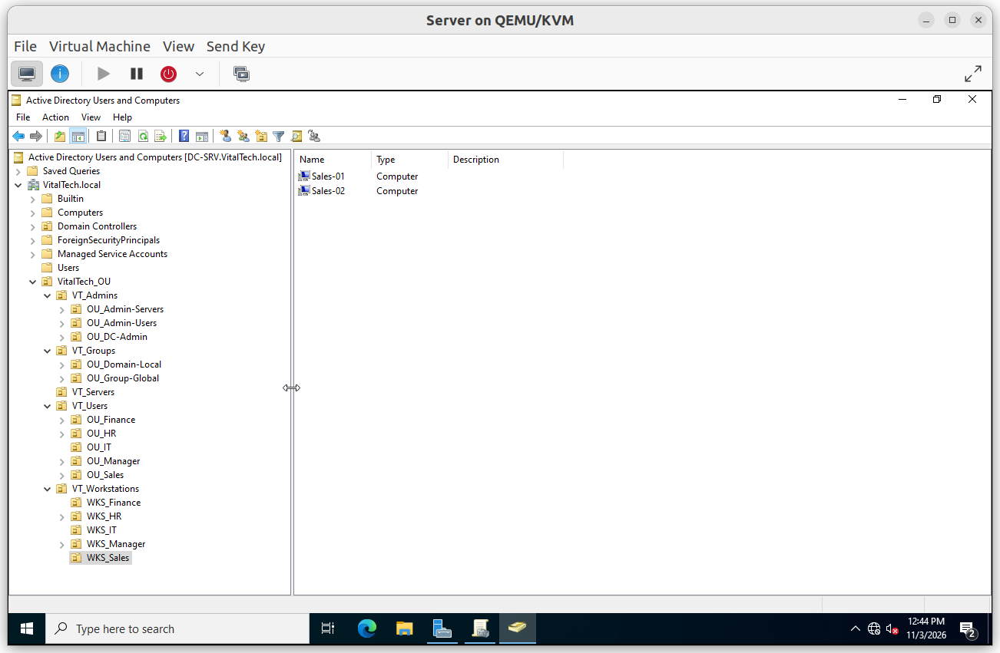
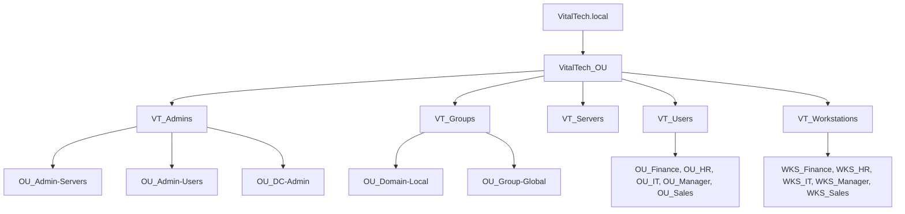
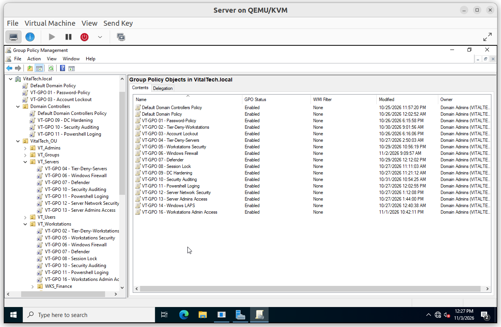

# Architecture

The domain `VitalTech.local` is organized so that administration, groups, servers, users and workstations are separated. Policies are linked to the OU that needs them, which keeps each one easy to understand, test and withdraw.

## Summary

| # | Topic | Purpose |
|---|---|---|
| 1 | OU structure | Separate administration, groups, servers, users and workstations |
| 2 | Tiers and groups | Give each administrator level its own global group |
| 3 | Link plan | Decide where each policy is linked |

---

## OU structure

The Group Policy Objects of the project appear in the Group Policy Management console, with their links under the pilot OU `WKS_Sales`.

## Tiers and groups

| Tier | Scope | Global group |
|---|---|---|
| Tier 0 | Domain controllers and the domain | `GG_DC-Admin` |
| Tier 1 | Servers | `GG_Admin-Server` |
| Tier 2 | Workstations and users | `GG_Admin-User` |

The nesting follows **AGDLP**: accounts go into global groups, global groups go into domain local groups (for example `DL_Admin-User`), and access is granted to the domain local group. The deny policies are the exception by design: they target the privileged groups directly.

**Principle:** an account of a higher tier must never leave its credentials on a machine of a lower tier. The policy `VT-GPO 02 - Tier-Deny-Workstations` enforces this on workstations (see [`03_Access_Control`](../03_Access_Control/)).

## Link plan

Each policy is linked at the highest level where it must apply, so any new workstation inherits the security baseline as soon as it is placed in its OU.

| Level | Policies |
|---|---|
| Domain root | `VT-GPO 01 - Password-Policy`, `VT-GPO 03 - Account Lockout` (link order 1 and 2, above the Default Domain Policy) |
| `VT_Workstations` | `VT-GPO 02`, `05`, `06`, `07`, `08`, `10`, `11`, `16` |

Policies linked to `VT_Workstations` apply to all its child OUs by inheritance (`WKS_Finance`, `WKS_HR`, `WKS_IT`, `WKS_Manager`, `WKS_Sales`). The tests were run on the workstation `Sales-01`, located in `WKS_Sales`, which inherits all of them.

Domain-wide account policies only apply to domain accounts when they are linked at the domain root.