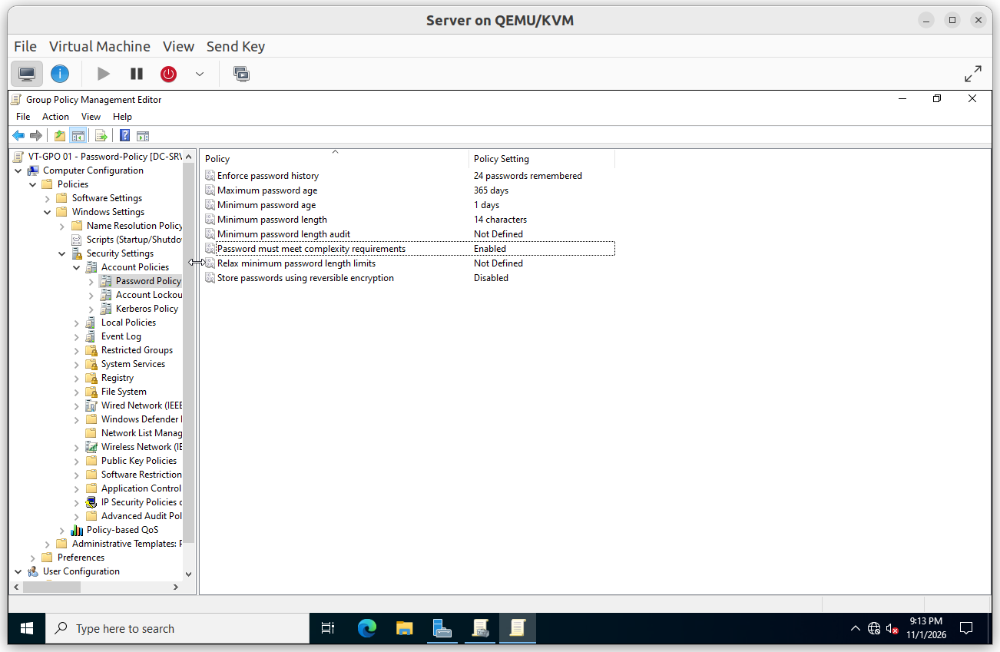
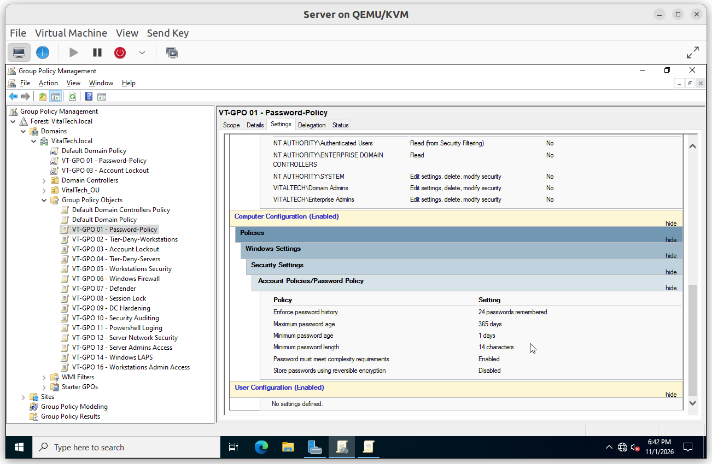
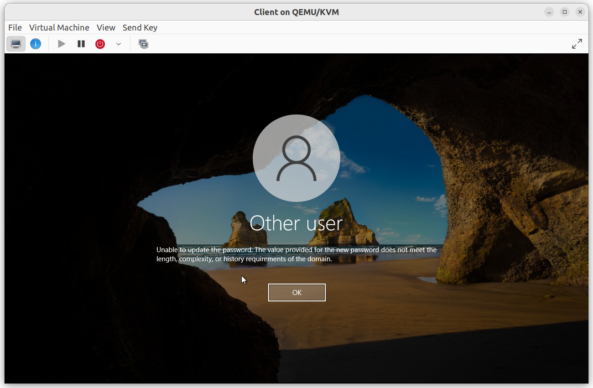
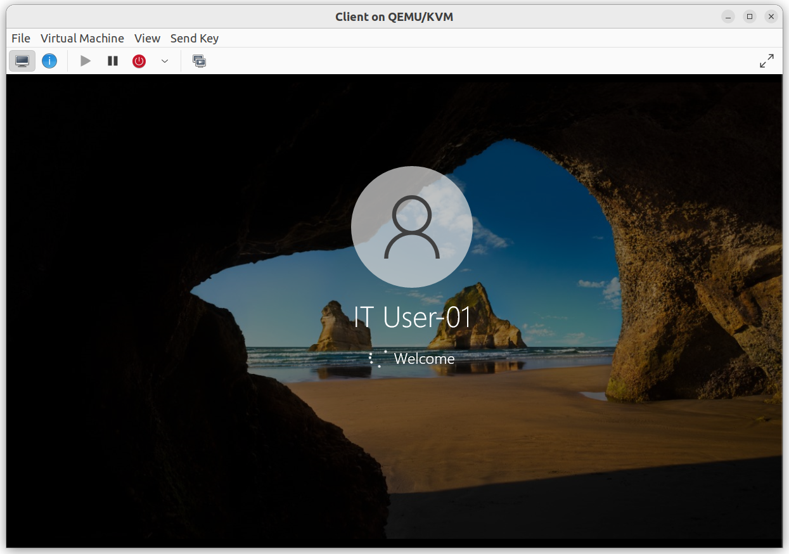
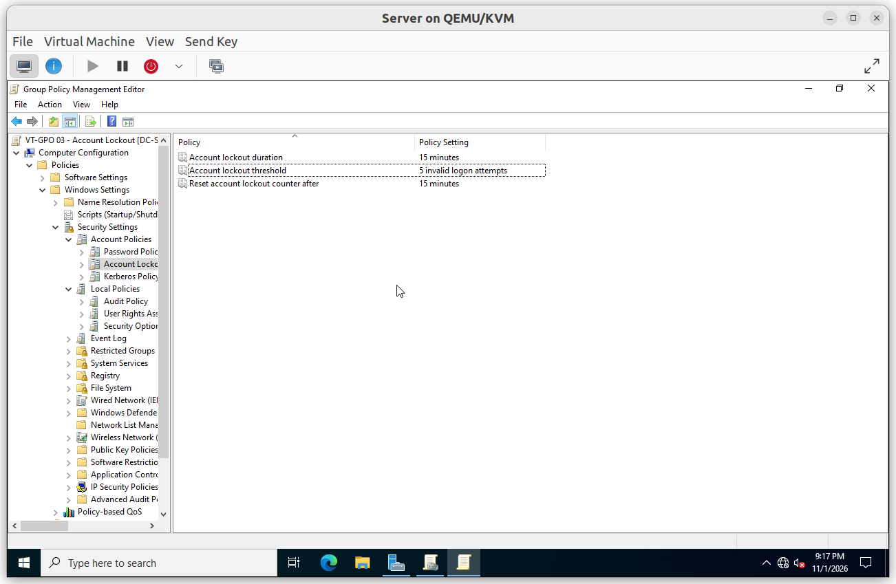
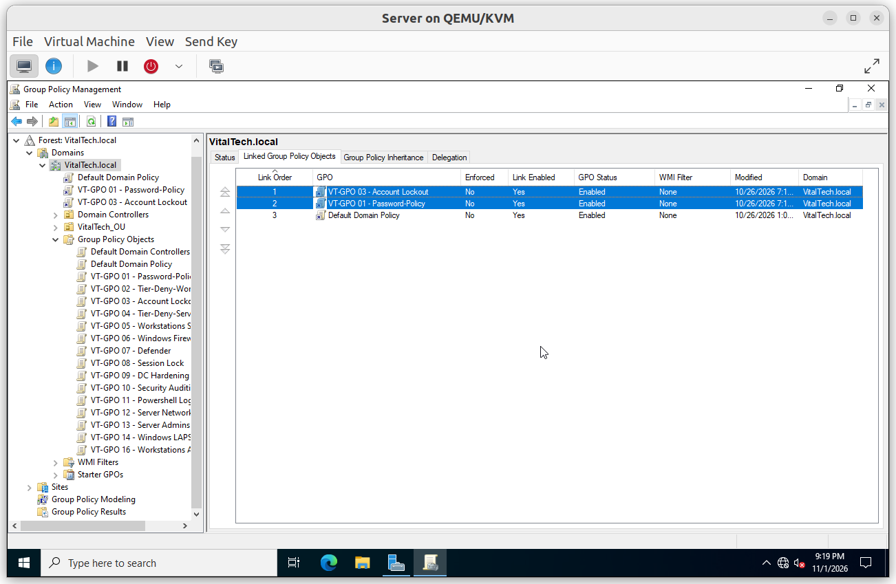
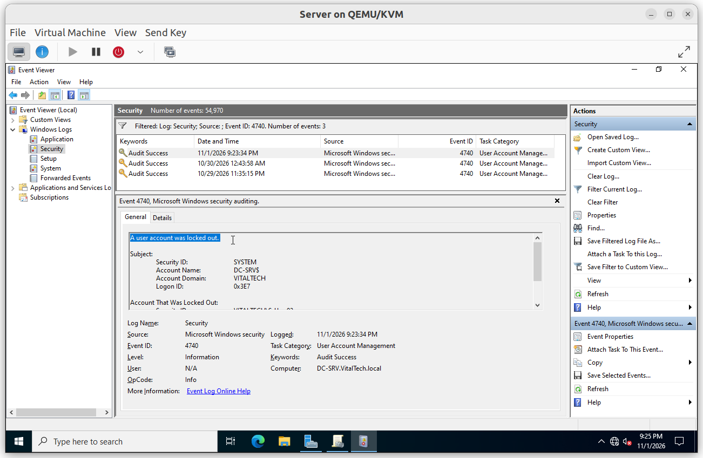
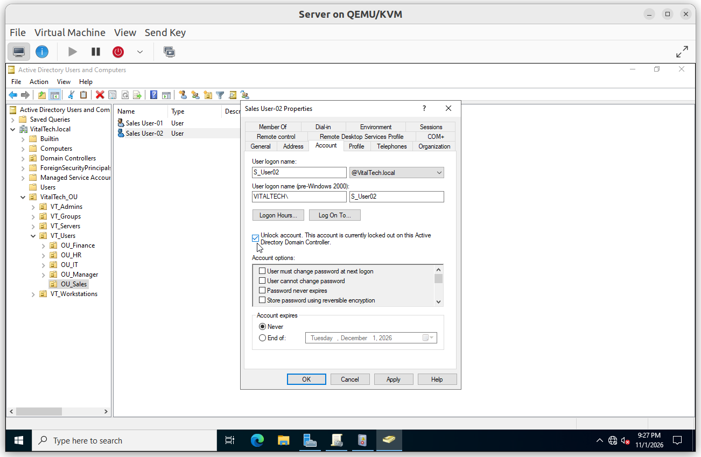

# Domain Policies

Two policies set the rules every domain account follows: how strong a password must be, and what happens after repeated failed sign-ins. Both are linked at the domain root.

## Summary

| GPO | Linked to | Purpose |
|---|---|---|
| VT-GPO 01 - Password-Policy | Domain root | Length, history and complexity of passwords |
| VT-GPO 03 - Account Lockout | Domain root | Lock an account after repeated failures |

Account policies only take effect for domain accounts when they are linked at the domain root. Both policies are placed in link order 1 and 2, **above the Default Domain Policy**, so their values win.

---

## VT-GPO 01 - Password-Policy

**Scope**: linked to the domain root, link order above the Default Domain Policy.

**Why**: long passwords resist guessing far better than complex short ones. The policy asks for 14 characters, keeps a long history so passwords are not recycled, and rejects trivial passwords.

**Configuration**

| Setting | Value |
|---|---|
| Enforce password history | 24 |
| Maximum password age | 365 days |
| Minimum password age | 1 day |
| Minimum password length | 14 |
| Password must meet complexity requirements | Enabled |
| Store passwords using reversible encryption | Disabled |

### Verification

#### V1. Policy is the winning one

- **Test**: in Group Policy Management, run *Group Policy Results* for the domain controller and read the *Account Policies* section.
- **Expected**: the *Winning GPO* column shows `VT-GPO 01 - Password-Policy`.
- **Result**: ✅

#### V2. Short password refused

- **Test**: in Active Directory Users and Computers, reset the password of a test user with 12 characters that meet complexity.
- **Expected**: the reset is refused with a message that the password does not meet the password policy.
- **Result**: ✅

#### V3. Compliant password accepted

- **Test**: reset the same password with 14 characters or more that meet complexity.
- **Expected**: the reset succeeds.
- **Result**: ✅

---

## VT-GPO 03 - Account Lockout

**Scope**: linked to the domain root, link order just after `VT-GPO 01`, above the Default Domain Policy.

**Why**: an attacker guessing passwords is stopped after a few attempts, while a user who mistypes has a short wait. The policy locks the account after five failures and releases it after 15 minutes.

**Configuration**

| Setting | Value |
|---|---|
| Account lockout threshold | 5 invalid attempts |
| Account lockout duration | 15 minutes |
| Reset account lockout counter after | 15 minutes |

### Verification

#### V1. Link order

- **Test**: in Group Policy Management, select the domain and open the *Linked Group Policy Objects* tab.
- **Expected**: `VT-GPO 03` and `VT-GPO 01` are in positions 1 and 2, above the Default Domain Policy, without *Enforced*.
- **Result**: ✅

#### V2. Account locked after five failures

- **Test**: on the workstation, enter five wrong passwords for a test user.
- **Expected**: Windows reports that the account is currently locked out.
- **Result**: ✅

#### V3. Lockout logged on the domain controller

- **Test**: on `DC-SRV`, open *Event Viewer* > *Windows Logs* > *Security* and filter on event ID 4740.
- **Expected**: an event records the locked account and the computer the attempts came from.
- **Result**: ✅

#### V4. Account unlocked

- **Test**: in Active Directory Users and Computers, open the account properties, *Account* tab, and tick *Unlock account*, then sign in again.
- **Expected**: the sign-in works.
- **Result**: ✅

