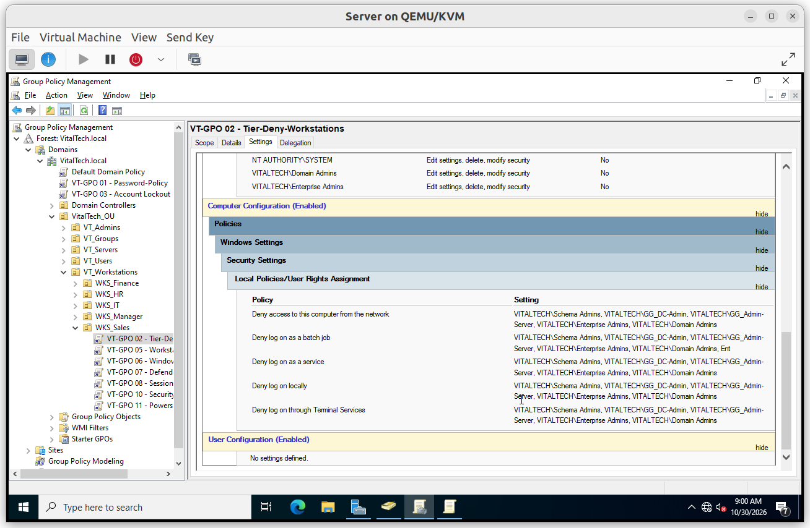
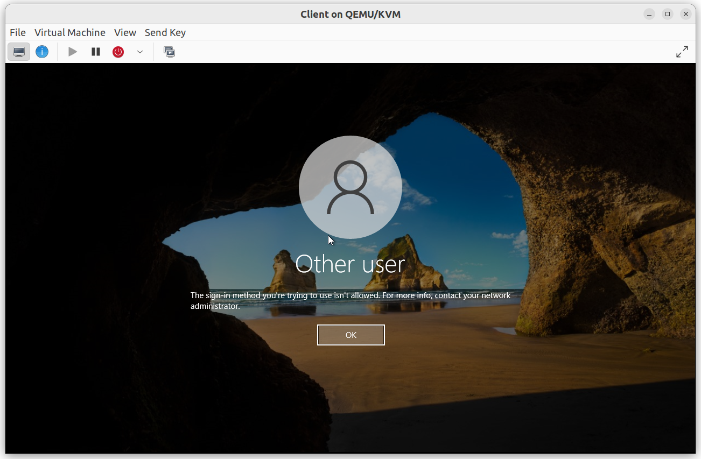
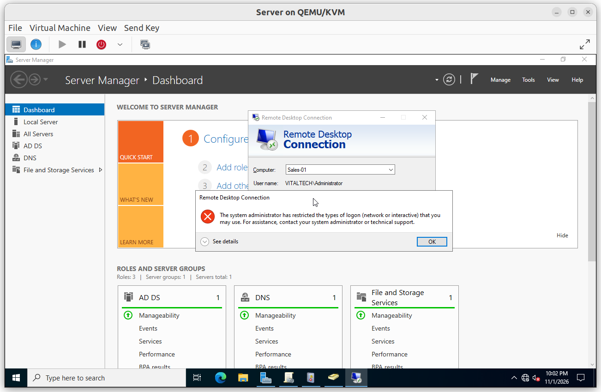
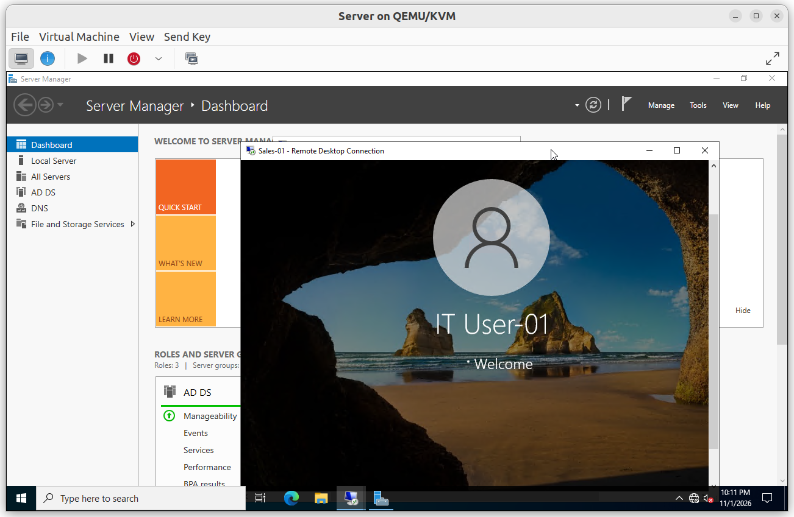
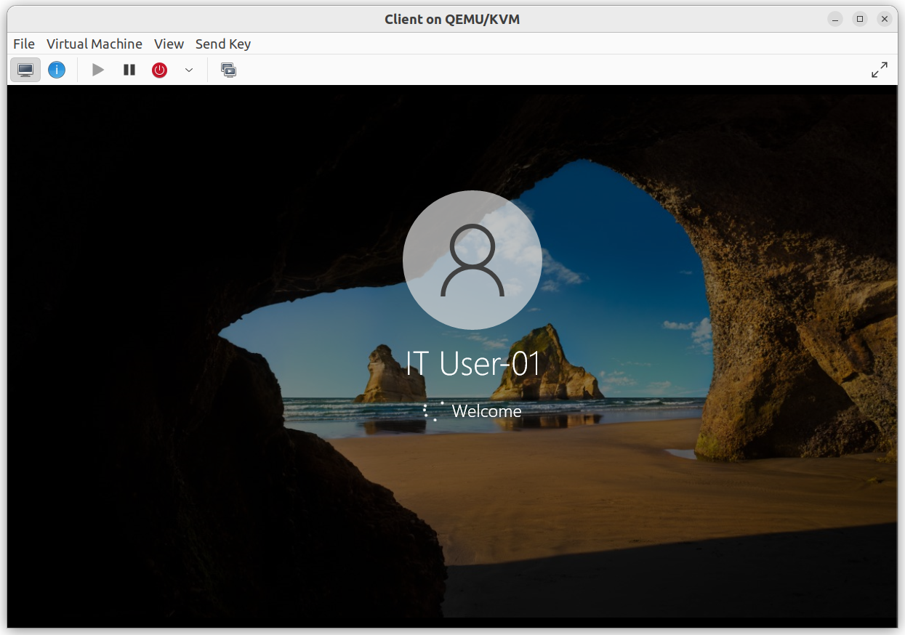
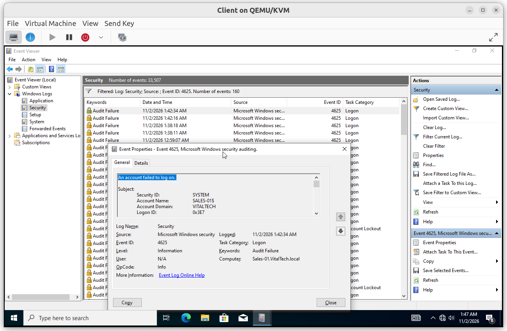
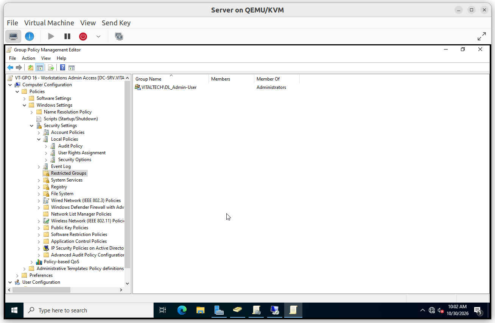
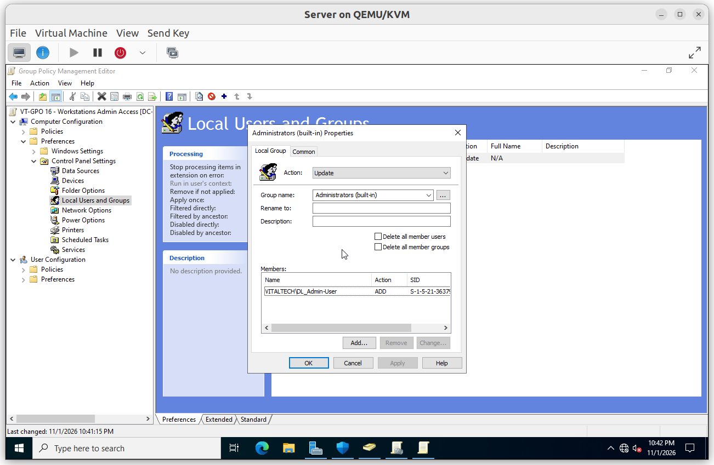
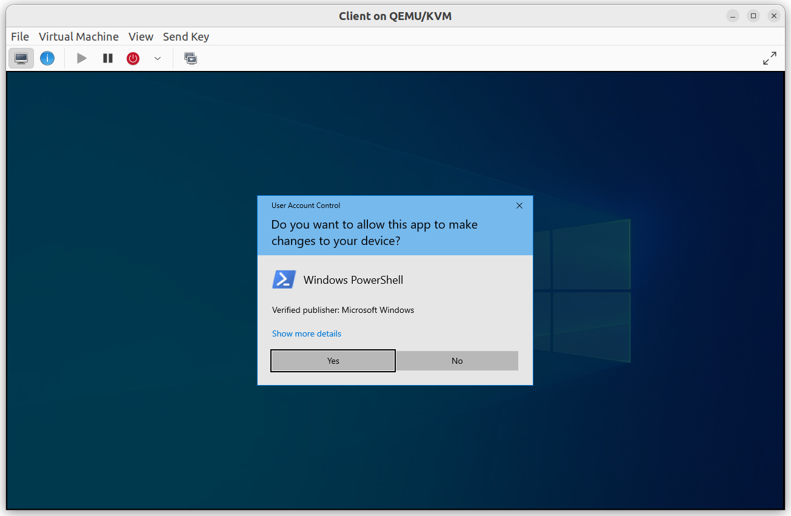

# Access Control

Two policies decide who can sign in to a workstation and who holds administrator rights on it: one denies the privileged groups any sign-in, the other gives the Tier 2 administrators their local rights.

## Summary

| GPO | Linked to | Purpose |
|---|---|---|
| VT-GPO 02 - Tier-Deny-Workstations | `WKS_Sales` (pilot) | Privileged groups cannot sign in to workstations |
| VT-GPO 16 - Workstations Admin Access | `WKS_Sales` (pilot) | Tier 2 group becomes local administrator |

---

## VT-GPO 02 - Tier-Deny-Workstations

**Scope**: linked to the pilot OU `WKS_Sales`.

**Why**: if a Tier 0 or Tier 1 administrator signs in to a workstation, their credentials stay in memory on a machine that is less protected, where they can be stolen. The policy removes that possibility by denying five logon rights to the privileged groups.

**Configuration**: `Computer Configuration > Policies > Windows Settings > Security Settings > Local Policies > User Rights Assignment`

| Right | Denied to |
|---|---|
| Deny access to this computer from the network | `GG_DC-Admin`, `GG_Admin-Server`, Domain Admins, Enterprise Admins, Schema Admins |
| Deny log on as a batch job | same five groups |
| Deny log on as a service | same five groups |
| Deny log on locally | same five groups |
| Deny log on through Remote Desktop Services | same five groups |

`GG_Admin-User` (Tier 2) is deliberately not denied.

### Verification

#### V1. Tier 1 administrator refused

- **Test**: on the workstation console, sign in with a member of `GG_Admin-Server`.
- **Expected**: Windows reports that the sign-in method is not allowed.
- **Result**: ✅

#### V2. Tier 0 administrator refused

- **Test**: sign in with a member of `GG_DC-Admin`.
- **Expected**: the same message.
- **Result**: ✅

#### V3. Domain Administrator refused

- **Test**: sign in with the domain `Administrator`, locally and through Remote Desktop.
- **Expected**: both are refused, because the account belongs to Domain Admins.
- **Result**: ✅

#### V4. Tier 2 administrator allowed

- **Test**: sign in with a member of `GG_Admin-User`.
- **Expected**: the session opens.
- **Result**: ✅

#### V5. Standard user allowed

- **Test**: sign in with a standard user of `OU_Sales`.
- **Expected**: the session opens, which proves the policy targets only the privileged groups.
- **Result**: ✅

#### V6. Refusal logged

- **Test**: on the workstation, open *Event Viewer* > *Windows Logs* > *Security* and filter on event ID 4625.
- **Expected**: the refused sign-in appears with status `0xC000015B`, which means the logon type was not granted on this computer.
- **Result**: ✅

---

## VT-GPO 16 - Workstations Admin Access

**Scope**: linked to the pilot OU `WKS_Sales`.

**Why**: once the privileged groups are denied, workstations still need someone who can administer them. The policy adds the domain local group `DL_Admin-User`, which contains the Tier 2 group `GG_Admin-User`, to the local Administrators group.

It uses a **Restricted Group** configured as *this group is a member of Administrators*. This adds the group and keeps the existing members, whereas listing members would replace the whole local group.

**Configuration**: `Computer Configuration > Policies > Windows Settings > Security Settings > Restricted Groups`

| Group | This group is a member of |
|---|---|
| `VITALTECH\DL_Admin-User` | `Administrators` |

### Verification

#### V1. Group added to local administrators

- **Test**: on the workstation, open *Computer Management* > *Local Users and Groups* > *Groups* > *Administrators*.
- **Expected**: `VITALTECH\DL_Admin-User` is a member.
- **Result**: ✅

#### V2. Tier 2 administrator can elevate

- **Test**: signed in as a Tier 2 administrator, right-click an application and choose *Run as administrator*.
- **Expected**: the consent prompt appears and the application opens with administrator rights.
- **Result**: ✅

