# Workstation Security

Four policies set the security baseline of a workstation: how users sign in and how elevation prompts behave, which network traffic the firewall allows, how Microsoft Defender is configured, and when an idle session locks. All four are linked to the pilot OU `WKS_Sales`.

## Summary

| GPO | Linked to | Purpose |
|---|---|---|
| VT-GPO 05 - Workstations Security | `WKS_Sales` (pilot) | UAC, guest account, logon screen, AutoPlay, LSA protection, Remote Desktop with NLA |
| VT-GPO 06 - Windows Firewall | `WKS_Sales` (pilot) | Firewall on, inbound blocked, logging, RDP and WinRM allowed |
| VT-GPO 07 - Defender | `WKS_Sales` (pilot) | Antivirus, real-time protection, cloud protection, network protection |
| VT-GPO 08 - Session Lock | `WKS_Sales` (pilot) | Lock an idle session after 900 seconds |

---

## VT-GPO 05 - Workstations Security

**Scope**: linked to the pilot OU `WKS_Sales`.

**Why**: default Windows settings favour convenience. This policy makes elevation explicit, removes the guest account, forces a deliberate sign-in, blocks automatic execution from removable media, and enables Remote Desktop in a controlled way.

**Configuration**

| Area | Setting | Value |
|---|---|---|
| UAC | Run all administrators in Admin Approval Mode | Enabled |
| UAC | Elevation prompt for administrators | Prompt for consent on the secure desktop |
| UAC | Elevation prompt for standard users | Automatically deny elevation requests |
| UAC | Detect application installations and prompt for elevation | Enabled |
| UAC | Only elevate UIAccess applications installed in secure locations | Enabled |
| UAC | Switch to the secure desktop when prompting | Enabled |
| Accounts | Guest account status | Disabled |
| Accounts | Limit local account use of blank passwords to console logon only | Enabled |
| Interactive logon | Don't display last signed-in | Enabled |
| Interactive logon | Do not require CTRL+ALT+DEL | Disabled |
| AutoPlay | Turn off AutoPlay, and do not execute any autorun commands | Enabled |
| LSA | `RunAsPPL` (LSA protection) | 1 |
| Remote Desktop | Allow users to connect remotely by using Remote Desktop Services | Enabled |
| Remote Desktop | Require user authentication for remote connections by using NLA | Enabled |

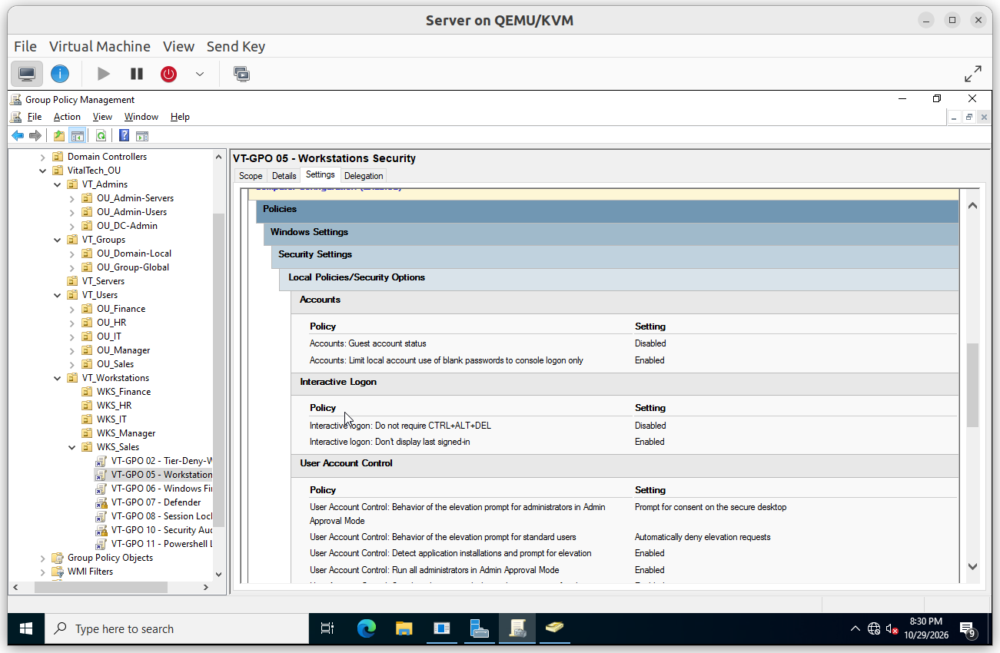

### Verification

#### V1. Ctrl+Alt+Del required

- **Test**: lock the workstation and look at the sign-in screen.
- **Expected**: Windows asks for Ctrl+Alt+Del before showing the password field.
- **Result**: ✅

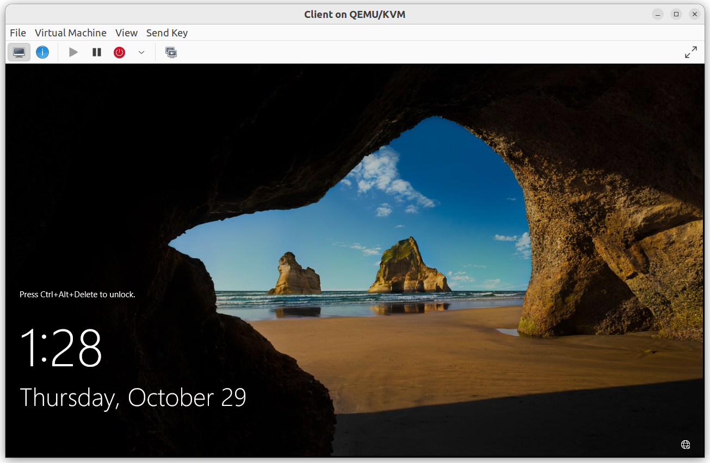

#### V2. Last user not displayed

- **Test**: sign out and look at the sign-in screen.
- **Expected**: no user name is pre-filled.
- **Result**: ✅

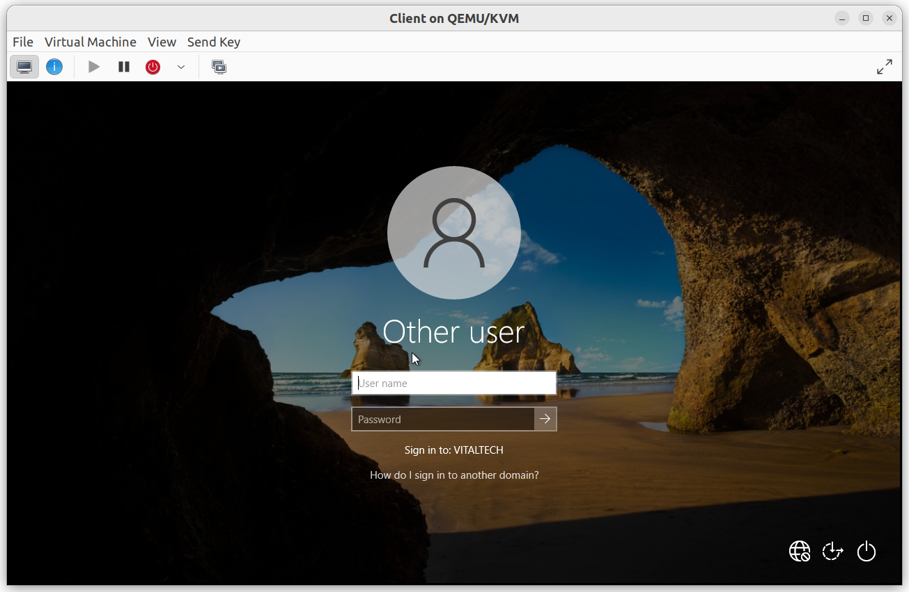

#### V3. Guest account disabled

- **Test**: open *Computer Management* > *Local Users and Groups* > *Users*.
- **Expected**: the *Guest* account shows the disabled arrow.
- **Result**: ✅

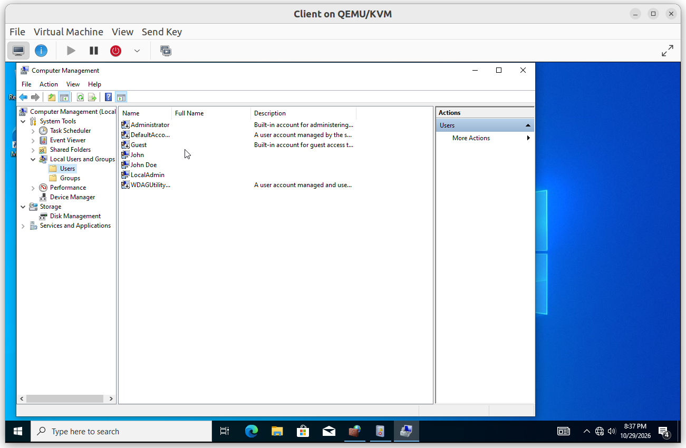

#### V4. Standard user cannot elevate

- **Test**: as a standard user, right-click an application and choose *Run as administrator*.
- **Expected**: the request is denied without asking for credentials.
- **Result**: ✅

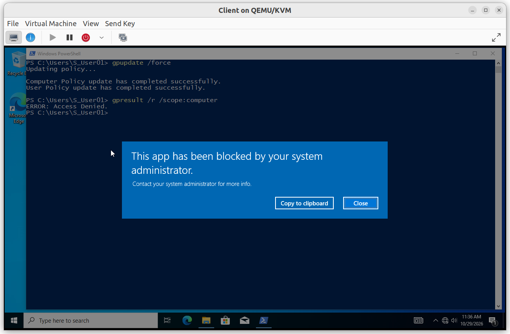

#### V5. Administrator elevation on the secure desktop

- **Test**: as an administrator, run an application as administrator.
- **Expected**: the screen dims and a consent prompt appears on the secure desktop.
- **Result**: ✅

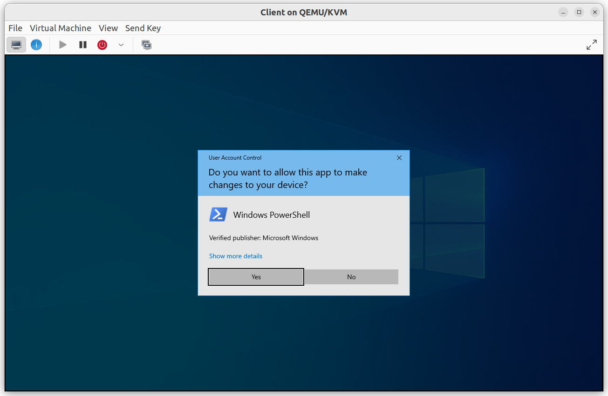

#### V6. Remote Desktop managed by the policy

- **Test**: open *System Properties* > *Remote* on the workstation.
- **Expected**: *Allow remote connections to this computer* is selected and greyed out, with Network Level Authentication ticked.
- **Result**: ✅

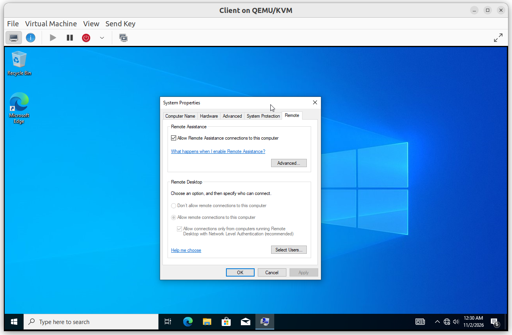

#### V7. Remote Desktop session opens

- **Test**: from `DC-SRV`, open a Remote Desktop connection to `Sales-01` with an authorized account.
- **Expected**: the session opens.
- **Result**: ✅

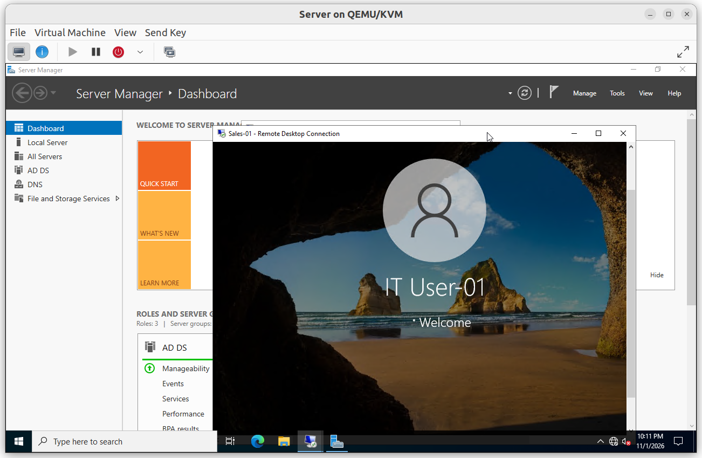

---

## VT-GPO 06 - Windows Firewall

**Scope**: linked to the pilot OU `WKS_Sales`.

**Why**: a workstation should accept nothing it did not ask for. The policy turns the firewall on for all profiles, blocks inbound traffic by default, keeps a log of dropped packets, and opens only Remote Desktop and Windows Remote Management for administration.

**Configuration**: `Computer Configuration > Policies > Windows Settings > Security Settings > Windows Defender Firewall with Advanced Security`

| Setting | Value |
|---|---|
| Firewall state (Domain, Private, Public) | On |
| Inbound connections | Block |
| Outbound connections | Allow |
| Log dropped packets | Yes, 16384 KB |
| Public profile: apply local firewall rules | No |
| Inbound allow rules | Remote Desktop, Windows Remote Management |

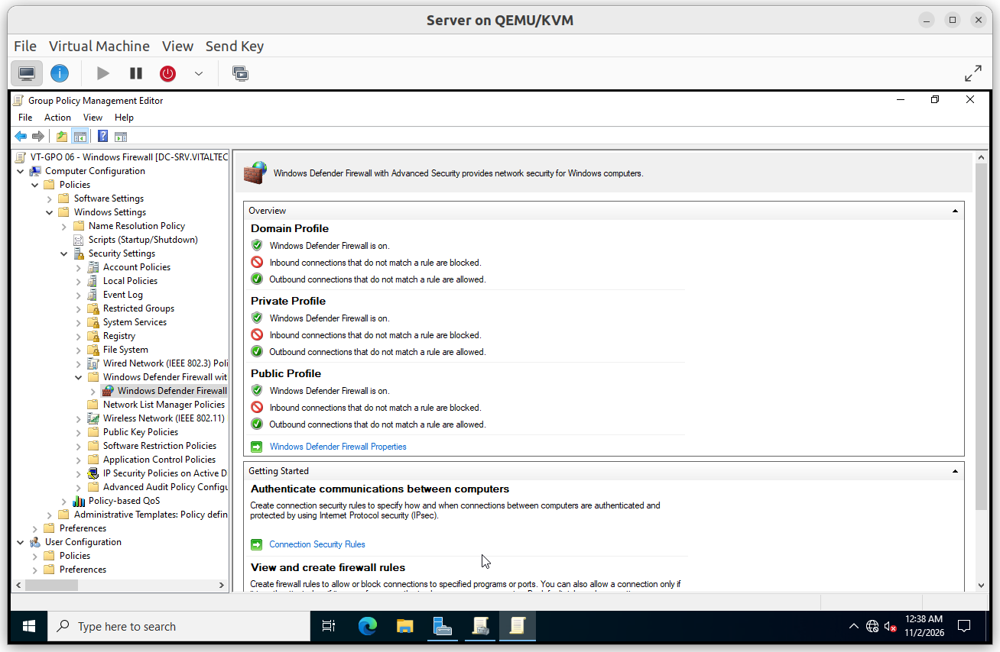

### Verification

#### V1. Profiles configured

- **Test**: on the workstation, open `wf.msc`, right-click the root, *Properties*, and read the three profile tabs.
- **Expected**: state *On*, inbound *Block*, outbound *Allow*, options greyed out because they are managed by policy.
- **Result**: ✅

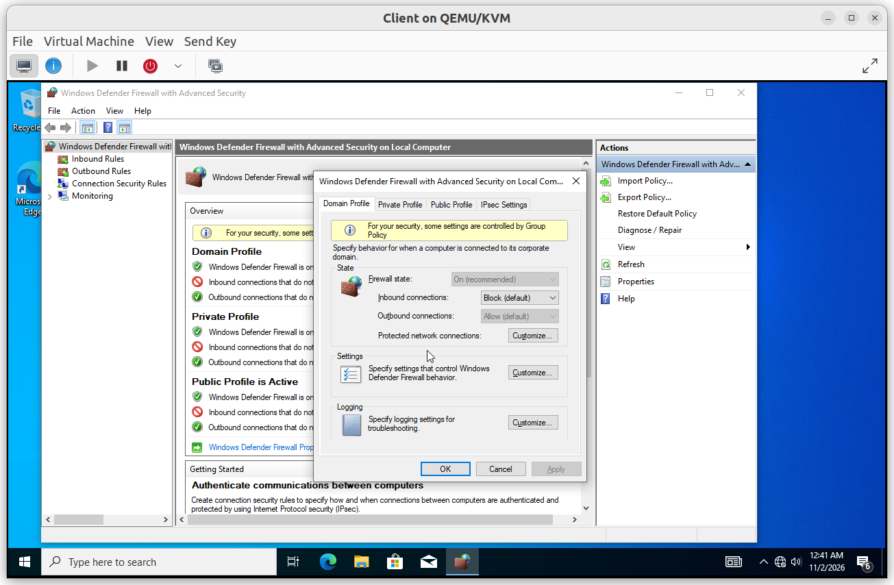

#### V2. Remote Desktop rules enabled

- **Test**: in *Inbound Rules*, look at the *Remote Desktop* group.
- **Expected**: the rules are enabled in the Domain profile with the action *Allow*.
- **Result**: ✅

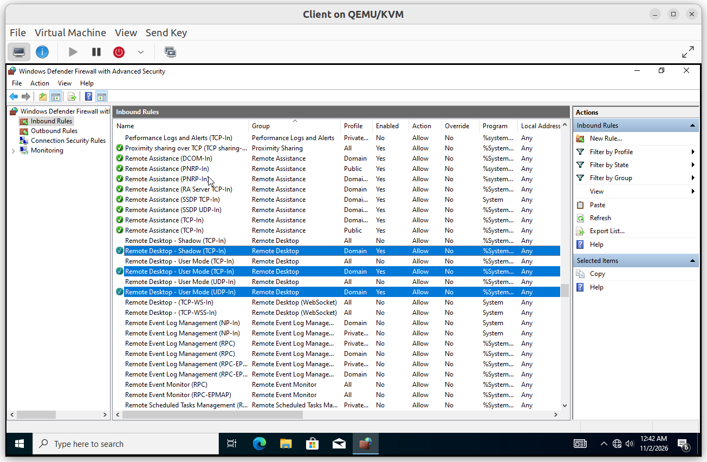

#### V3. Windows Remote Management rule enabled

- **Test**: in *Inbound Rules*, look for *Windows Remote Management (HTTP-In)*.
- **Expected**: the rule is enabled in the Domain profile with the action *Allow*.
- **Result**: ✅

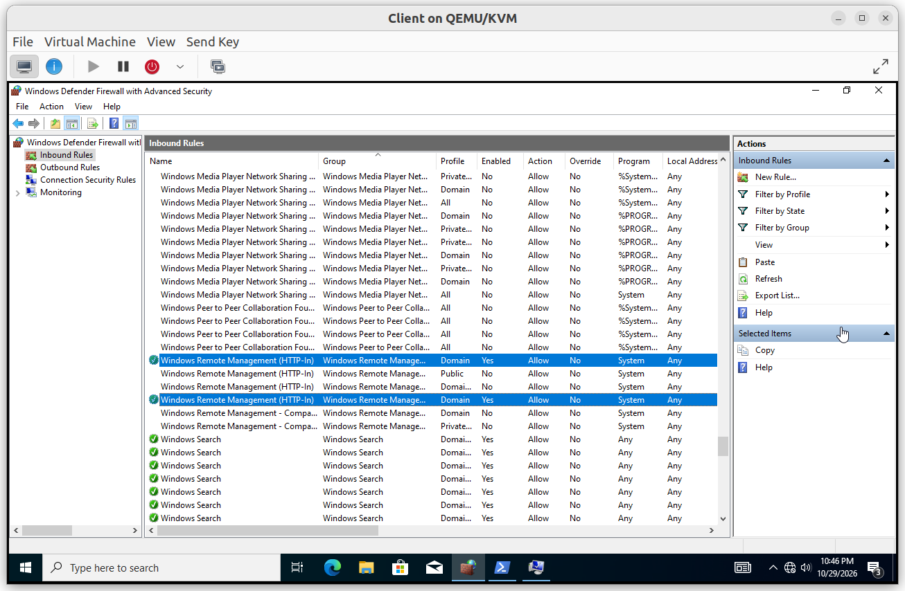

#### V4. Dropped packets logged

- **Test**: try to connect from `DC-SRV` to a closed port of the workstation, then open `C:\Windows\System32\LogFiles\Firewall\pfirewall.log`.
- **Expected**: the log contains `DROP` entries for the blocked connection.
- **Result**: ✅

---

## VT-GPO 07 - Defender

**Scope**: linked to the pilot OU `WKS_Sales`.

**Why**: antivirus protection must stay on and must not be switched off by a user. The policy enforces real-time protection, behaviour monitoring, cloud protection and network protection.

**Configuration**: `Computer Configuration > Policies > Administrative Templates > Windows Components > Microsoft Defender Antivirus`

| Setting | Value |
|---|---|
| Turn off Microsoft Defender Antivirus | Disabled |
| Configure detection for potentially unwanted applications | Enabled, Block |
| Turn off real-time protection | Disabled |
| Turn on behavior monitoring | Enabled |
| Scan all downloaded files and attachments | Enabled |
| Join Microsoft MAPS | Enabled, Advanced MAPS |
| Send file samples when further analysis is required | Enabled, Send safe samples |
| Scheduled scan type | Quick scan, every day |
| Network Protection | Enabled, Block |

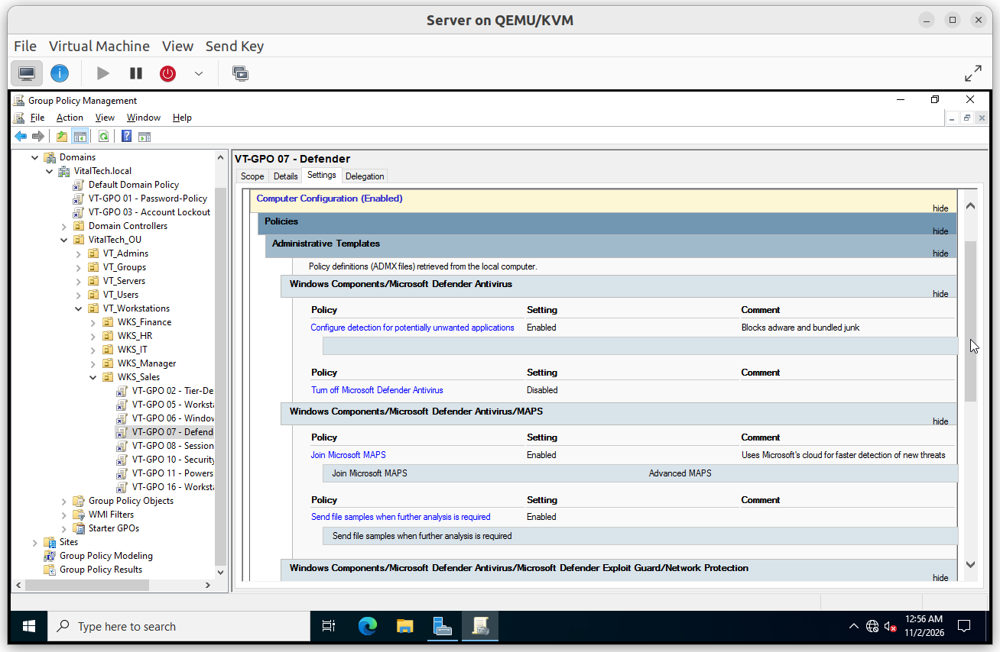

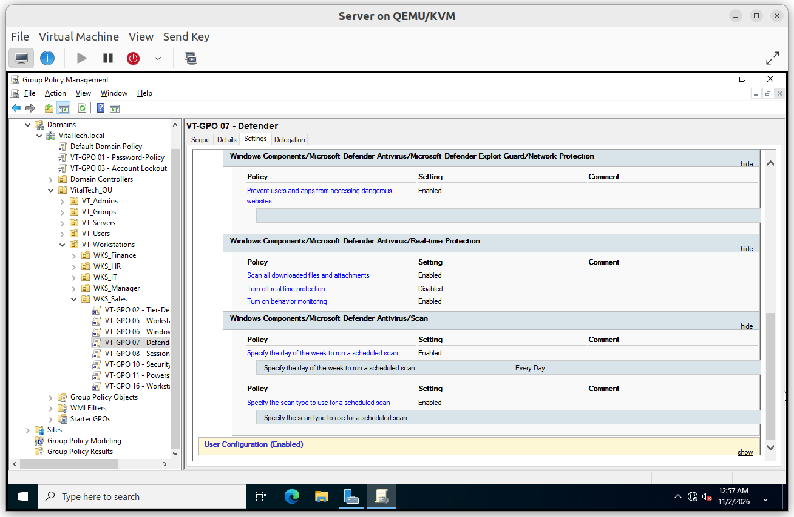

### Verification

#### V1. Defender managed by the organization

- **Test**: open *Windows Security* > *Virus & threat protection* > *Manage settings*.
- **Expected**: a message says that some settings are managed by your organization, and real-time protection is on and cannot be switched off.
- **Result**: ✅

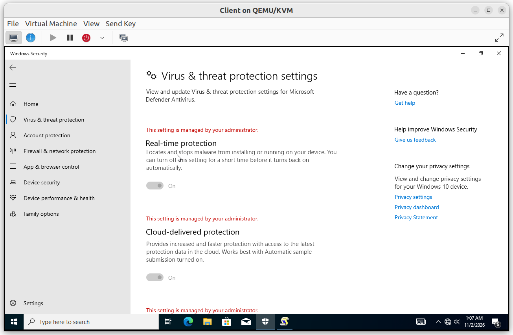

---

## VT-GPO 08 - Session Lock

**Scope**: linked to the pilot OU `WKS_Sales`.

**Why**: a workstation left unattended should not stay open. The policy locks the session after 15 minutes of inactivity.

**Configuration**: `Security Settings > Local Policies > Security Options`

| Setting | Value |
|---|---|
| Interactive logon: Machine inactivity limit | 900 seconds |

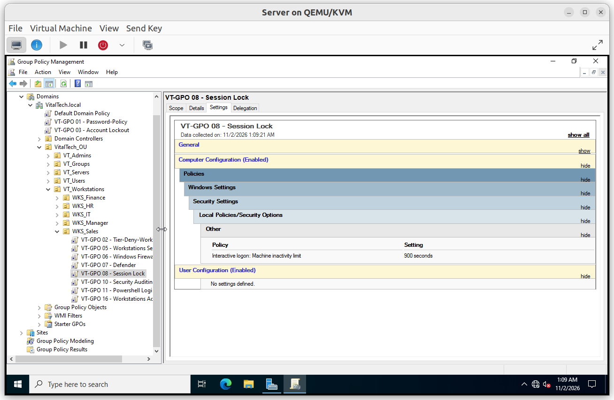

### Verification

#### V1. Idle session locks

- **Test**: sign in and leave the workstation untouched for the configured delay.
- **Expected**: the session locks by itself.
- **Result**: ✅

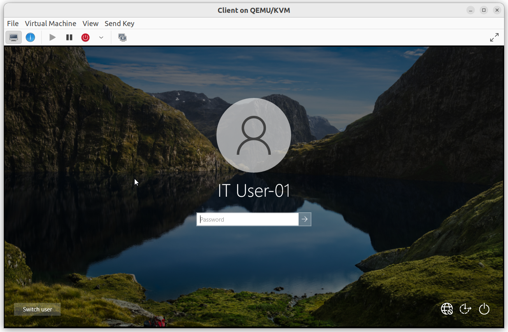
