# Audit and Logging

Auditing records who did what, so an incident can be investigated afterwards. Two policies configure it once for the workstation: one for the Windows audit policy and the Security log, one for PowerShell.

## Summary

| GPO | Linked to | Purpose |
|---|---|---|
| VT-GPO 10 - Security Auditing | `WKS_Sales` (pilot) | Advanced audit policy, command line in process events, larger Security log |
| VT-GPO 11 - Powershell Logging | `WKS_Sales` (pilot) | Script block and module logging |

---

## VT-GPO 10 - Security Auditing

**Scope**: linked to the pilot OU `WKS_Sales`.

**Why**: the legacy audit policy only offers broad categories. The *Advanced Audit Policy* gives per-subcategory control, and *Force audit policy subcategory settings* makes sure the subcategories win over the legacy categories. Recording the command line of every new process shows exactly what was run, and a 192 MB Security log keeps the history long enough to be useful.

**Configuration**

| Area | Setting | Value |
|---|---|---|
| Security Options | Audit: Force audit policy subcategory settings to override category settings | Enabled |
| Administrative Templates | Include command line in process creation events | Enabled |
| Event Log Service | Security log maximum size | 196608 KB |

Advanced audit subcategories (`Computer Configuration > Policies > Windows Settings > Security Settings > Advanced Audit Policy Configuration`):

| Audit | Subcategories |
|---|---|
| Success and Failure | Credential Validation, Logon, Security Group Management, User Account Management, Audit Policy Change, Sensitive Privilege Use, Security State Change, System Integrity |
| Success | Computer Account Management, Logoff, Special Logon, Process Creation, Authentication Policy Change |
| Failure | Account Lockout |

The Kerberos and Directory Service subcategories are also defined, for use on domain controllers.

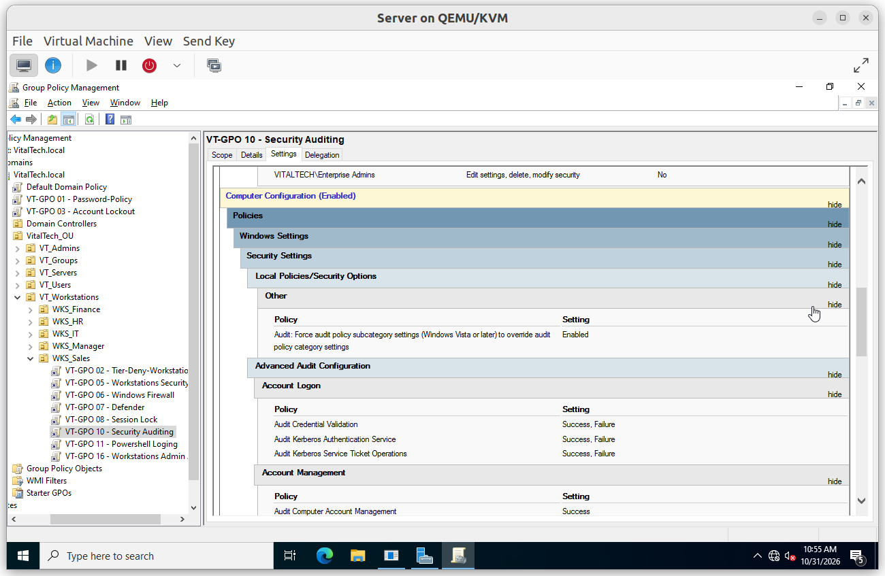

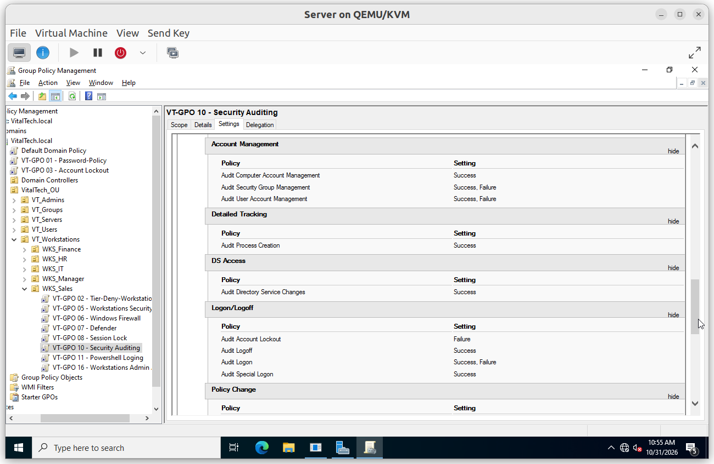

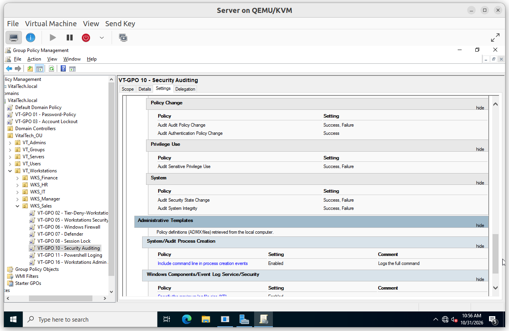

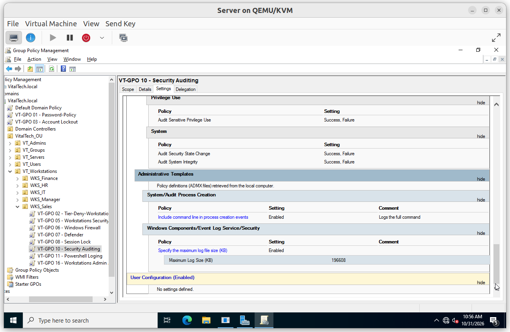

### Verification

#### V1. Audit policy effective on the workstation

- **Test**: on `Sales-01`, open PowerShell as administrator and run `auditpol /get /category:*`.
- **Expected**: the configured subcategories show *Success*, *Failure* or *Success and Failure* instead of *No Auditing*.
- **Result**: ✅

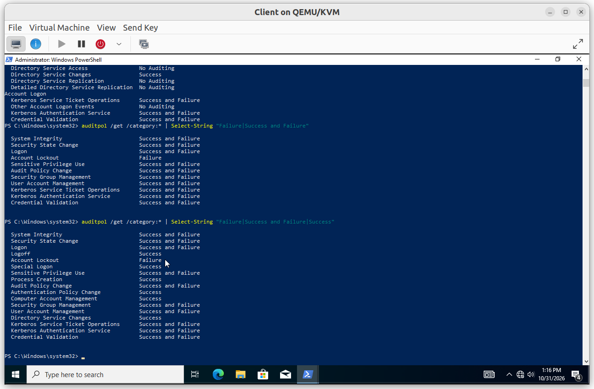

#### V2. Security log size applied

- **Test**: run `rsop.msc` and open *Computer Configuration > Administrative Templates > Windows Components > Event Log Service > Security*.
- **Expected**: *Specify the maximum log file size* is *Enabled*, with the source `VT-GPO 10 - Security Auditing`.
- **Result**: ✅

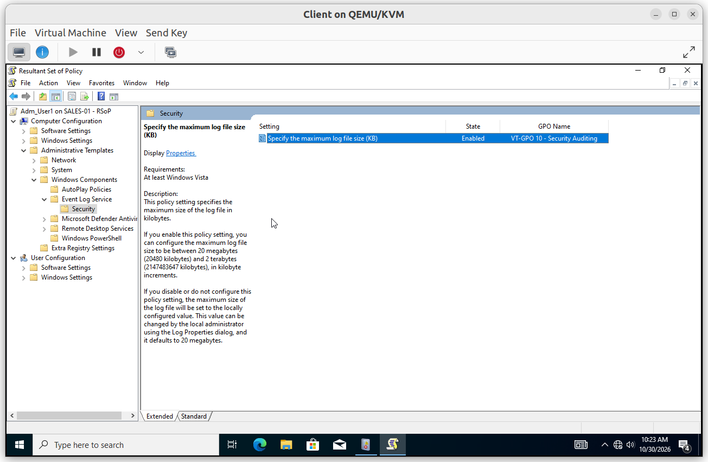

#### V3. Process creation with command line

- **Test**: open an application, then in *Event Viewer* > *Windows Logs* > *Security* filter on event ID 4688 and open the latest event.
- **Expected**: the event shows the new process and its *Process Command Line*.
- **Result**: ✅

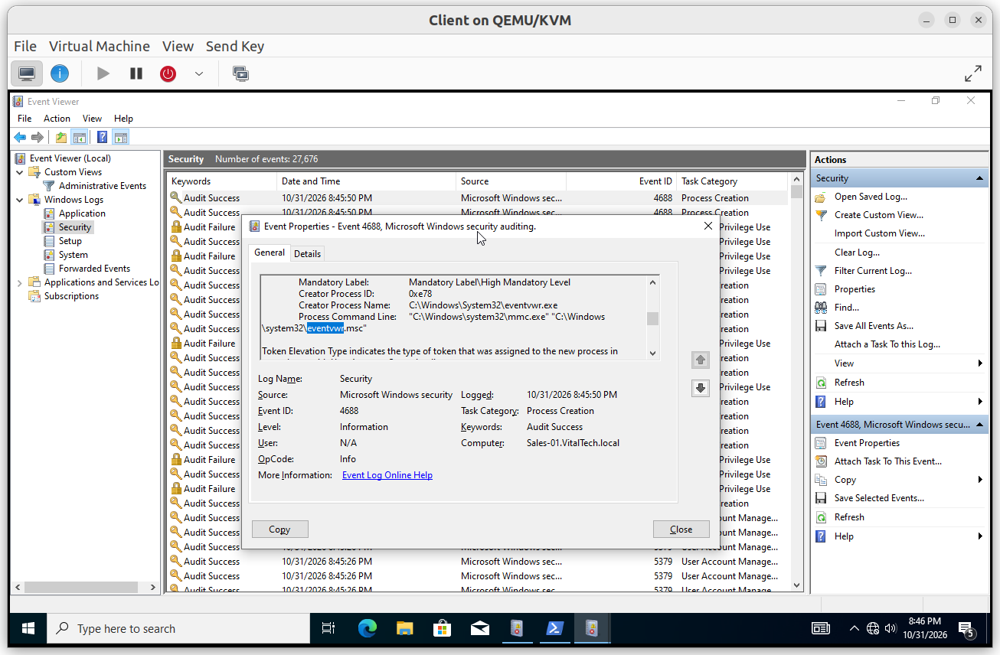

#### V4. Failed sign-in logged

- **Test**: on the sign-in screen, enter a user name that does not exist and any password. Then filter the Security log on event ID 4625.
- **Expected**: an *Audit Failure* event records the account name, the domain and the computer.
- **Result**: ✅

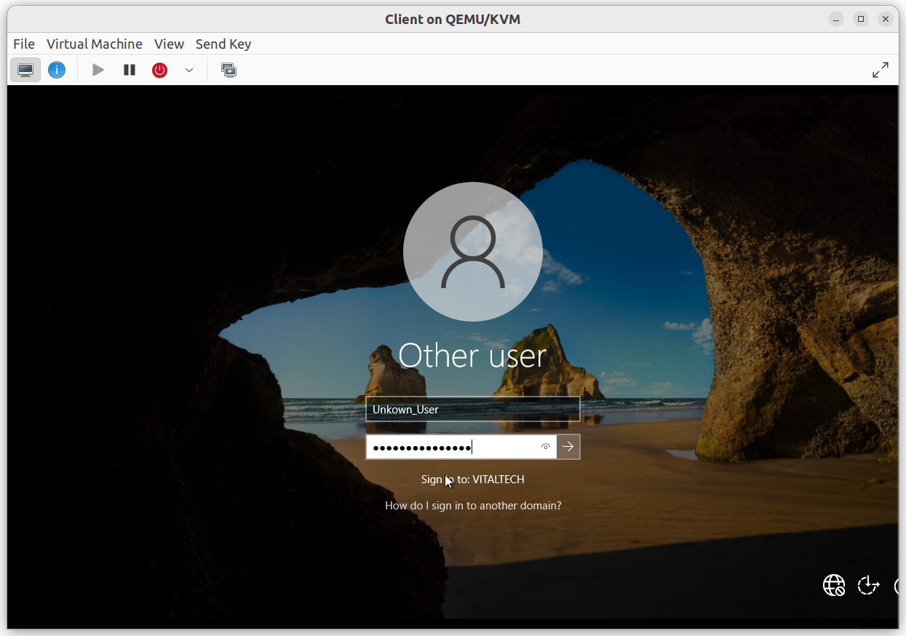

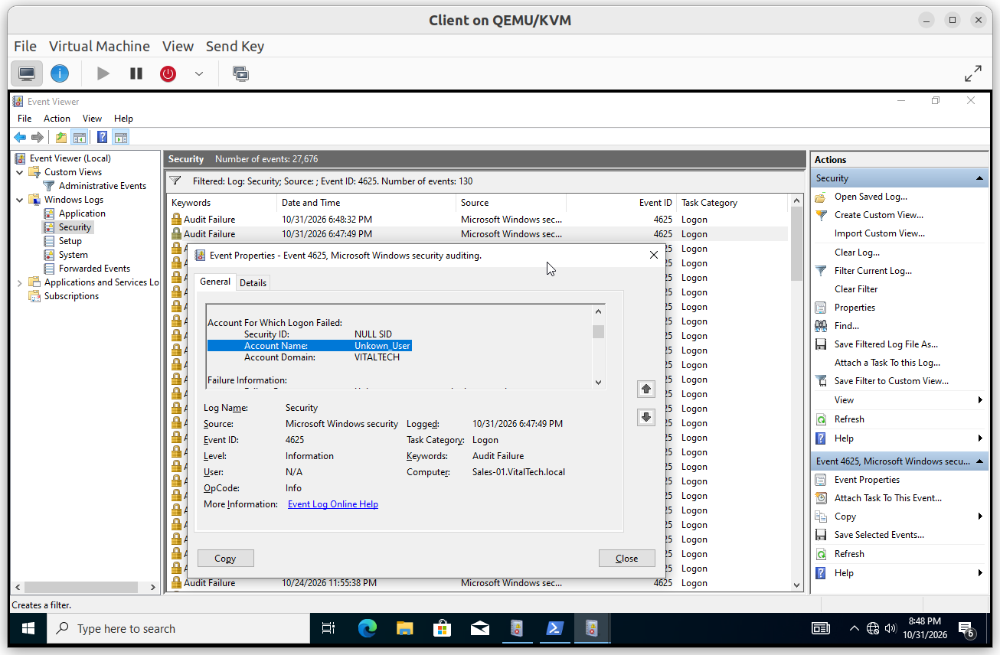

---

## VT-GPO 11 - Powershell Logging

**Scope**: linked to the pilot OU `WKS_Sales`.

**Why**: attackers often use PowerShell because it is built in. Script block logging records the code that actually runs, even when it was obfuscated, and module logging records the pipeline output.

**Configuration**: `Computer Configuration > Policies > Administrative Templates > Windows Components > Windows PowerShell`

| Setting | Value |
|---|---|
| Turn on PowerShell Script Block Logging | Enabled |
| Turn on Module Logging | Enabled, module names `*` |

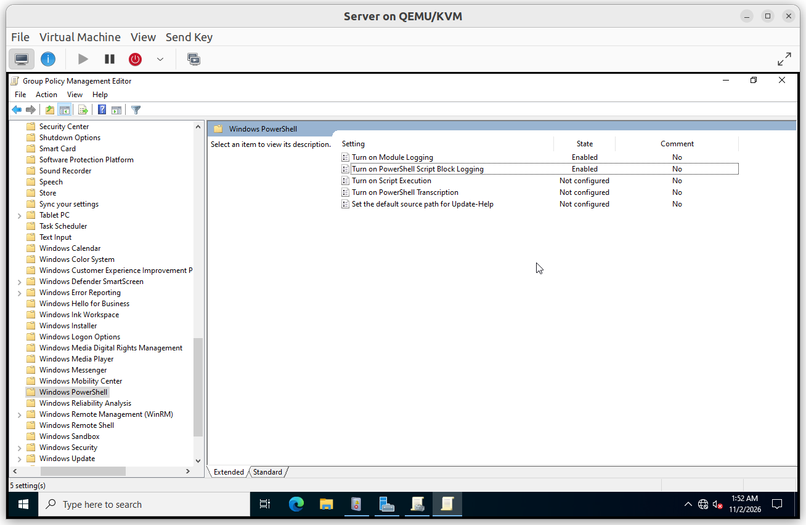

### Verification

#### V1. Script block logged

- **Test**: run a command in PowerShell, then open *Event Viewer* > *Applications and Services Logs* > *Microsoft* > *Windows* > *PowerShell* > *Operational* and filter on event ID 4104.
- **Expected**: an event contains the command that was run.
- **Result**: ✅

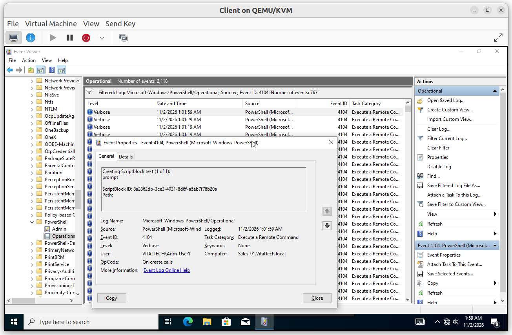
