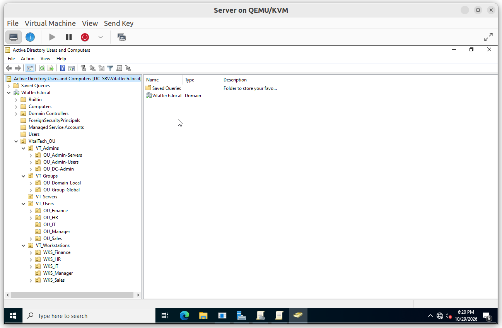

# VitalTech AD Hardening Lab: Group Policy Security Baseline and Tiered Administration

A hardened Active Directory domain built with Group Policy: a domain-wide password and lockout policy, a tiered administration model (Tier 0 / 1 / 2), a security baseline for workstations (UAC, firewall, Defender, session lock), and a full audit and logging layer. Every policy is linked at the right level of the domain and was verified on a pilot workstation with documented tests.



---

## 1. Overview

**VitalTech.local** is a lab domain for a fictional IT company. The goal is to turn a default Active Directory into a hardened one, without configuring any machine by hand: every setting comes from a Group Policy Object, and every Group Policy Object is followed by the test that proves it.

Each policy is linked at the highest level where it must apply: the domain root for account policies, and `VT_Workstations` for workstation policies. Any new workstation therefore inherits the security baseline as soon as it is placed in its OU. The tests were run on a pilot workstation, `Sales-01` (OU `WKS_Sales`), which inherits all of them.

| Machine | Role | Platform |
|---|---|---|
| `DC-SRV` | Domain Controller, DNS, Group Policy management | QEMU/KVM |
| `Sales-01` | Domain-joined pilot workstation (OU `WKS_Sales`) | QEMU/KVM |

**Skills demonstrated**

- Designed an OU structure and a **tiered administration model** (Tier 0, Tier 1, Tier 2) with the **AGDLP** group nesting
- Enforced a **domain-wide password and account lockout policy**, and controlled GPO precedence through the link order
- Prevented privileged accounts from signing in to workstations, and kept a controlled **local administrator path** for Tier 2
- Built a **workstation security baseline**: UAC, logon screen, Remote Desktop with NLA, Windows Firewall, Microsoft Defender and automatic session lock
- Configured **advanced audit policy**, process command-line logging, a larger Security log and PowerShell script block logging
- Validated every policy with documented tests (Test, Expected, Result, Screenshot)

---

## 2. Lab components

### Architecture and tiers

The OU structure separates administration, groups, servers, users and workstations. Three administrator tiers map to three global groups, and access is granted through domain local groups (AGDLP).

Details: [`01_Architecture`](01_Architecture/)

### Domain policies

Password policy and account lockout are domain-wide, so they are linked at the domain root, above the Default Domain Policy.

Details: [`02_Domain_Policies`](02_Domain_Policies/)

### Access control

One policy denies the privileged groups any sign-in to workstations. A second policy adds the Tier 2 administrator group to the local Administrators group, so workstations stay manageable.

Details: [`03_Access_Control`](03_Access_Control/)

### Workstation security

Four policies harden the workstation: UAC and logon behaviour, Windows Firewall, Microsoft Defender and the inactivity lock.

Details: [`04_Workstation_Security`](04_Workstation_Security/)

### Audit and logging

Advanced audit policy, command line in process creation events, a 192 MB Security log and PowerShell logging give a usable trail for investigation.

Details: [`05_Audit_Logging`](05_Audit_Logging/)

---

## 3. Repository structure

```
.
├── README.md
├── 01_Architecture/         OU structure, tiers, groups, link plan
├── 02_Domain_Policies/      Password policy and account lockout
├── 03_Access_Control/       Tier deny policy and local administrators
├── 04_Workstation_Security/ UAC, firewall, Defender, session lock
├── 05_Audit_Logging/        Audit policy and PowerShell logging
└── assets/                  Shared images
```

Each folder holds one `.md` file and an `images/` folder referenced inline. Each configuration is followed by its verification.

---

## 4. Validation results

Legend: ✅ passed

| Area | Test | Result |
|---|---|---|
| Domain policies | Password policy applied and short passwords refused | ✅ |
| Domain policies | Account locked after five failed sign-ins, event 4740 logged | ✅ |
| Domain policies | Policies win over the Default Domain Policy | ✅ |
| Access control | Tier 0 and Tier 1 accounts and Domain Admins refused on the workstation | ✅ |
| Access control | Tier 2 administrator and standard user allowed | ✅ |
| Access control | Tier 2 group is local administrator on the workstation | ✅ |
| Workstation security | Logon screen and UAC behaviour | ✅ |
| Workstation security | Remote Desktop enabled by policy with NLA | ✅ |
| Workstation security | Firewall profiles, rules and drop log | ✅ |
| Workstation security | Defender managed by the organization | ✅ |
| Workstation security | Session locks after inactivity | ✅ |
| Audit and logging | Audit policy effective on the workstation | ✅ |
| Audit and logging | Process creation with command line (event 4688) | ✅ |
| Audit and logging | Failed sign-in logged (event 4625) | ✅ |
| Audit and logging | PowerShell script block logged (event 4104) | ✅ |

Each result is documented with its screenshot in the section of the component it concerns.

---

## 5. Security hardening

The baseline is built into the configuration itself, and each measure is verified where it applies.

| Measure | Documented in |
|---|---|
| Long passwords, history and complexity, lockout after repeated failures | [`02_Domain_Policies`](02_Domain_Policies/) |
| Tiered administration: privileged accounts denied on workstations | [`03_Access_Control`](03_Access_Control/) |
| Controlled local administrator rights by group | [`03_Access_Control`](03_Access_Control/) |
| UAC strict mode, no guest account, last user hidden, Ctrl+Alt+Del | [`04_Workstation_Security`](04_Workstation_Security/) |
| Firewall on with inbound blocked and dropped-packet logging | [`04_Workstation_Security`](04_Workstation_Security/) |
| Antivirus, real-time protection and network protection enforced | [`04_Workstation_Security`](04_Workstation_Security/) |
| Automatic lock after 15 minutes of inactivity | [`04_Workstation_Security`](04_Workstation_Security/) |
| Advanced audit, command line logging, PowerShell logging | [`05_Audit_Logging`](05_Audit_Logging/) |

No secrets are stored in this repository.

---

## 6. Known limitations

- **Windows LAPS** was not part of this project. It will be covered by a dedicated project.
- **WSUS** was not part of this project. It will be covered by a dedicated project.

---

## 7. Author

**Vital Kossi Didier AYI**: Windows Server administration and DevSecOps, available for freelance work.

- GitHub: `https://github.com/Sagny-Ak/`
- Fiverr: `https://fr.fiverr.com/s/X00z4yV`
- LinkedIn: `https://www.linkedin.com/in/vital-ayi`