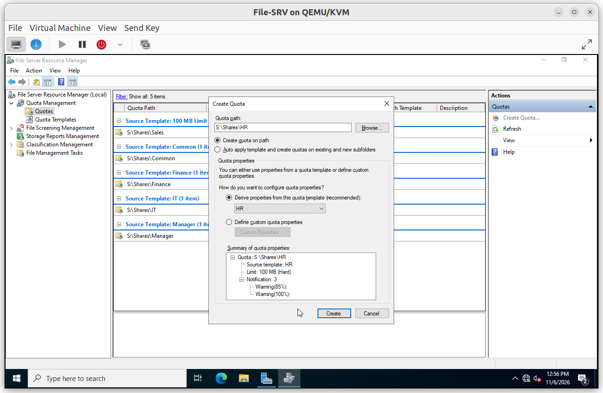
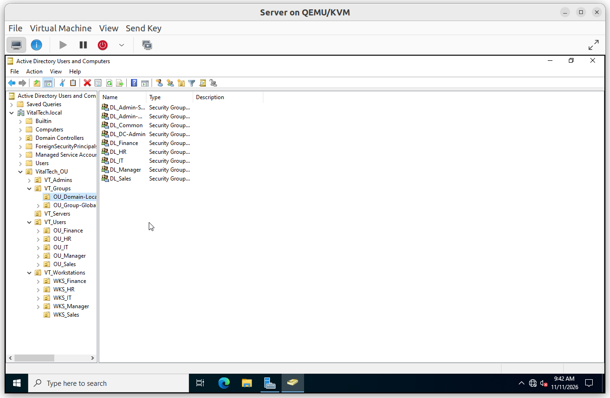

# Architecture

`File-SRV` is a member server of `VitalTech.local` that hosts the department data. Access follows the AGDLP model, and the server is administered through a dedicated Tier 1 group.

## Summary

| Component | Description |
|---|---|
| File server | `File-SRV` (Windows Server 2022, build 20348), joined to `VitalTech.local` |
| Data volume | `S:` (4.88 GB), data under `S:\Shares` |
| Shares | One SMB share per department, plus `Common` |
| Permission model | AGDLP: users, Global groups, Domain Local groups, permissions |
| Administration | Domain Local group `DL_Admin-Server` |
| Supporting controls | Quotas, file screening, auditing, Shadow Copies, backup, BitLocker |

## Environment

| Item | Value |
|---|---|
| Domain | `VitalTech.local` |
| Domain controller | `DC-SRV` |
| File server | `File-SRV` in OU `VitalTech_OU > VT_Servers > File-SRV` |
| Hypervisor | QEMU/KVM |
| Test client | `Sales-01` (domain-joined Windows client) |

**Test users**

| Department | User |
|---|---|
| Sales | `S_User01` |
| Admin User | `Adm_User1` |

## Folders and shares

```
S:\Shares
├── Common
├── Finance
├── HR
├── IT
├── Manager
└── Sales
```

| Share | Path | Access-based enumeration | SMB encryption |
|---|---|---|---|
| Common | `S:\Shares\Common` | Enabled | Disabled |
| Finance | `S:\Shares\Finance` | Enabled | Disabled |
| HR | `S:\Shares\HR` | Enabled | Disabled |
| IT | `S:\Shares\IT` | Enabled | Disabled |
| Manager | `S:\Shares\Manager` | Enabled | Disabled |
| Sales | `S:\Shares\Sales` | Enabled | Disabled |



## AGDLP model

**Why**: permissions are never given to individual users. A user's role is expressed by a Global group, and the access to a resource is expressed by a Domain Local group. When someone changes department, only group membership changes and no ACL is touched.

| Letter | Object | Naming | Examples |
|---|---|---|---|
| A | User accounts | `<Initial>_User<NN>` | `S_User01`, `F_User01` |
| G | Global groups (department) | `GG_<Department>` | `GG_Sales`, `GG_Common` |
| DL | Domain Local groups (access to a folder) | `DL_<Folder>` | `DL_Sales`, `DL_Common` |
| P | Permissions (NTFS) | | Modify on `Finance` for `DL_Finance` |

```
User  →  GG_<Department>  →  DL_<Folder>  →  NTFS permission on the folder
```



## Administration

Administration of the server and of the shares is done by members of `DL_Admin-Server` (Tier 1), which has Full Control on `S:\Shares`. The restrictions on the other tiers are documented in [03_Server_Hardening](../03_Server_Hardening/Server_Hardening.md).
