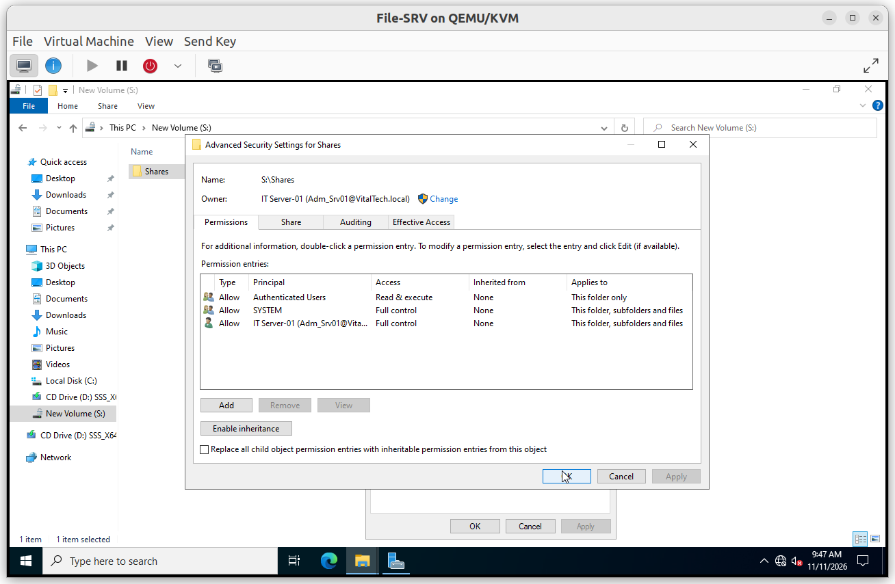
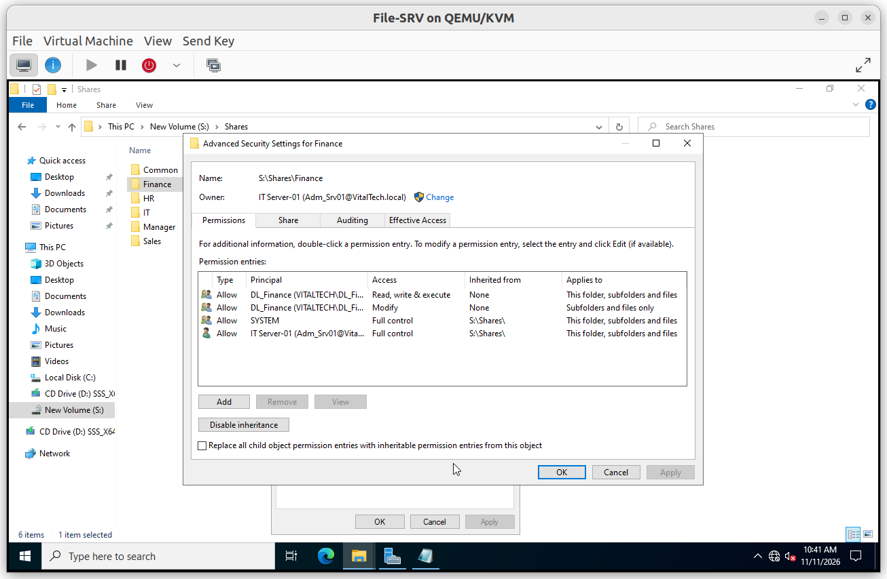
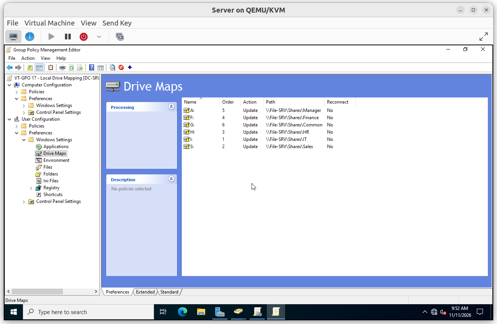
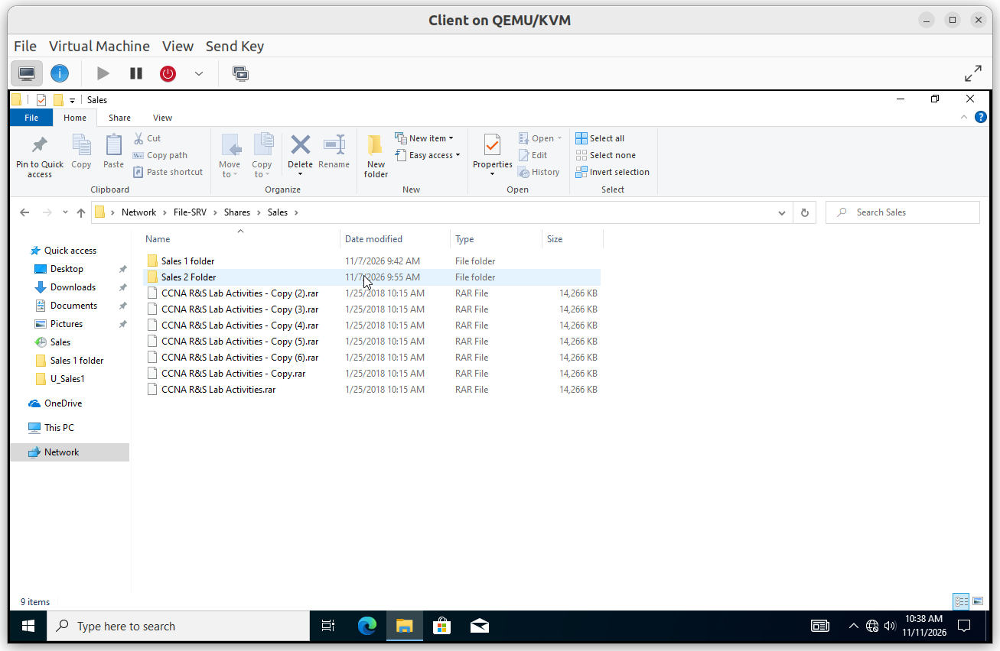
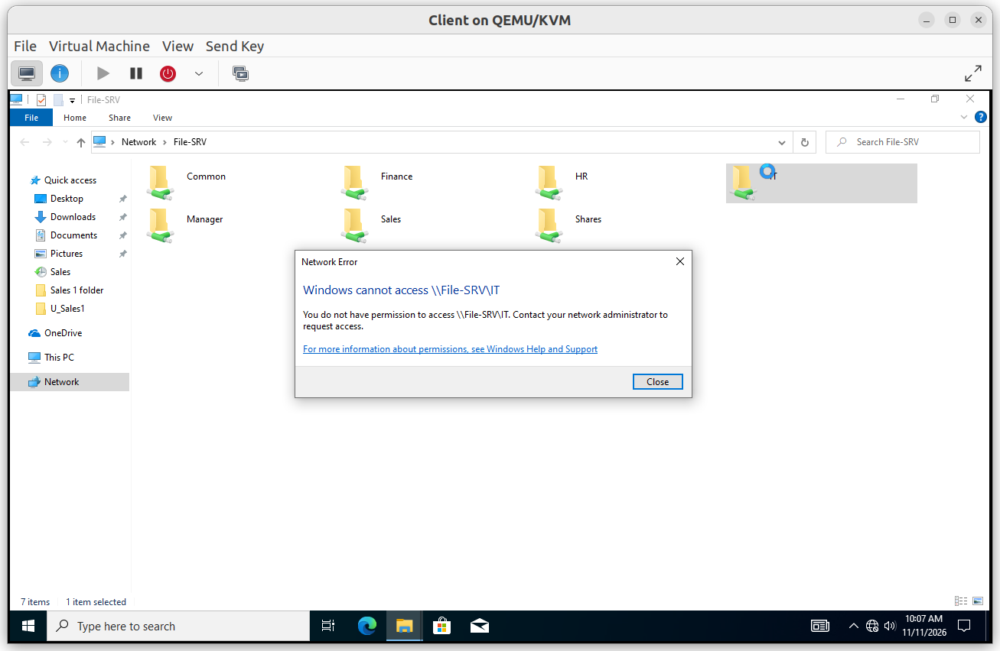
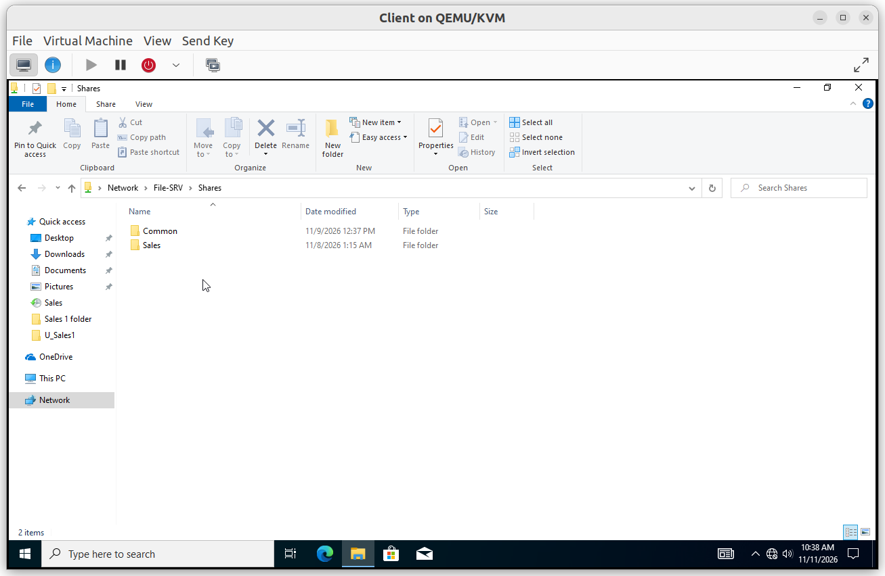
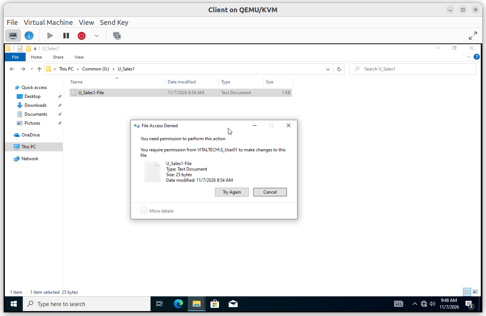
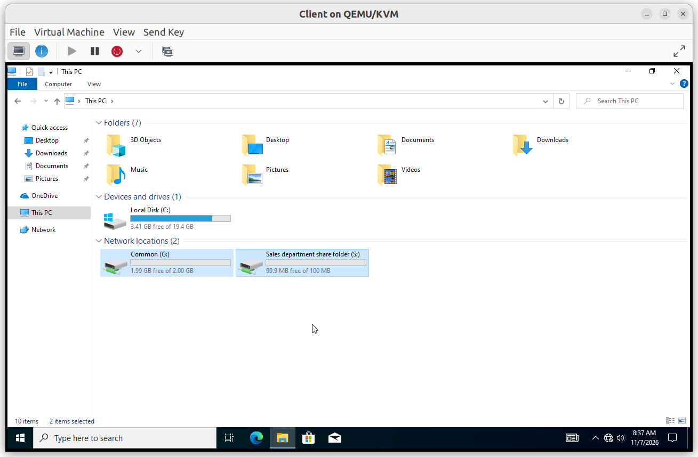

# Share Permissions

Access to the department data is controlled by NTFS permissions on `S:\Shares`, one share per department, access-based enumeration on every share, and a drive-mapping policy for users.

## Summary

| Control | Scope | Purpose |
|---|---|---|
| NTFS permissions | `S:\Shares` and department folders | Restrict each folder to its Domain Local group |
| Access-Based Enumeration | Department shares | Hide folders the user cannot open |
| VT-GPO 17 - Local Drive Mapping | `VT_Users` | Map the department drive at sign-in |

---

## NTFS permissions

**Scope**: `S:\Shares` and its subfolders. Inheritance is disabled on the root.

**Why**: NTFS is the single place where access is decided. Permissions are granted only to Domain Local groups, never to users, and users do not get Full Control.

**Configuration**

| Folder | Principal | Access | Applies to |
|---|---|---|---|
| `S:\Shares` | Authenticated Users | Read, write & execute | This folder only |
| `S:\Shares` | `DL_Admin-Server` | Full control | This folder, subfolders and files |
| `S:\Shares` | SYSTEM | Full control | This folder, subfolders and files |
| `S:\Shares\Finance` | `DL_Finance` | Read, write & execute | This folder, subfolders and files |
| `S:\Shares\Finance` | `DL_Finance` | Modify | Subfolders and files only |
| `S:\Shares\Finance` | `DL_Admin-Server`, SYSTEM | Full control (inherited) | This folder, subfolders and files |
| `S:\Shares\Common` | `DL_Common` | Read, write & execute | This folder only |
| `S:\Shares\Common` | CREATOR OWNER | Modify | Subfolders and files only |
| `S:\Shares\Common` | `DL_Admin-Server`, SYSTEM | Full control (inherited) | This folder, subfolders and files |

`HR`, `IT`, `Manager` and `Sales` follow the same model as `Finance` with their own Domain Local group.

---

## Access-Based Enumeration

**Scope**: the six department shares.

**Why**: a user who cannot open a folder should not see it either. This reduces information leakage and curiosity browsing.

**Configuration**: `FolderEnumerationMode` is `AccessBased` on `Common`, `Finance`, `HR`, `IT`, `Manager` and `Sales`.

---

## VT-GPO 17 - Local Drive Mapping

**Scope**: linked to the `VT_Users` OU.

**Why**: users reach their department data through a mapped drive instead of typing a path.

**Configuration**: `User Configuration > Preferences > Windows Settings > Drive Maps`

| Order | Drive | Path | Action | Targeting |
|---|---|---|---|---|
| 1 | `I:` | `\\File-SRV\Shares\IT` | Update | `DL_IT: IT Domain Local Group]` |
| 2 | `S:` | `\\File-SRV\Shares\Sales` | Update | `DL_Sales: Sales Domain Local Group` |
| 3 | `H:` | `\\File-SRV\Shares\HR` | Update | `DL_HR: HR Domain Local Group` |
| 4 | `F:` | `\\File-SRV\Shares\Finance` | Update | `DL_Finance: Finance Domain Local Group` |
| 5 | `A:` | `\\File-SRV\Shares\Manager` | Update | `DL_Manager: Manager Domain Local Group` |
| 6 | `G:` | `\\File-SRV\Shares\Common` | Update | `DL_Common: group for all users]` |

---

### Verification

#### V1. User reaches the share of their own department

- **Test**: sign in as a user of the department and open the mapped drive.
- **Expected**: the content is visible and files can be created.
- **Result**: ✅

#### V2. User cannot reach another department

- **Test**: as a Sales user, open `\\File-SRV\IT` directly.
- **Expected**: access is denied.
- **Result**: ✅

#### V3. Access-based enumeration hides other folders

- **Test**: as a department user, browse `\\File-SRV\Shares`.
- **Expected**: only the shares the user can open are listed.
- **Result**: ✅

#### V4. Common: users cannot change files created by others

- **Test**: user A creates a file in `Common`, user B tries to edit and delete it.
- **Expected**: user B is refused.
- **Result**: ✅

#### V5. Drive mapping applied

- **Test**: sign in as an Sales user, run `gpupdate /force` and open File Explorer.
- **Expected**: the Sales drive is mapped, and no drive of another department appears.
- **Result**: ✅

