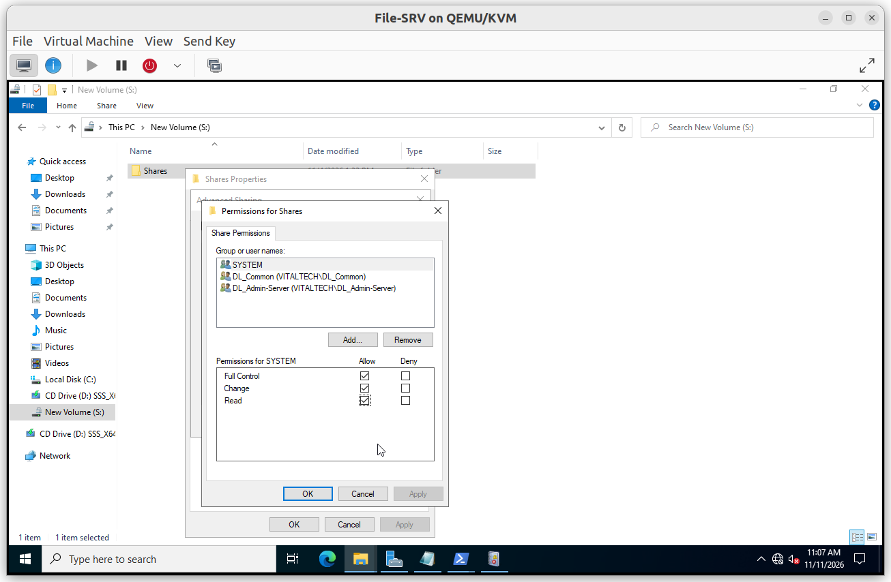
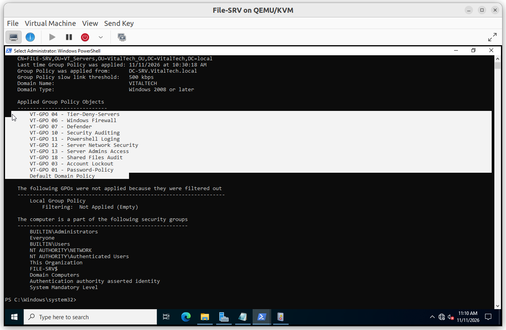
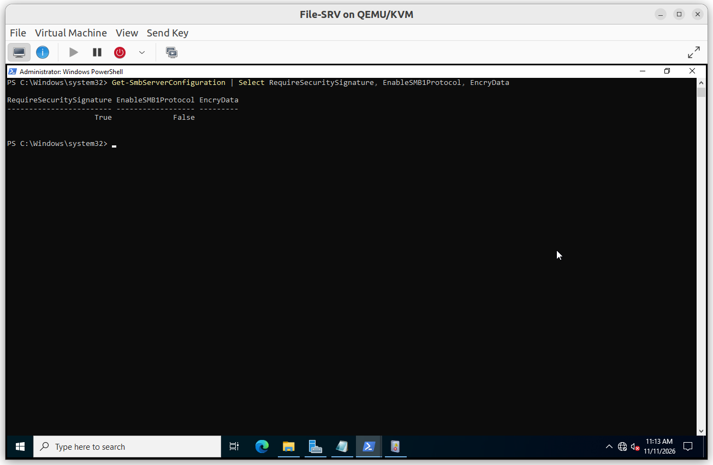

# Server Hardening

`File-SRV` is a member server in the Tier 1 scope, so it receives the server baseline built in the [Active Directory Security Hardening](../../Active%20Directory%20Security%20Hardening/README.md) lab. This document lists what applies to the file server and the file-server specific settings.

## Summary

| GPO | Purpose |
|---|---|
| VT-GPO 01 - Password-Policy | Domain password policy |
| VT-GPO 03 - Account Lockout | Domain account lockout policy |
| VT-GPO 04 - Tier-Deny-Servers | Restrict which tiers can sign in to servers |
| VT-GPO 06 - Windows Firewall | Firewall baseline |
| VT-GPO 07 - Defender | Antivirus baseline |
| VT-GPO 10 - Security Auditing | Advanced audit baseline |
| VT-GPO 11 - Powershell Logging | PowerShell logging |
| VT-GPO 12 - Server Network Security | Network hardening of member servers |
| VT-GPO 13 - Server Admins Access | Who administers the servers |
| VT-GPO 18 - Shared Files Audit | File access auditing (see [04_Audit_Logging](../04_Audit_Logging/Audit_Logging.md)) |

---

## File-server specific settings

| Setting | Value |
|---|---|
| Administration group | `DL_Admin-Server` (Full control on `S:\Shares`) |
| SMB encryption | Disabled on all shares |
| SMB signing required | Yes |
| SMBv1 | Disabled |
| Administrative shares | `ADMIN$`, `C$`, `S$`, `IPC$` (default, administrators only) |

---

### Verification

#### V1. Server baseline applied

- **Test**: on `File-SRV`, run `gpresult /r` and read the applied Group Policy Objects.
- **Expected**: GPO 01, 03, 04, 06, 07, 10, 11, 12, 13 and 18 are listed.
- **Result**: ✅

#### V2. SMB settings

- **Test**: run `Get-SmbServerConfiguration | Select RequireSecuritySignature, EnableSMB1Protocol, EncryptData`.
- **Expected**: `RequireSecuritySignature` is `True` and `EnableSMB1Protocol` is `False`.
- **Result**: ✅

