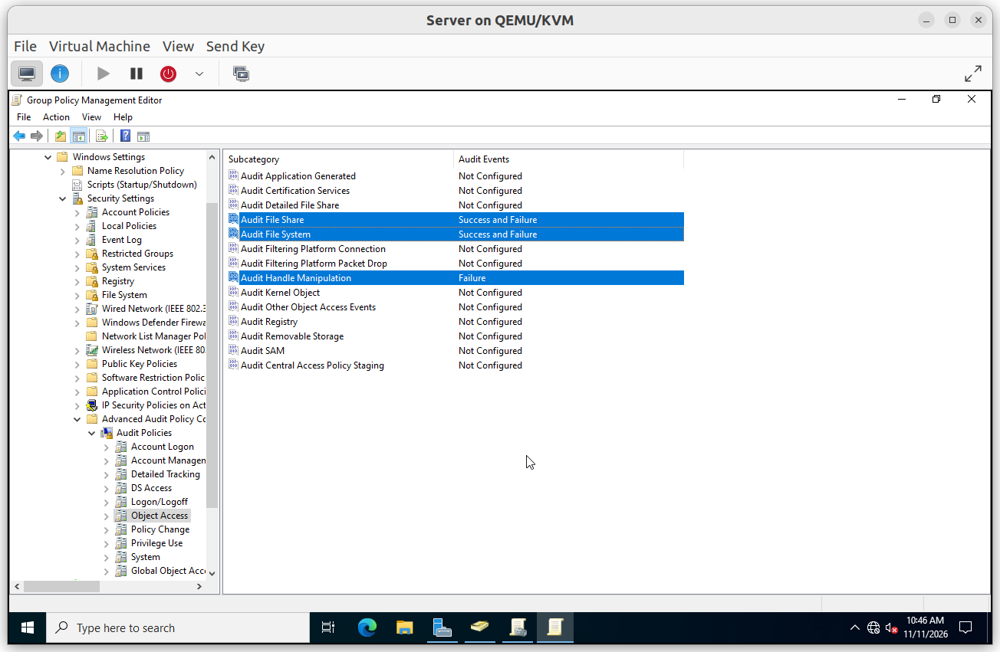
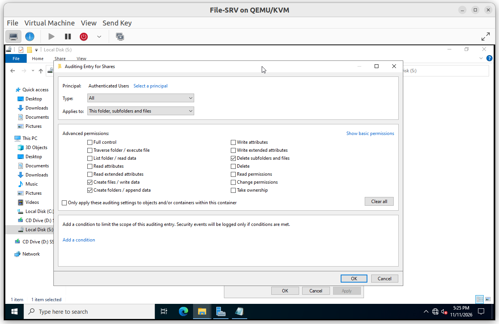
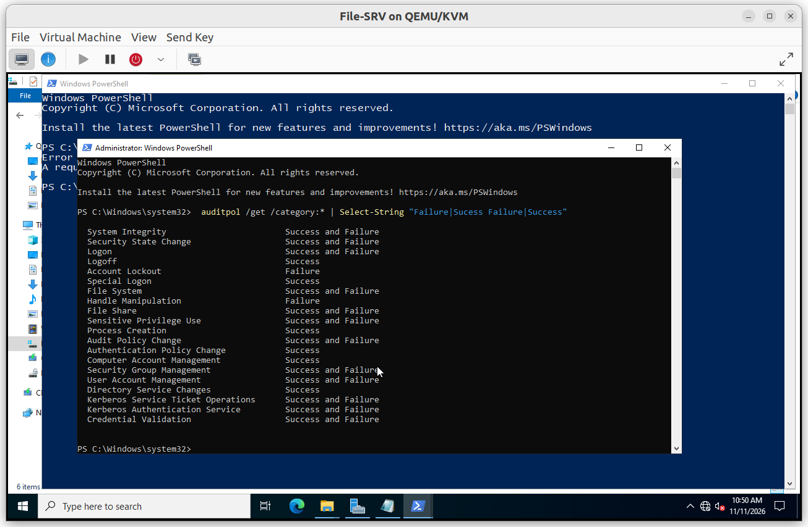
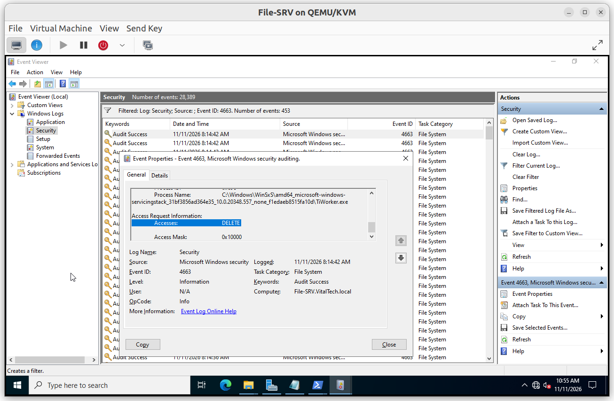
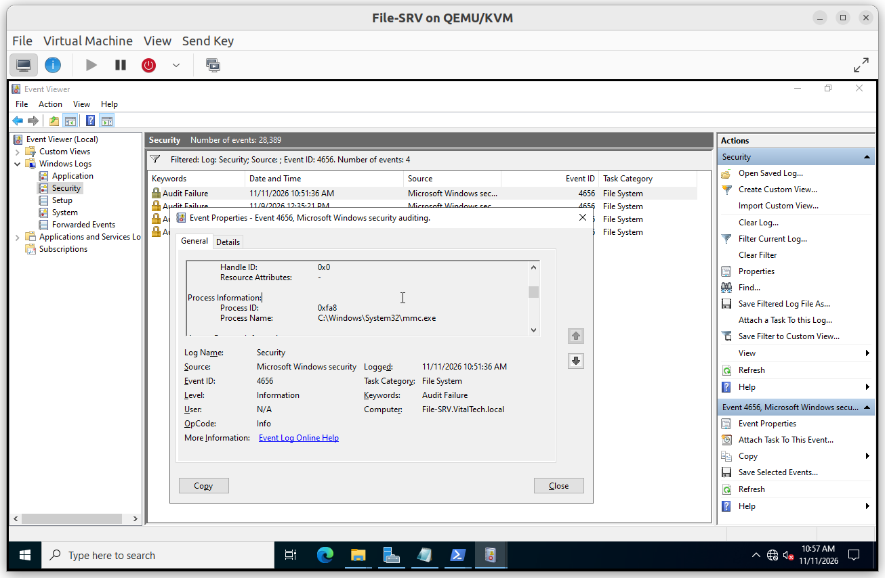

# Audit Logging

File access is audited in two layers. The audit policy of the server decides which kinds of events can be written, and the SACL on the folders decides which actions are watched.

## Summary

| GPO | Linked to | Purpose |
|---|---|---|
| VT-GPO 18 - Shared Files Audit | File-SRV (Computer Object by Targeting) | Enable file system auditing on the file server |

---

## VT-GPO 18 - Shared Files Audit

**Scope**: applied to `File-SRV`

**Why**: without the audit policy, the SACL on a folder writes nothing. The policy turns on auditing of file access, and failures are kept to catch denied attempts.

**Configuration**: `Computer Configuration > Policies > Windows Settings > Security Settings > Advanced Audit Policy Configuration > Audit Policies`

| Category | Subcategory | Value |
|---|---|---|
| Object Access | Audit File System | Success and Failure |
| Object Access | Audit Handle Manipulation | Failure |
| Object Access | Audit File Share | Success and Failure |

**SACL on `S:\Shares`**

| Principal | Type | Applies to | Watched actions |
|---|---|---|---|
| `All(Fail & Sucess)` | All | This folder, subfolders and files | `Delete Subfolders and Files, Create files / write data, Create folders /append data, Take ownership]` |

**Event log**: the Security log has a maximum size of 192 MB.

---

### Verification

#### V1. Audit policy active

- **Test**: run `auditpol /get /category: | Select-String "Sucess|Failure|Success and Failure` on `File-SRV`.
- **Expected**: `File System` is set to Success and Failure.
- **Result**: ✅

#### V2. File creation, change and deletion are recorded

- **Test**: as a department user, create, edit and delete a file in a department share, then read the Security log on `File-SRV` filtered on event 4663.
- **Expected**: events show the account name, the file name and the access type.
- **Result**: ✅

#### V3. Denied access is recorded

- **Test**: as a Sales user, open `\\File-SRV\Finance`, then filter the Security log on event 4656.
- **Expected**: a failure event shows the account name and the object name.
- **Result**: ✅

#### V4. Deletion event

- **Test**: delete a file from a client through the share and look for events 4663 and 4660.
- **Expected**: an event 4663 with the access `DELETE`. Event 4660 may also appear.
- **Result**: ✅

> A deletion made locally on the server with File Explorer goes to the Recycle Bin, which is a move, so the test must be done from a client through the share.
