# Storage Protection

Five controls protect the data on `S:`: quotas against disk exhaustion, file screening against unwanted file types, Shadow Copies for quick recovery, Windows Server Backup for real recovery, and BitLocker for encryption at rest.

## Summary

| Control | Scope | Purpose |
|---|---|---|
| FSRM quotas | Department folders | Limit the space used by each department |
| FSRM file screening | `S:\Shares` | Block unwanted file types |
| Shadow Copies | `S:` | Let users restore previous versions |
| Windows Server Backup | `S:` | Independent copy of the data |
| BitLocker | `S:` | Encrypt the volume at rest |

---

## FSRM quotas

**Scope**: department folders under `S:\Shares`.

**Why**: one department must not be able to fill the shared disk. Hard quotas refuse writes once the limit is reached.

**Configuration**

| Folder | Limit | Type |
|---|---|---|
| `S:\Shares\Common` | 2 GB | Hard |
| `S:\Shares\Finance`, `HR`, `IT`, `Manager`, `Sales` | 100 MB | Hard |

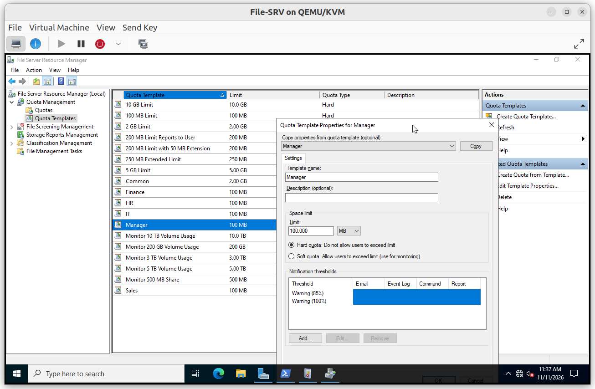

#### V1. Copy refused when the quota is full

- **Test**: as a Sales user, copy a 13.9 MB file into the Sales share until the 100 MB quota is almost full.
- **Expected**: Windows refuses the copy with a "not enough space" message.
- **Result**: ✅

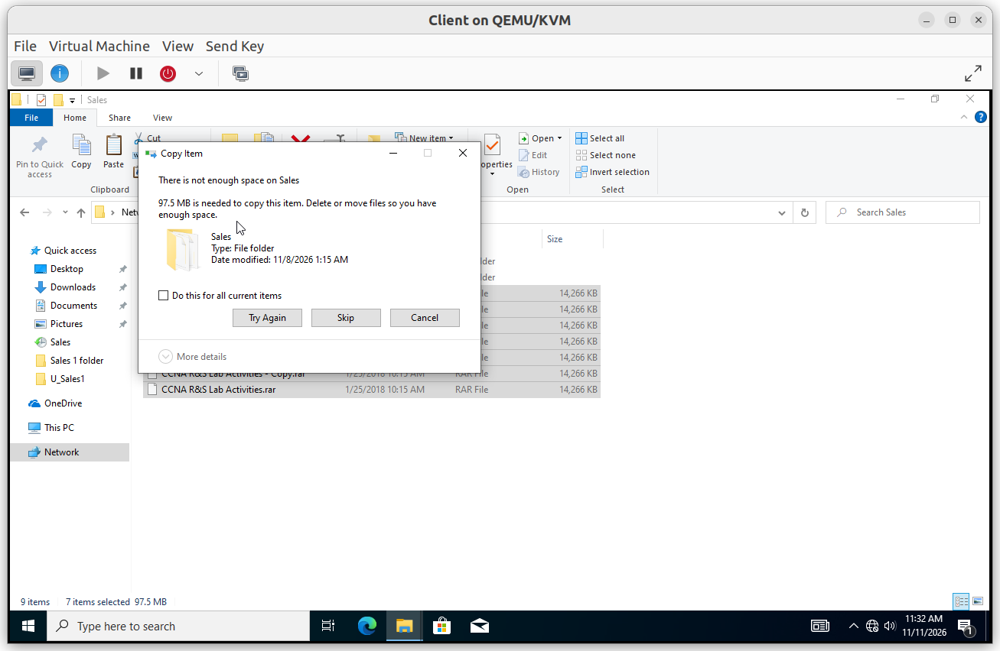

---

## FSRM file screening

**Scope**: `S:\Shares`.

**Why**: scripts and executables have no place in department shares. An active screen refuses them when they are saved.

**Configuration**: one active file screen on `S:\Shares` using the template `Block Executable Files`, which refuses the file group `Executable Files` (scripts and executables such as `.bat`, `.cmd`, `.exe` and `.js`..etc.).

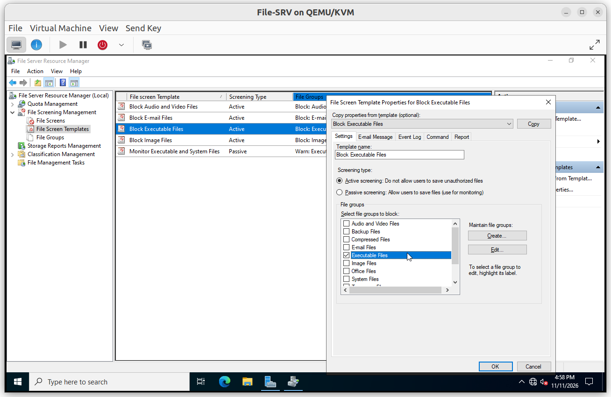

#### V1. Script file refused

- **Test**: as a standard user, copy a `test.bat` into `Common`.
- **Expected**: the save is refused.
- **Result**: ✅

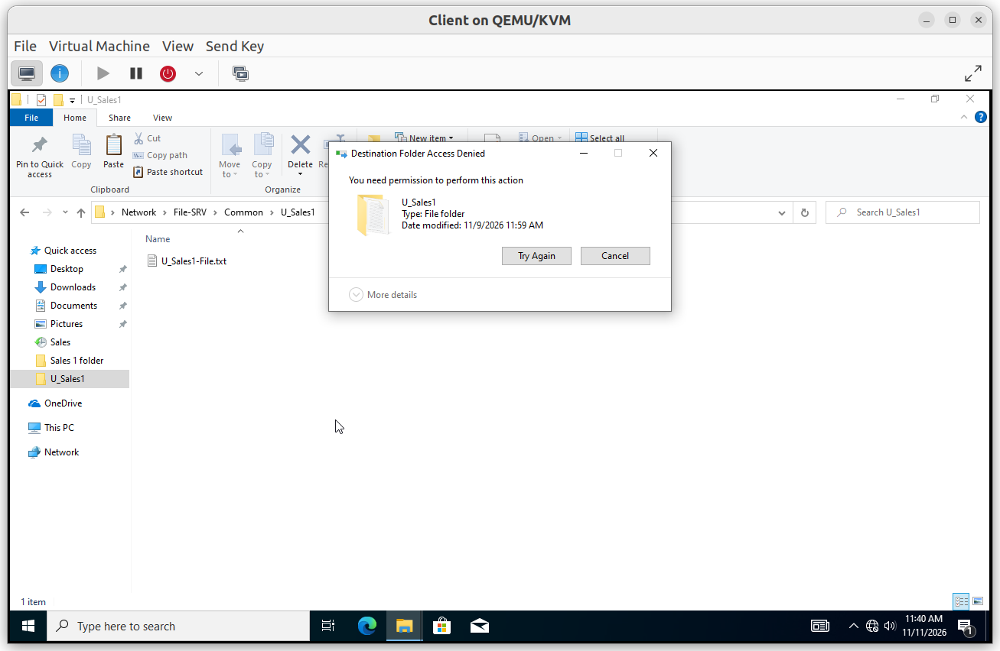

---

## Shadow Copies

**Scope**: volume `S:`.

**Why**: most restore requests are accidental deletions or overwrites. Previous versions let users recover files without the administrator.

**Configuration**: enabled on `S:` with five snapshots per day (9:00 AM, 12:00 PM, 2:00 PM, 4:00 PM and 6:00 PM). The snapshots are stored on the same volume, so they do not replace the backup.

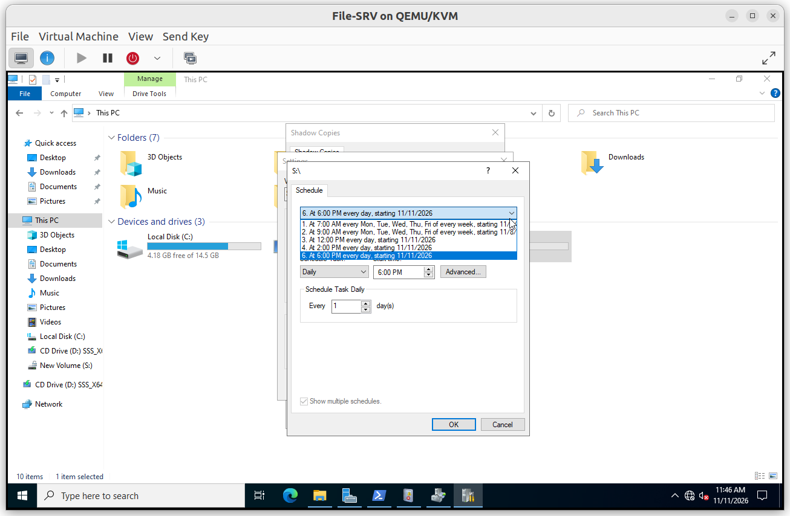

#### V1. Previous version restored

- **Test**: as a Sales user, create a file in the mapped drive, take a snapshot, delete the file from the client, then recover it from the *Previous Versions* tab of the folder.
- **Expected**: the deleted file is available in the snapshot and can be copied back.
- **Result**: ✅

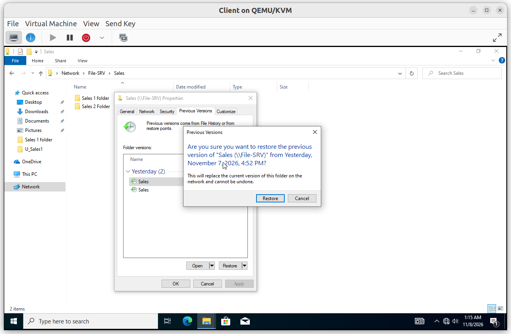

---

## Windows Server Backup

**Scope**: volume `S:`.

**Why**: a backup on a separate disk survives the loss of the data disk, which snapshots do not.

**Configuration**

| Setting | Value |
|---|---|
| Backup time | Daily at 10:00 PM |
| Items | Volume `S:` |
| Destination | Dedicated disk (5 GB) |
| Advanced option | VSS Copy Backup |

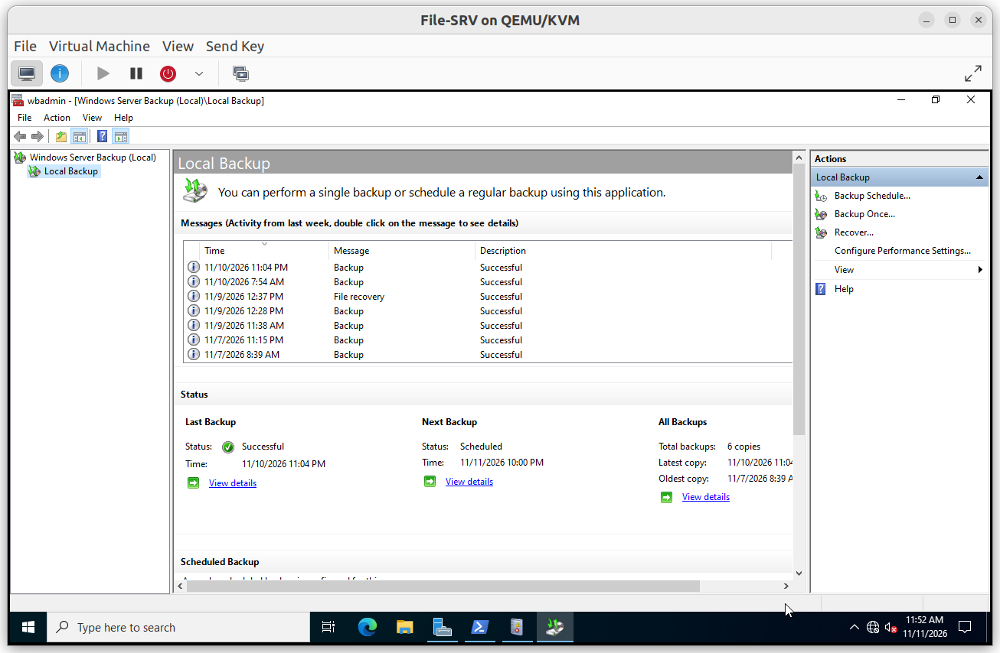

#### V1. Backup and restore

- **Test**: run a backup, delete a test file, restore it with the *Recover* wizard, then check the permissions with `icacls`.
- **Expected**: the file is restored with its NTFS permissions.
- **Result**: ✅

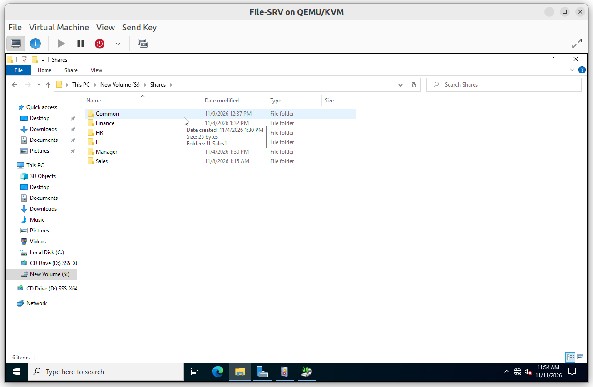

---

## BitLocker

**Scope**: volume `S:`.

**Why**: NTFS permissions do not protect a stolen disk or a copied VM image. BitLocker encrypts the data at rest.

**Configuration**

| Setting | Value |
|---|---|
| Encryption method | XTS-AES 128 |
| Encrypted space | Used space only |
| Key protectors | Password and recovery password |
| Auto-unlock | Disabled |

The recovery key is stored outside the server and outside the repository.

### Verification

#### V1. Volume encrypted

- **Test**: run `manage-bde -status S:`.
- **Expected**: conversion status *Used Space Only Encrypted*, protection status *On*.
- **Result**: ✅

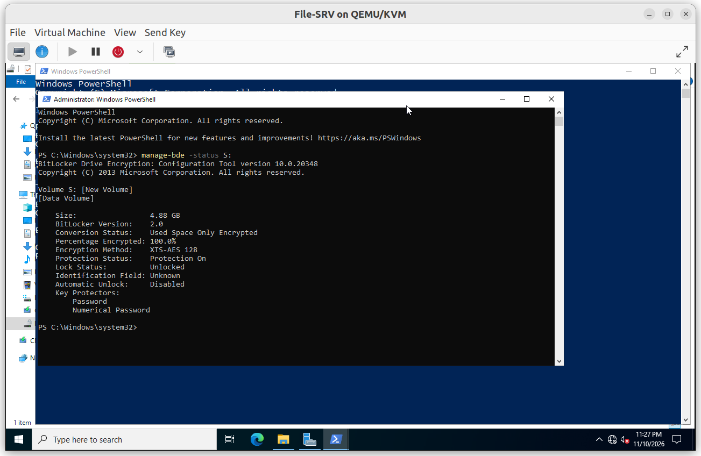

#### V2. Locked volume is unavailable

- **Test**: lock `S:`, then open the shares from the client.
- **Expected**: the shares are not reachable.
- **Result**: ✅

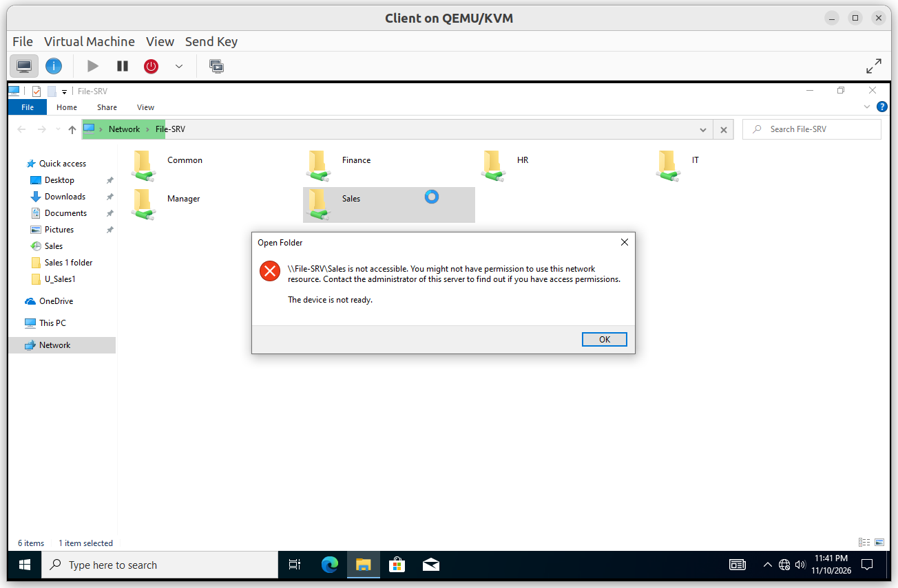

#### V3. Unlock with the password

- **Test**: unlock `S:` with the password.
- **Expected**: the data is readable and the shares are back.
- **Result**: ✅

#### V4. Unlock with the recovery key

- **Test**: lock `S:` again and unlock it with the recovery key in the graphical interface.
- **Expected**: `S:` unlocks.
- **Result**: ✅

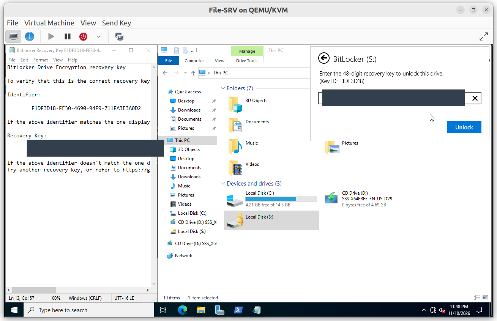

#### V5. Volume stays locked after a reboot

- **Test**: restart `File-SRV` and check `S:`.
- **Expected**: `S:` is locked and the shares are offline until an administrator unlocks it.
- **Result**: ✅

#### V6. Services work after unlocking

- **Test**: unlock `S:`, then check user access, the quota and a file from the client.
- **Expected**: everything works as before.
- **Result**: ✅

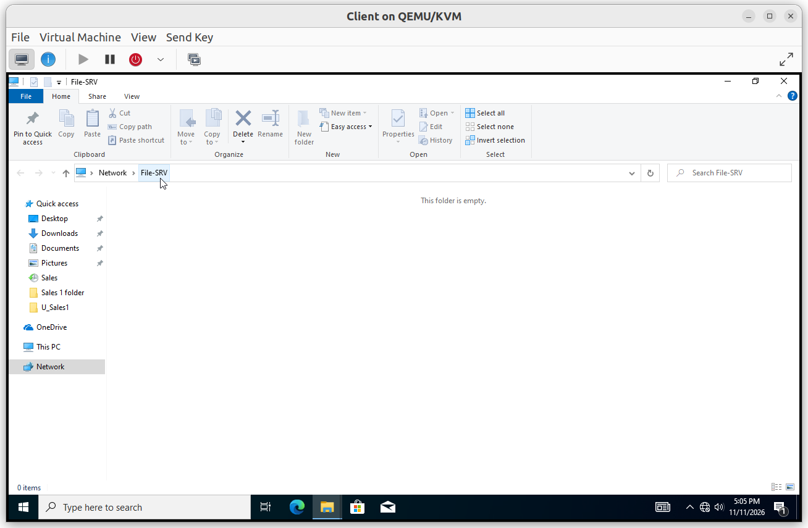
