# DC-SRV_01: Domain Controller

`DC-SRV_01` is the first Domain Controller and the backbone of the infrastructure. This document covers the installation of AD DS, the creation of the `VitalTech.local` forest, the Organizational Unit design, the AGDLP groups, the separation of administrator accounts and the creation of users, followed by the verification tests.

## Summary

| # | Step | Purpose |
|---|---|---|
| 1 | Install the AD DS role | Add the Active Directory binaries to the server |
| 2 | Promote the server to Domain Controller | Create the forest `VitalTech.local` |
| 3 | Organizational Units | Separate users, computers, groups and admin accounts |
| 4 | AGDLP groups | Grant access through groups, never to individual users |
| 5 | Administrator accounts | Separate privileged accounts from daily accounts |
| 6 | User creation | Create department users with a temporary password |

---

## Prerequisites

| Item | Value |
|---|---|
| Computer name | `DC-SRV_01` |
| IP address | `172.16.10.1/24` (static) |
| Operating system | Windows Server 2022 |

## Step 1. Install the AD DS role

In Server Manager, **Add Roles and Features** installs the *Active Directory Domain Services* role together with its required management tools.

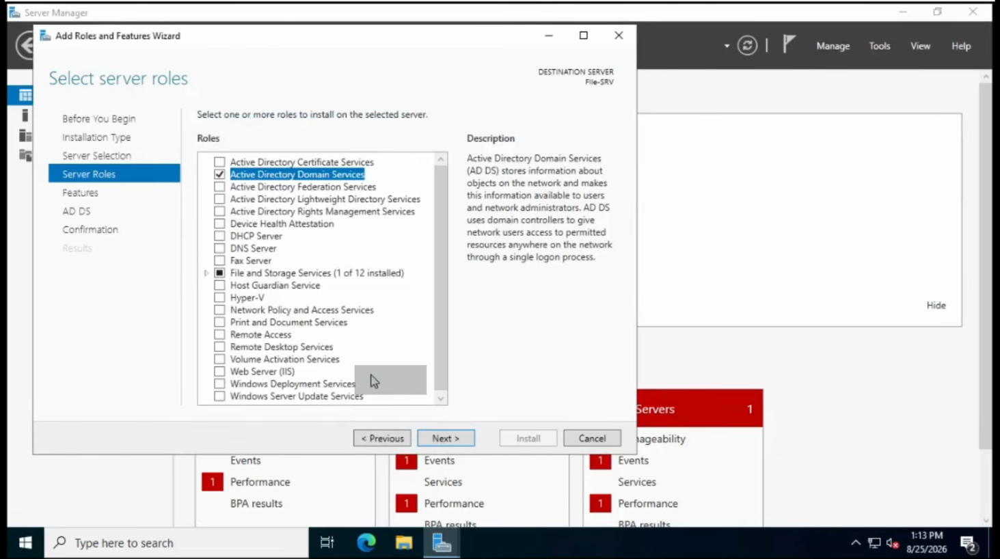

The Confirmation page summarizes everything that will be installed before the installation starts.

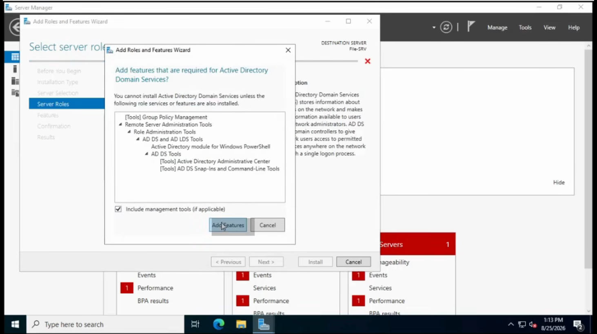

The Results page confirms the installation and offers to promote the server to a Domain Controller.

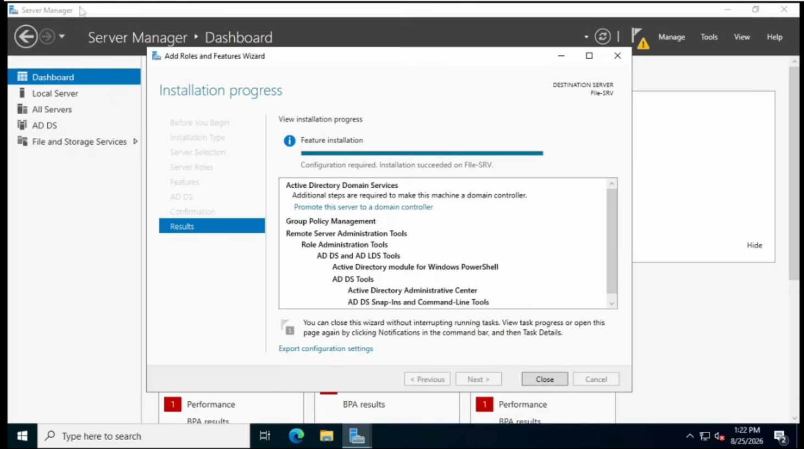

---

## Step 2. Promote the server to Domain Controller

The promotion wizard creates a **new forest** with the root domain `VitalTech.local`.

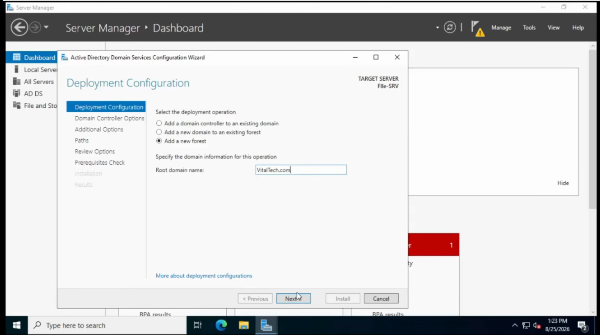

On the Domain Controller Options page, the server is set up as a DNS server and Global Catalog, and the Directory Services Restore Mode (DSRM) password is defined.

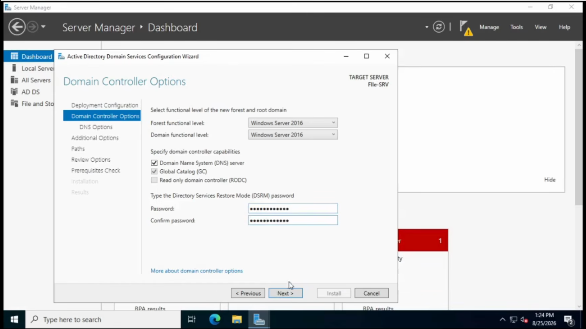

The Review Options page lists all the choices before the configuration is applied.

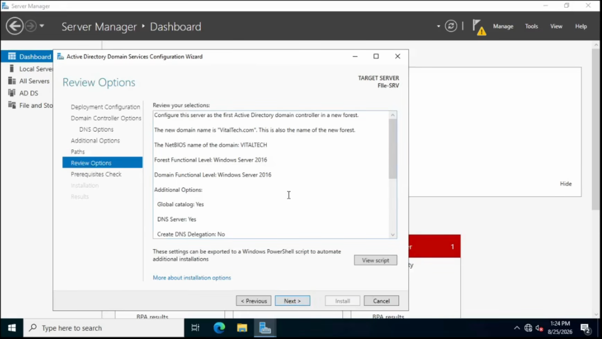

The prerequisites check validates the server before the installation.

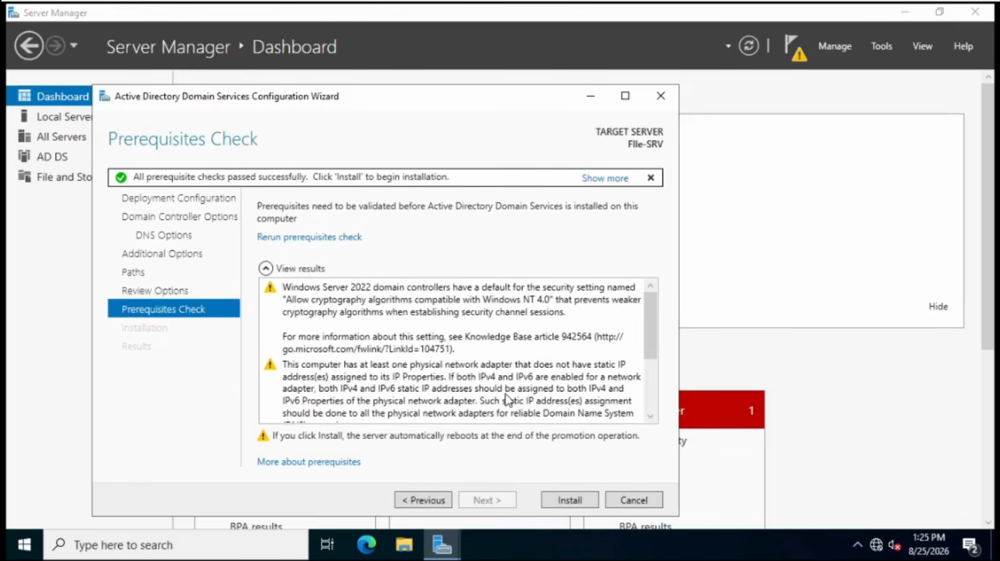

At the end of the installation, the server announces the restart that completes the promotion.

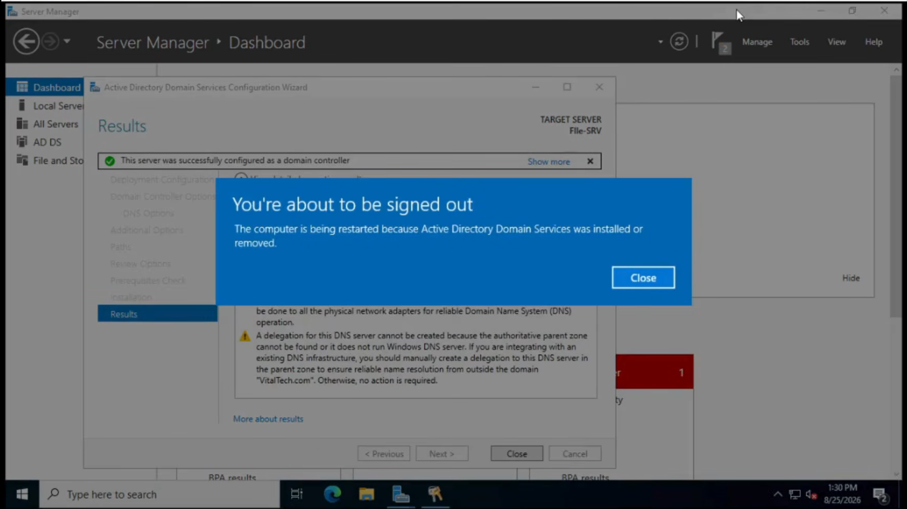

---

## Step 3. Organizational Units

OUs separate objects by function, so that each GPO targets exactly the users or machines it concerns.

```
VitalTech.local
└── VitalTech_OU
    ├── Admin
    │   ├── OU_Admin_Server
    │   └── OU_Admin_User
    ├── Groups
    │   ├── OU_Domain_Local
    │   └── OU_Group_Global
    ├── Users
    │   ├── OU_Dev
    │   ├── OU_Direction
    │   ├── OU_Finance
    │   ├── OU_HR
    │   └── OU_IT
    └── Workstations
        ├── OU_Server
        └── WKS_Users
            ├── WKS_Dev
            ├── WKS_Direction
            ├── WKS_Finance
            ├── WKS_HR
            └── WKS_IT
```

The Domain Controllers stay in their default OU. This is deliberate: the server firewall policy is linked to `OU_Server` and must not be applied to the Domain Controllers, where it could block Active Directory ports.

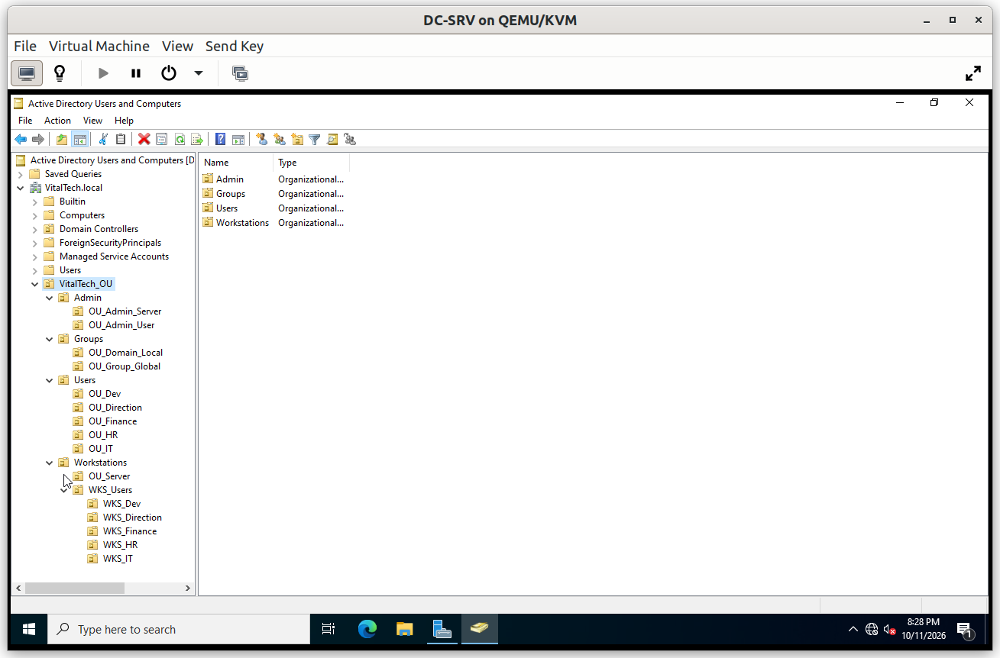

---

## Step 4. AGDLP groups

Access follows the **AGDLP** model:

| Layer | Object | Example |
|---|---|---|
| **A**ccount | User | An HR employee |
| **G**lobal group | `GG_*` | `GG_HR` |
| **D**omain **L**ocal group | `DL_*` | `DL_HR` |
| **P**ermission | NTFS or share permission | Modify on the HR folder |

Users are added to a global group, the global group is added to the domain local group, and permissions are granted only to the domain local group. All groups are of type **Security**.

Each global group has a matching domain local group:

| Global group | Domain local group |
|---|---|
| `GG_Admin_Server` | `DL_Admin_Server` |
| `GG_Admin_User` | `DL_Admin_User` |
| `GG_Common` | `DL_Common` |
| `GG_Dev` | `DL_Dev` |
| `GG_Direction` | `DL_Direction` |
| `GG_Finance` | `DL_Finance` |
| `GG_HR` | `DL_HR` |
| `GG_IT` | `DL_IT` |

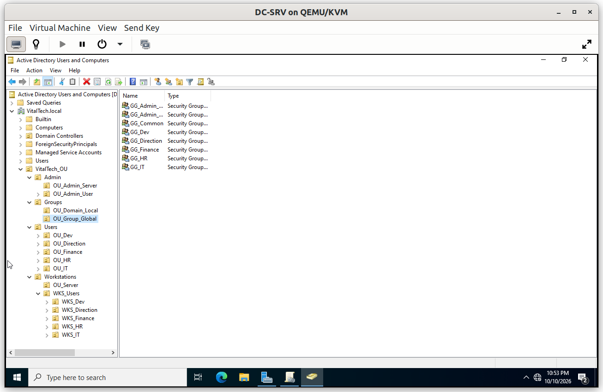

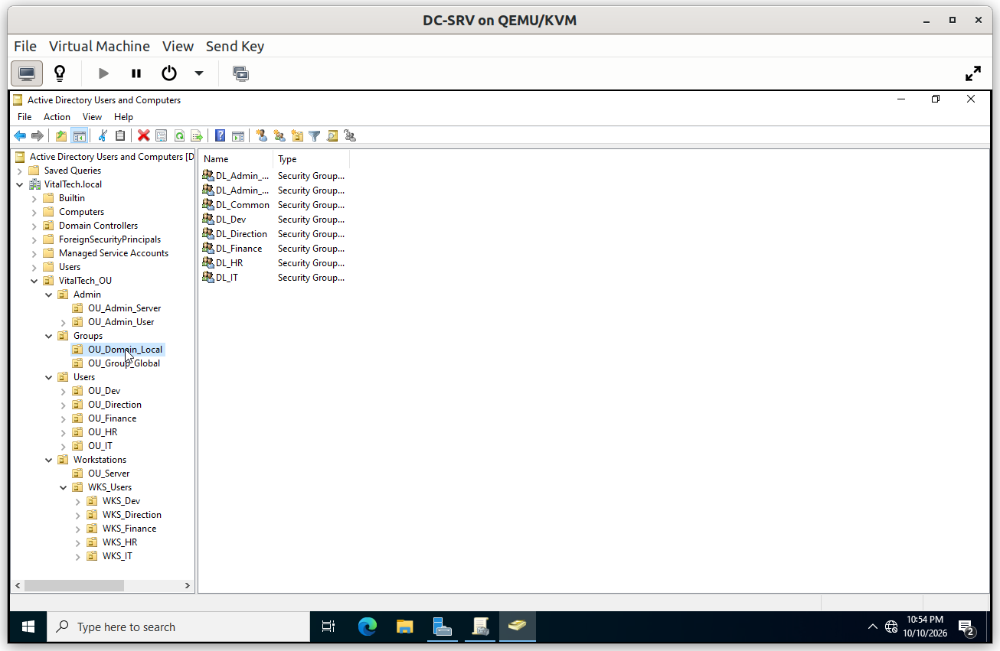

---

## Step 5. Administrator accounts

Privileged work is done with dedicated administrator accounts. Each administrator belongs to the IT department and holds two accounts: a **daily account**, member of the IT group, and a separate **administrator account** that carries the privileges matching their role:

- `OU_Admin_Server` holds the accounts that administer the servers (global group `GG_Admin_Server`)
- `OU_Admin_User` holds the accounts that administer the client workstations (global group `GG_Admin_User`)

Rights are separated on purpose. Being a **local administrator** on a machine does not grant **Active Directory rights** (managing DNS zones, editing GPOs, creating computer accounts). Accounts that hold Active Directory rights are kept to a minimum and never used for daily work. A compromised daily account therefore carries no administrative power, and privileged activity is easy to audit.

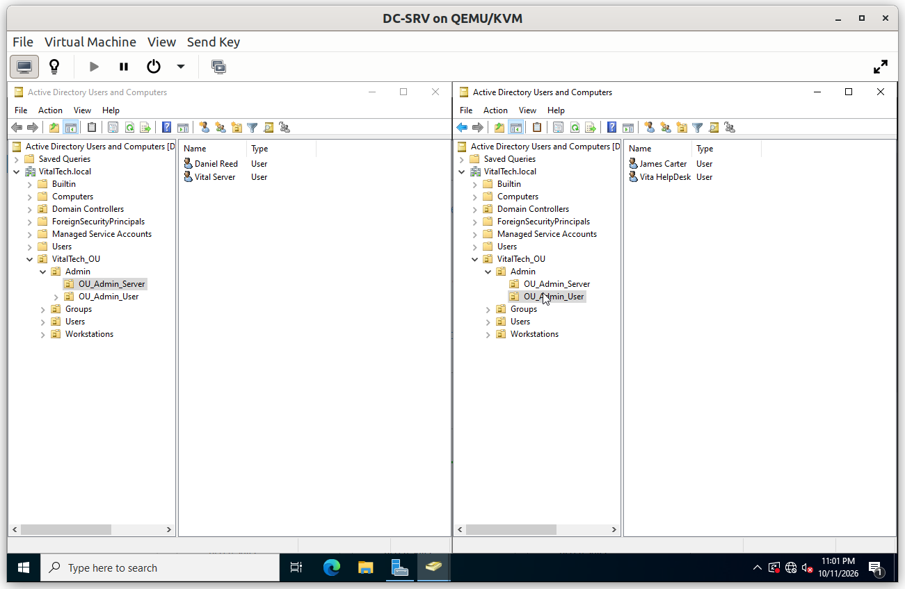

---

## Step 6. User creation

Each user is created in the OU of their department and added to the matching `GG_*` group. Accounts are created with a **temporary password** and the option *User must change password at next logon*, so the administrator who creates an account never knows the password that stays in use.

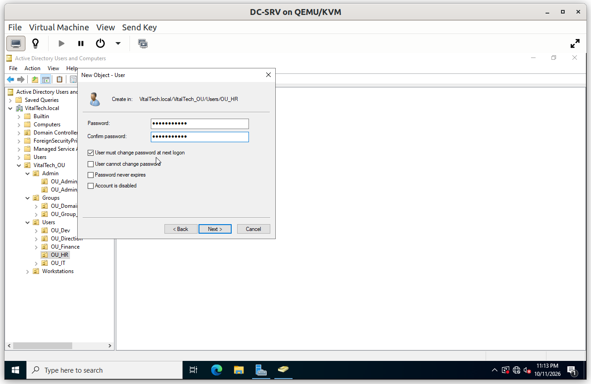

---

## Verification

### V1. Forced password change at first logon

- **Test**: sign in on the Windows 10 client for the first time with a newly created account that has *User must change password at next logon* enabled.
- **Expected**: Windows requires a new password before opening the session, so the temporary password never stays in use.
- **Result**: ✅

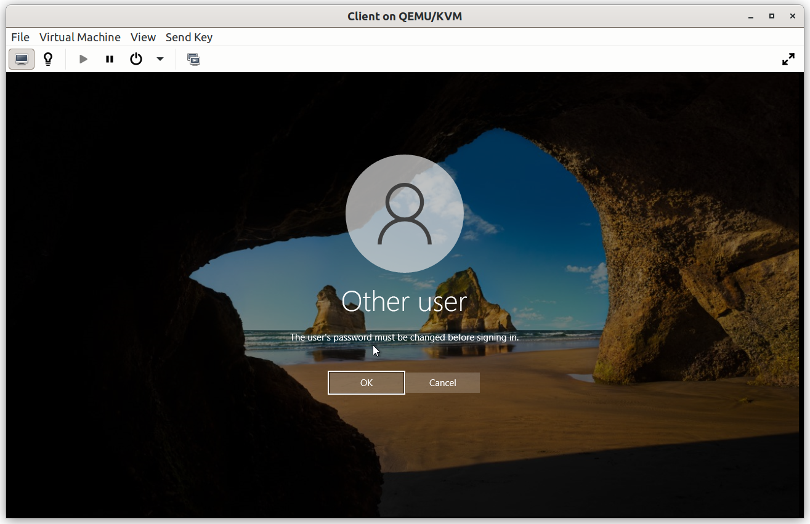


### V2. Domain user logon and group membership

- **Test**: sign in on the Windows 10 client as an HR user, then run `whoami /groups` and `gpresult /r`.
- **Expected**: the logon succeeds with the domain account, `GG_HR` appears in the groups, and the HR policies are applied (drive mapping, USB restriction for HR, corporate wallpaper).
- **Result**: ✅

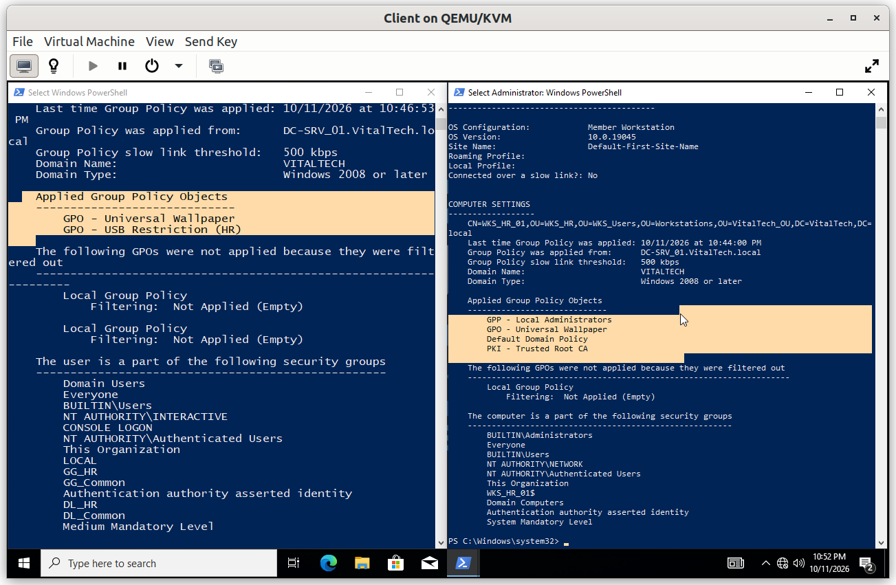