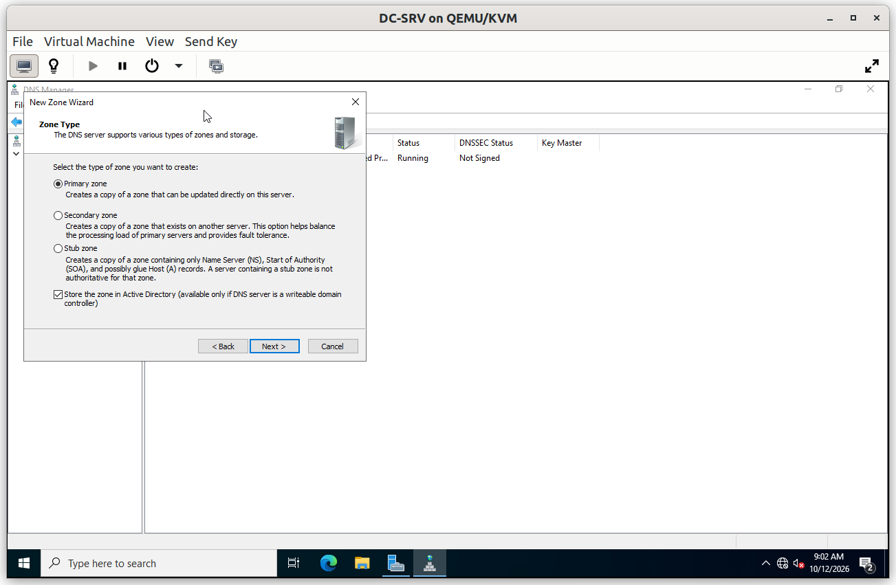
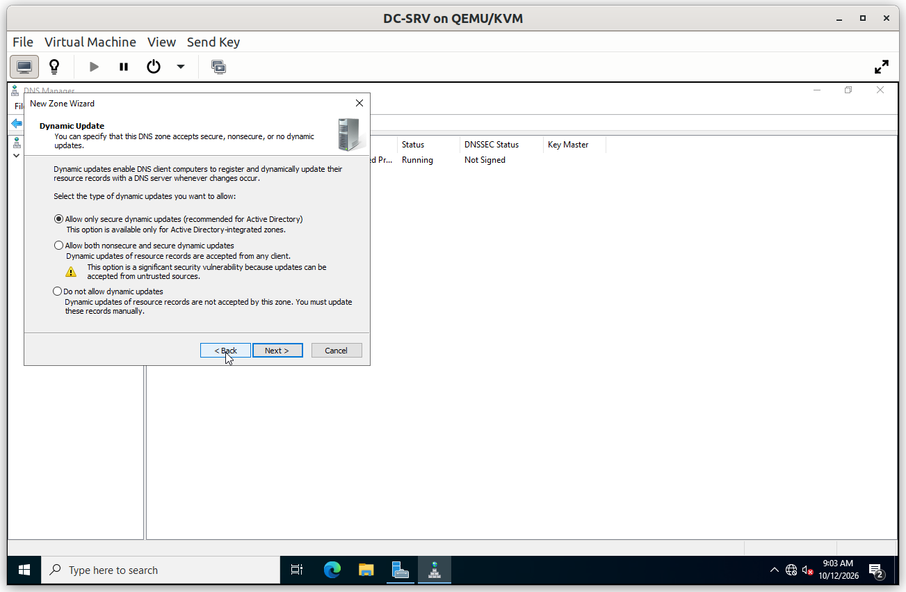
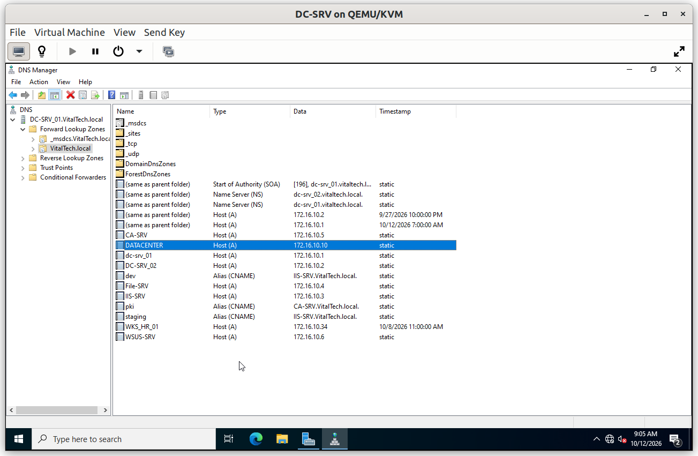
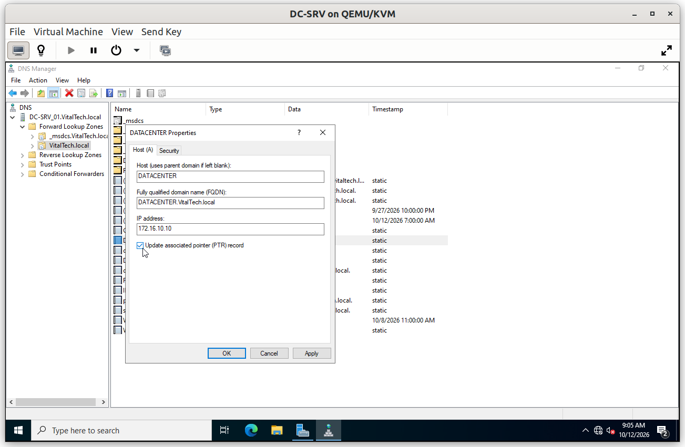
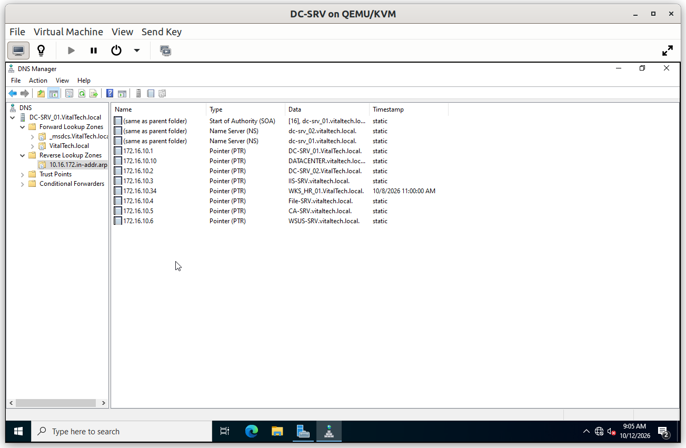
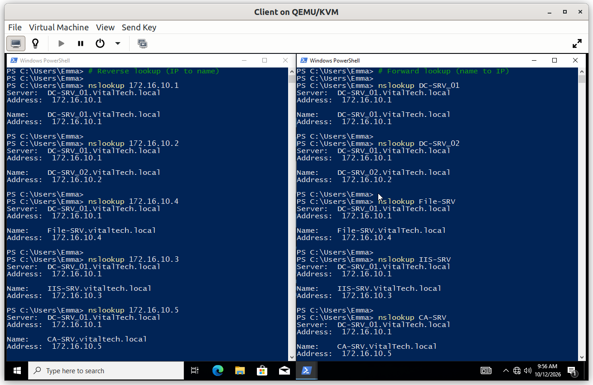

# DNS

DNS is installed with the forest on `DC-SRV_01` and integrated with Active Directory. It lets every service be reached by name (`File-SRV.VitalTech.local`, `pki.VitalTech.local`) instead of by IP address, and Active Directory itself relies on it to locate Domain Controllers. This document covers the reverse lookup zone, the forward zone and the automatic creation of PTR records, followed by the verification test.

## Summary

| # | Step | Purpose |
|---|---|---|
| 1 | Reverse lookup zone | Resolve an IP address back to a host name |
| 2 | Forward lookup zone and records | Resolve host names to IP addresses |
| 3 | Automatic PTR records | Keep forward and reverse records in sync without manual work |

---

## Step 1. Reverse lookup zone

A forward zone answers *"what is the IP address of this name?"*. A **reverse lookup zone** answers the opposite question and is created for the network `172.16.10.0/24`. It is not created automatically, and without it a reverse query such as `nslookup 172.16.10.1` has no zone to answer it.

The wizard starts with the zone type. The zone is **Active Directory-integrated**, so it is stored in the directory and replicated to every Domain Controller with no separate zone transfer to configure.

Then the Network ID of the zone is entered (`172.16.10`).

Finally the dynamic update mode is chosen. **Secure dynamic updates only** lets only authenticated domain members create or modify records, which prevents an unauthorized machine from registering a false record.

---

## Step 2. Forward lookup zone and records

The forward zone `VitalTech.local` is created automatically when the server is promoted, because the DNS role is installed with the forest. It holds the records of the domain, including the servers.

A new host record is created with the option **Create associated pointer (PTR) record** ticked, so that the reverse record does not have to be created by hand.

---

## Step 3. Automatic PTR records

Because of that option, the matching pointer record appears in the reverse zone without any manual action. Forward and reverse records stay consistent.

---

## Verification

### V1. Forward and reverse resolution

- **Test**: from the Windows 10 client, resolve the servers by name (forward lookup) and by IP address (reverse lookup) with `nslookup`.
- **Expected**: each name resolves to its IP address, each IP address resolves back to the name of its server, and the `Server:` line of the output displays `DC-SRV_01.VitalTech.local` instead of `UnKnown`.
- **Result**: ✅

