# Group Policy: Network Security

Windows Firewall is configured through Group Policy in layers. One **base policy** closes every server by default, then **one policy per server role** opens only the ports that role needs. Role policies are linked to `OU_Server` and use security filtering so that each one applies to a single computer account.

## Summary

| GPO | Linked to | Applies to | Purpose |
|---|---|---|---|
| GPO - Firewall - Base | `OU_Server` | All servers | Blocks inbound traffic by default, limits remote administration to the lab subnet |
| GPO - Firewall - File Server | `OU_Server` | `File-SRV` only | Opens SMB (TCP 445) |
| GPO - Firewall - IIS | `OU_Server` | `IIS-SRV` only | Opens HTTP and HTTPS |
| GPO - Firewall - CA | `OU_Server` | `CA-SRV` only | Opens HTTP for CRL and AIA, and RPC for certificate enrollment |
| GPO - Firewall - WSUS | `OU_Server` | `WSUS-SRV` only | Opens TCP 8530 and 8531 (prepared, not tested) |

The Domain Controllers are in a separate container and receive none of these policies, so Active Directory ports are never blocked by mistake.

---

## GPO - Firewall - Base

**Scope**: linked to `OU_Server`, so it applies to every server of the OU and not to the Domain Controllers.

**Why**: a server should expose nothing by default. This policy blocks all inbound connections that no rule explicitly allows, and restricts the remote administration protocols (RDP, WinRM) and ICMP to the lab subnet `172.16.10.0/24`. Every role-specific policy then opens only the ports it needs on top of this baseline.

**Configuration**

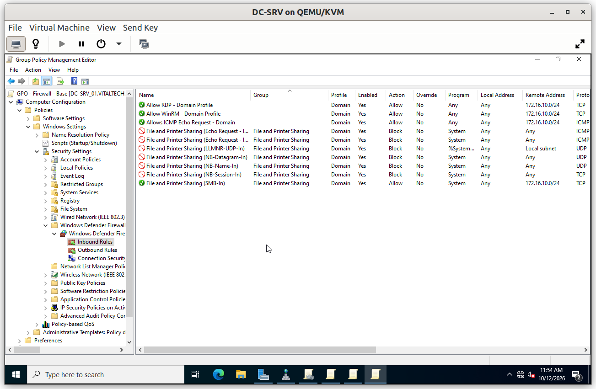

### Verification

#### V1. Policy applied on a server

- **Test**: on `File-SRV`, run `gpresult /r` and read the *Computer Settings* section.
- **Expected**: `GPO - Firewall - Base` is listed under *Applied Group Policy Objects*.
- **Result**: ✅

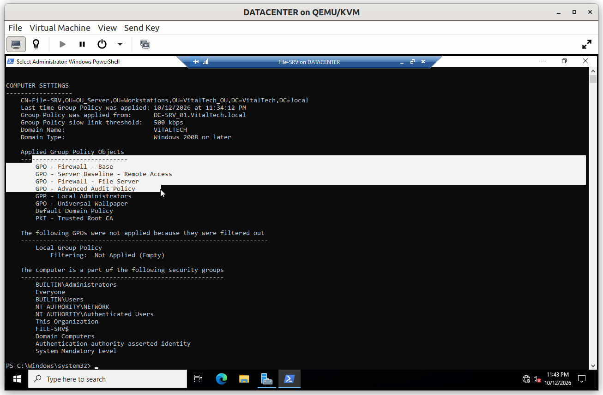

#### V2. Closed by default

- **Test**: from the Windows 10 client, run `Test-NetConnection File-SRV -Port 80`.
- **Expected**: `TcpTestSucceeded : False`. No rule opens port 80 on `File-SRV`, so the baseline blocks it.
- **Result**: ✅

#### V3. Remote administration allowed from the subnet

- **Test**: from the Windows 10 client (`172.16.10.34`), run `Test-NetConnection File-SRV -Port 3389`.
- **Expected**: `TcpTestSucceeded : True`, because the client is inside `172.16.10.0/24`.
- **Result**: ✅

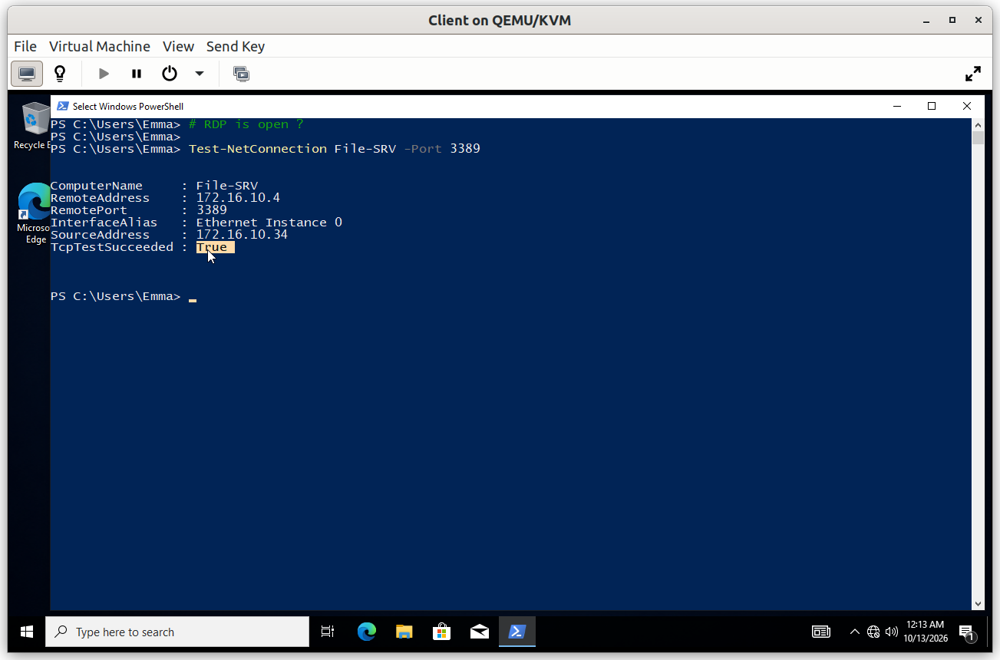

#### V4. Remote session opened with a server administrator

- **Test**: from the same client, open an RDP session to `File-SRV` with a server administrator account.
- **Expected**: the session opens, which confirms that the firewall allows RDP from the subnet and that the account is authorized.
- **Result**: ✅

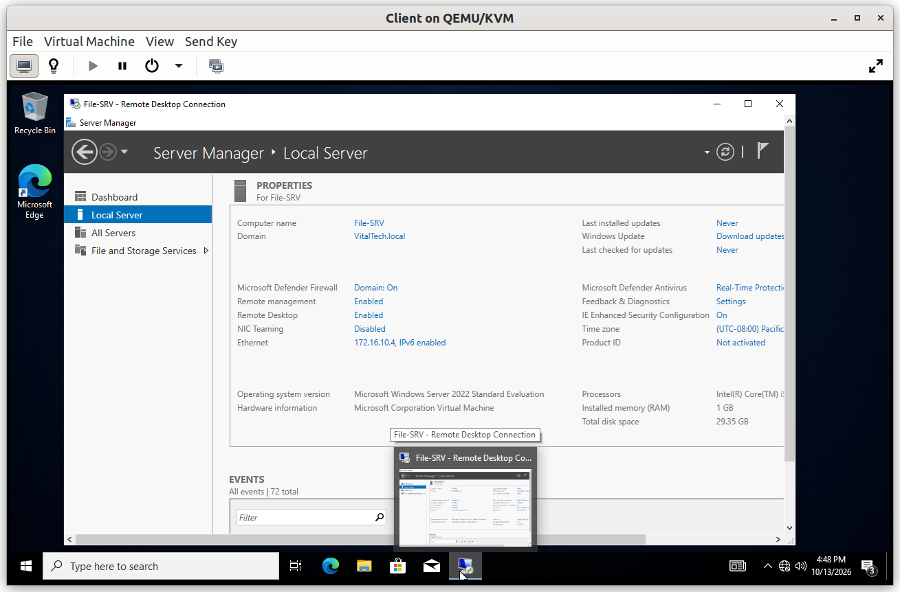

## GPO - Firewall - File Server

**Scope**: linked to `OU_Server`, security filtering limited to the computer account `File-SRV$`.

**Why**: file sharing runs over SMB on TCP 445. The port is opened on the file server only, so no other server exposes file shares.

**Configuration**

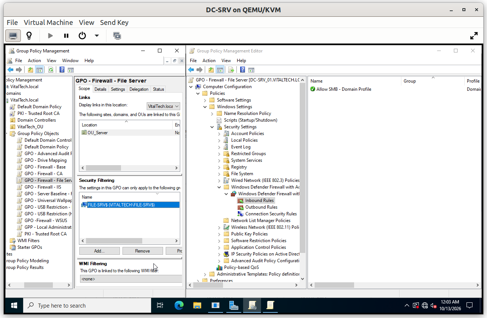

### Verification

#### V1. SMB open on the file server

- **Test**: from the client, run `Test-NetConnection File-SRV -Port 445`.
- **Expected**: `TcpTestSucceeded : True`.
- **Result**: ✅

#### V2. SMB closed on another server

- **Test**: from the client, run `Test-NetConnection IIS-SRV -Port 445`.
- **Expected**: `TcpTestSucceeded : False`. The rule applies only to `File-SRV`, which proves that the security filtering works.
- **Result**: ✅

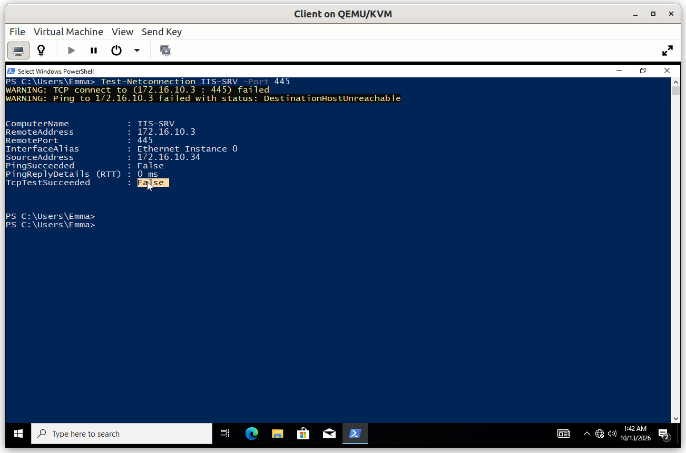

---

## GPO - Firewall - IIS

**Scope**: linked to `OU_Server`, security filtering limited to the computer account `IIS-SRV$`.

**Why**: the web server must accept HTTP and HTTPS connections for the `dev` and `staging` sites. These ports are opened on `IIS-SRV` only.

**Configuration**

### Verification

#### V1. HTTPS open on the web server

- **Test**: from the client, run `Test-NetConnection IIS-SRV -Port 443`.
- **Expected**: `TcpTestSucceeded : True`.
- **Result**: ✅

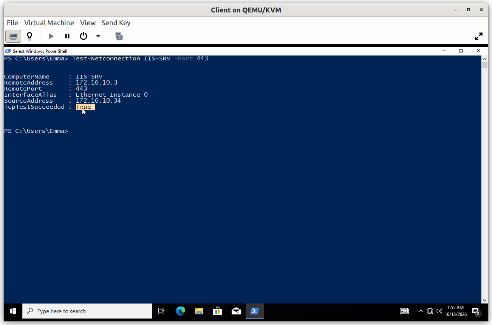

#### V2. HTTPS closed on another server

- **Test**: from the client, run `Test-NetConnection File-SRV -Port 443`.
- **Expected**: `TcpTestSucceeded : False`.
- **Result**: ✅

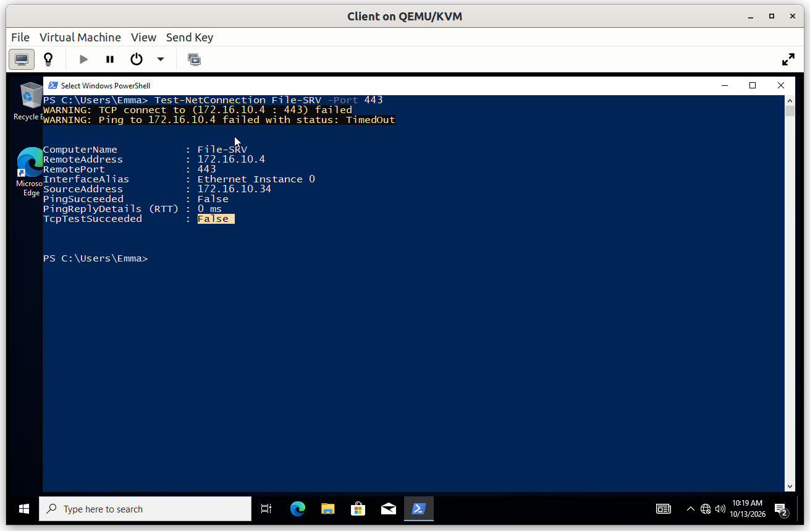

---

## GPO - Firewall - CA

**Scope**: linked to `OU_Server`, security filtering limited to the computer account `CA-SRV$`.

**Why**: the Issuing CA has two network roles. It publishes its CRL and AIA over HTTP (TCP 80), so that clients can check certificate revocation, and it receives certificate requests from other servers through RPC (endpoint mapper on TCP 135 and the dynamic port range 49152-65535). Without the RPC rules, a server such as `IIS-SRV` cannot enroll for a certificate.

**Configuration**

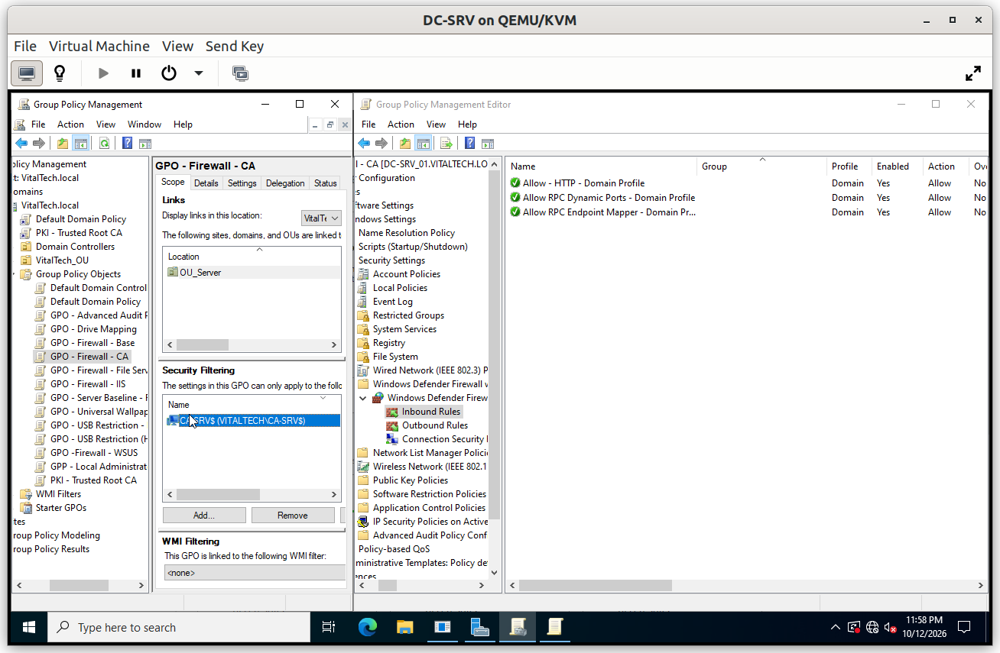

### Verification

#### V1. Root CA certificate and CRL reachable over HTTP

- **Test**: from the client, open `http://pki.VitalTech.local/pki/VitalTech-root-ca.crl` and `http://pki.VitalTech.local/pki/VitalTech-root-ca.crt` in a browser.
- **Expected**: both files are downloaded, which proves that the firewall allows HTTP to the CA and that the certificate and the revocation list are published. The directory URL itself answers 403, because directory browsing is disabled: clients fetch each file by its exact URL.
- **Result**: ✅

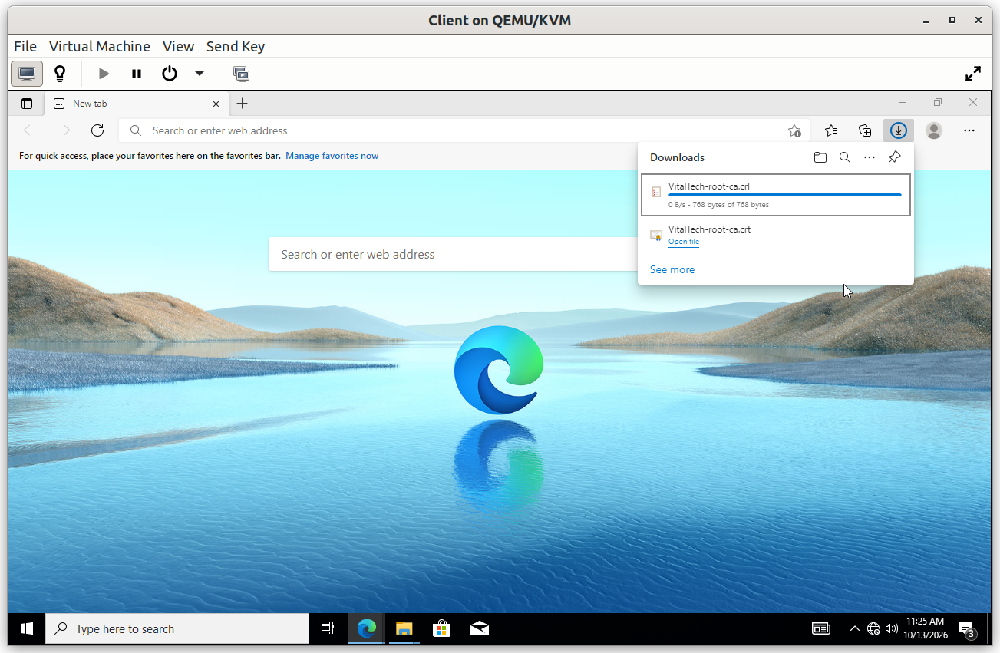
 
#### V2. HTTPS closed on the CA

- **Test**: from the client, run `Test-NetConnection CA-SRV -Port 443`.
- **Expected**: `TcpTestSucceeded : False`. The CA serves its CRL over HTTP only.
- **Result**: ✅

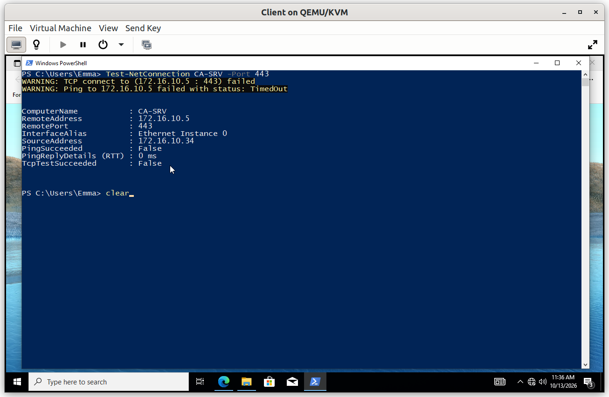

The RPC rules are proven by the certificate enrollment of `IIS-SRV`, documented in [`07_IIS`](../07_IIS/).

---

## GPO - Firewall - WSUS

**Scope**: linked to `OU_Server`, security filtering limited to the computer account `WSUS-SRV$`.

**Why**: a WSUS server receives client connections on TCP 8530 (HTTP) and 8531 (HTTPS). The rule opens these two ports on that server only.

**Configuration**

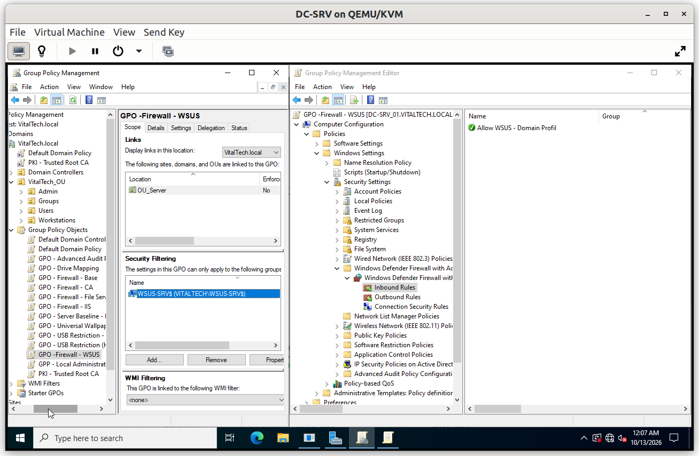

**Limitation**: this GPO is prepared but not tested. WSUS is not deployed in this lab, because the environment has no Internet access to synchronize updates.
