# Group Policy: Access Control

Two policies control who can connect to the servers and who holds administrator rights on each machine: one enables Remote Desktop on the servers, the other grants local administrator rights by role.

## Summary

| GPO | Linked to | Purpose |
|---|---|---|
| GPO - Server Baseline - Remote Access | `OU_Server` | Enables Remote Desktop on every server |
| GPP - Local Administrators | `Workstations` | Adds the right administrator group to the local Administrators group of each machine type |

---

## GPO - Server Baseline - Remote Access

**Scope**: linked to `OU_Server`, so it applies to every server of the OU.

**Why**: servers are administered remotely, so Remote Desktop must be enabled on all of them in the same way. Enabling it by policy avoids configuring each server by hand and keeps the setting from drifting. Enabling the service does not open the network path or grant access to everyone: the firewall limits the source to the lab subnet (see [`01_Network_Security`](01_Network_Security.md)), and only administrators and members of *Remote Desktop Users* may log on.

**Configuration**

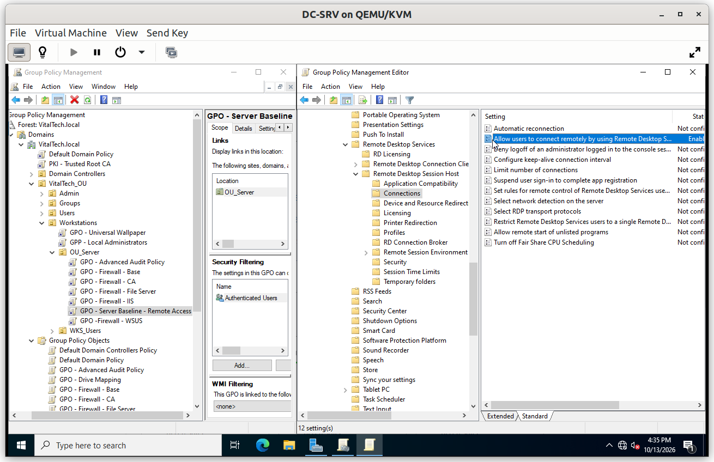

### Verification

#### V1. Administrator allowed

- **Test**: from the Windows 10 client, open an RDP session to `File-SRV` with a server administrator account.
- **Expected**: the session opens.
- **Result**: ✅

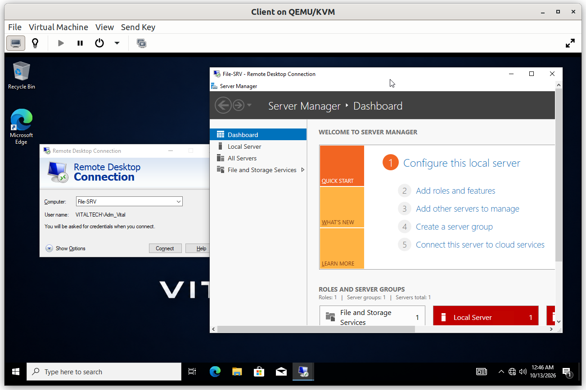

#### V2. Standard user refused

- **Test**: repeat the connection with a standard domain user (an HR user).
- **Expected**: the connection is refused because the account is not authorized to log on remotely.
- **Result**: ✅

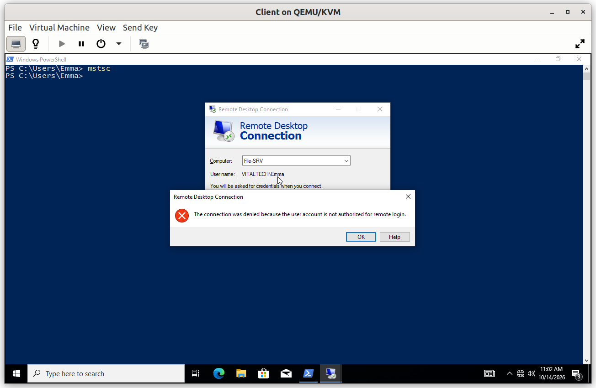

---

## GPP - Local Administrators

**Scope**: linked to `Workstations`, which is the parent of `OU_Server` and `WKS_Users`, so it reaches the servers and the client machines. Item-level targeting decides which administrator group is added to which machine type.

**Why**: administration is split by role, as designed in [`01_Active_Directory`](../01_Active_Directory/01_DC-SRV_01/DC-SRV_01.md#step-5-administrator-accounts):

| Machine type | Targeted by | Group added to the local Administrators group |
|---|---|---|
| Servers | `OU_Server` | `GG_Admin_Server` |
| Client workstations | `WKS_Users` | `GG_Admin_User` |

The policy is a **Group Policy Preference** (Local Users and Groups) with the **Update** action, not a Restricted Group. *Update* adds the group and leaves the existing members in place, whereas a Restricted Group would replace the whole membership and could remove built-in administrators.

**Configuration**

The GPO contains two Local Users and Groups items, one per administrator type. Each item has its own item-level targeting.

*Server administrators (local Administrators group on servers)*

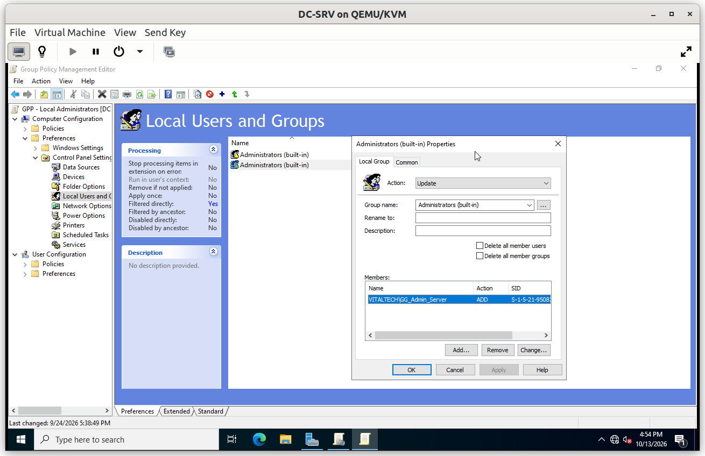

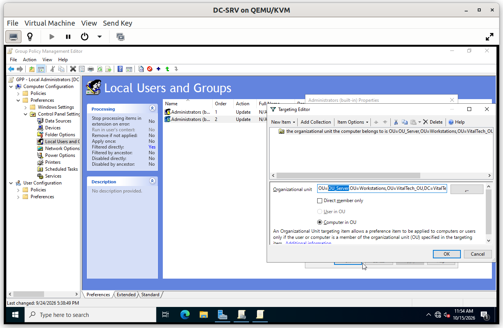

*Workstation administrators (local Administrators group on workstations)*

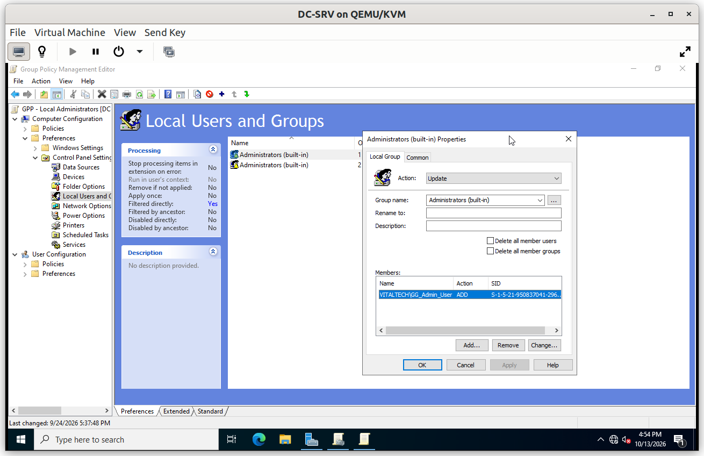

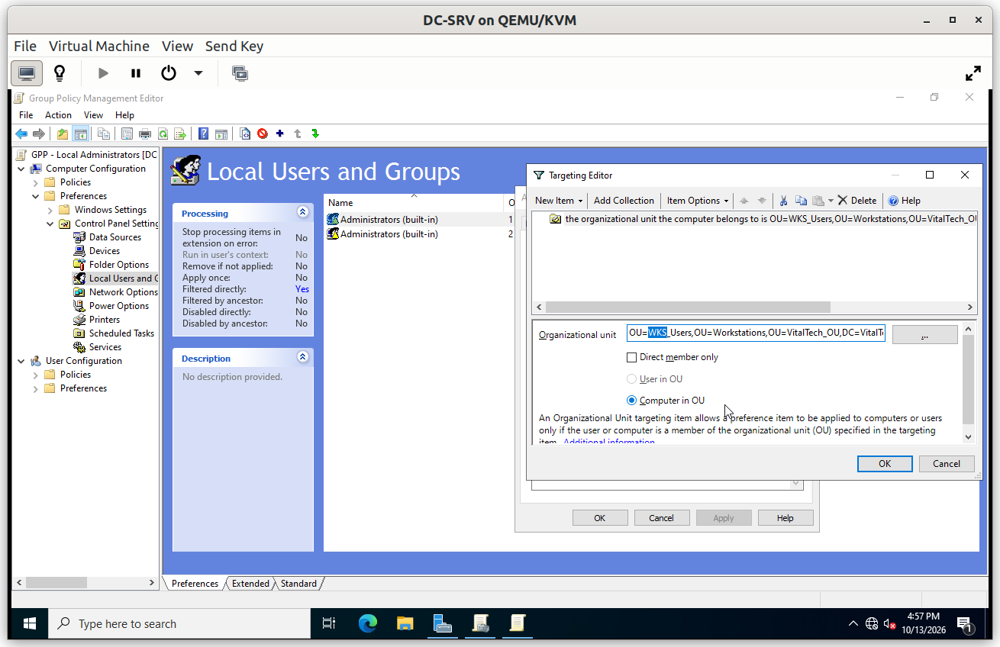

### Verification

The tests prove the separation in both directions. Use administrator accounts that are not members of Domain Admins, which would be local administrators everywhere regardless of this policy.

#### V1. Server administrators on a server

- **Test**: on `File-SRV`, run `net localgroup administrators`.
- **Expected**: `GG_Admin_Server` is listed and `GG_Admin_User` is not.
- **Result**: ✅

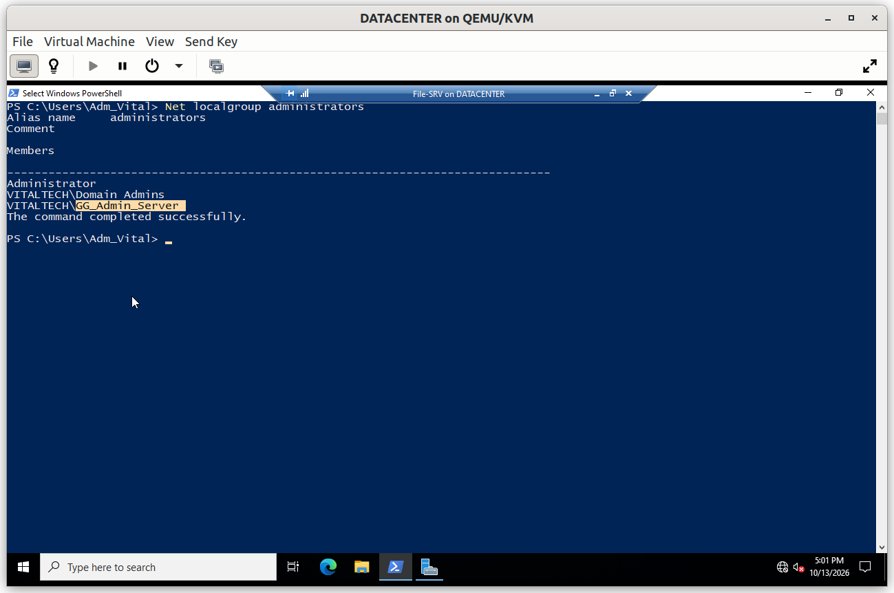

#### V2. Workstation administrators on the client

- **Test**: on the Windows 10 client, run `net localgroup administrators`.
- **Expected**: `GG_Admin_User` is listed and `GG_Admin_Server` is not.
- **Result**: ✅

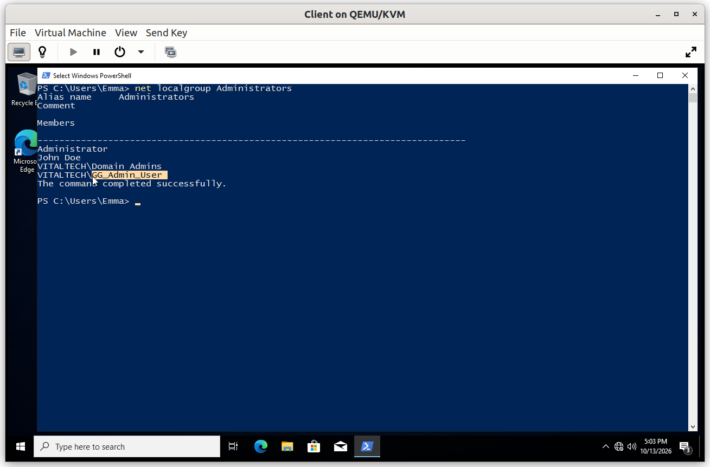

#### V3. A server administrator has no power on the client

- **Test**: on the client, open PowerShell as administrator and enter the credentials of a server administrator account.
- **Expected**: the elevation is refused.
- **Result**: ✅

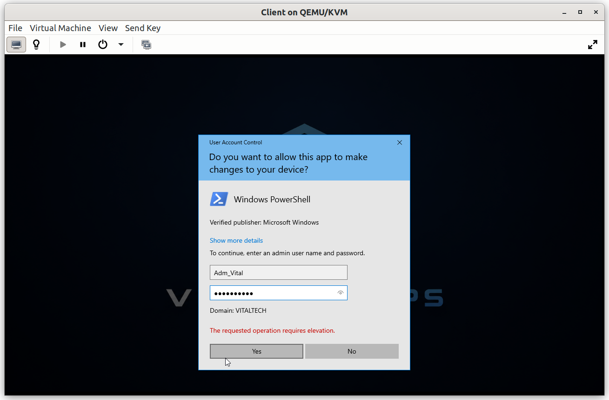

#### V4. A workstation administrator has no power on the server

- **Test**: open an RDP session to `File-SRV` with a workstation administrator account.
- **Expected**: the connection is refused, because this account is not an administrator of the server.
- **Result**: ✅

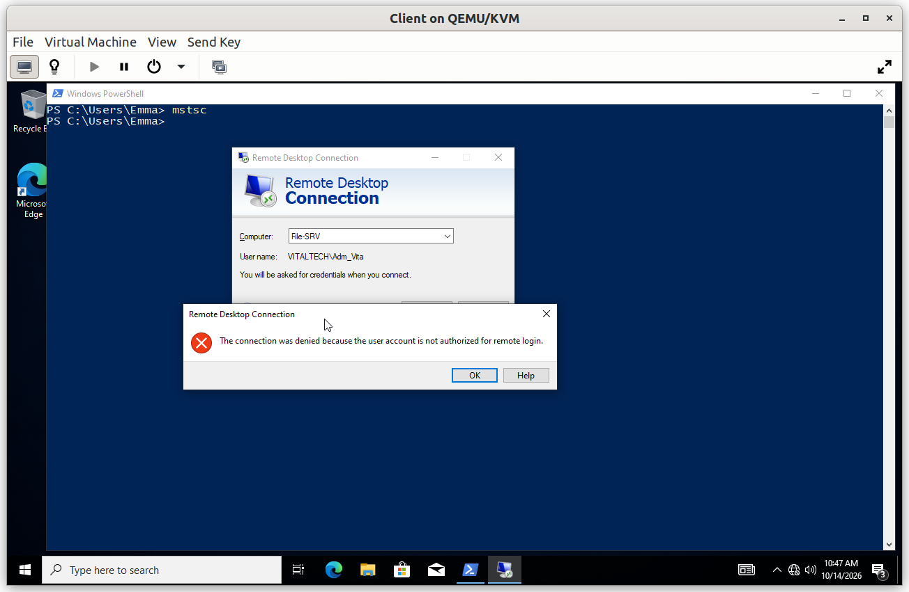