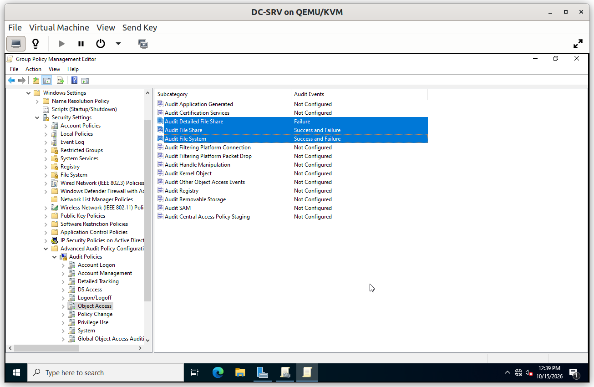
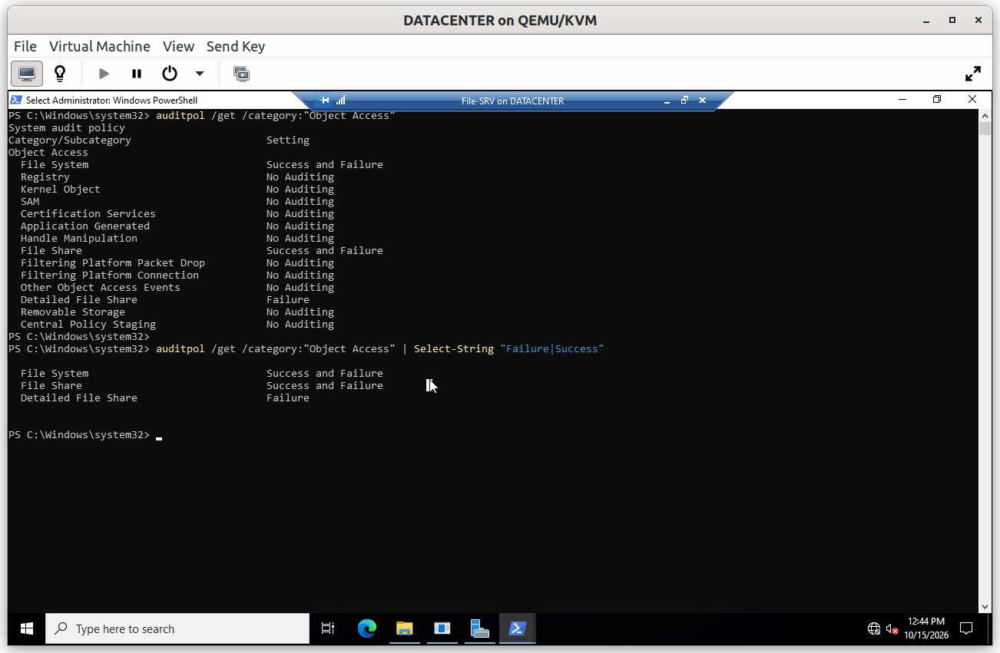
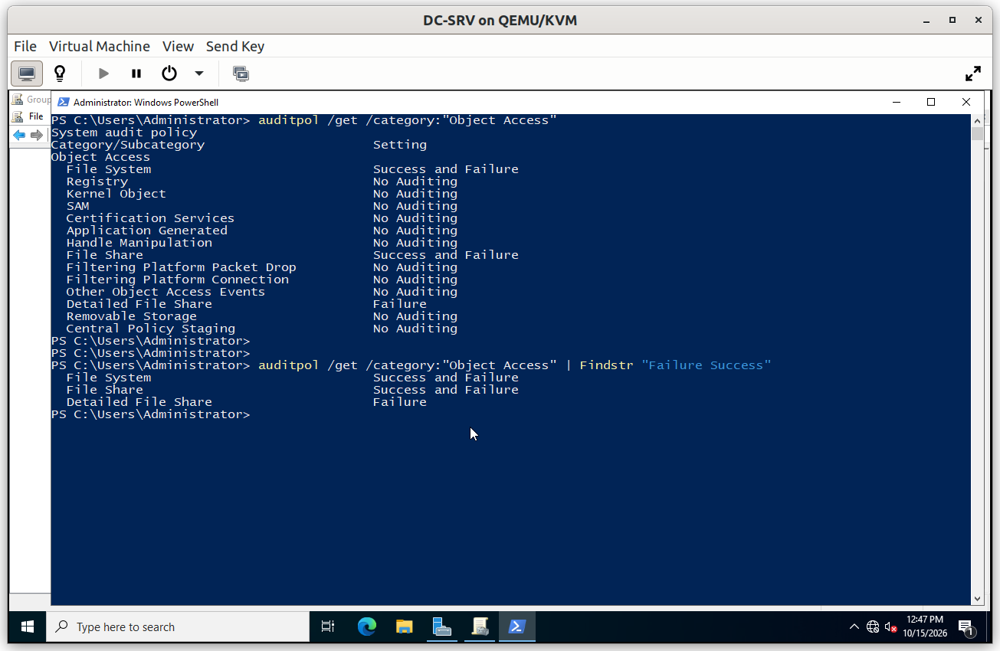
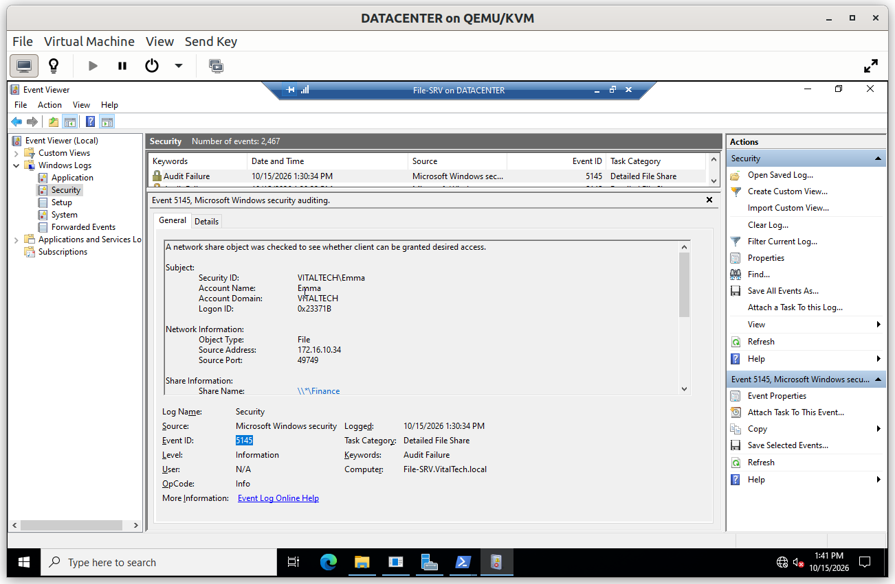

# Group Policy: Audit

Auditing records who accessed what, which allows investigating an incident after the fact. It is configured once by policy, so every server logs the same way.

## Summary

| GPO | Linked to | Purpose |
|---|---|---|
| GPO - Advanced Audit Policy | `OU_Server` and the Domain Controllers | Logs file system and file share access, successes and failures |

---

## GPO - Advanced Audit Policy

**Scope**: linked to `OU_Server` and to the Domain Controllers OU, so the file server, the other servers and the Domain Controllers audit the same categories.

**Why**: the *Advanced Audit Policy* gives per-subcategory control, where the legacy audit policy only offers broad categories. The policy enables three subcategories, each in **Success and Failure**:

- **File System**: access to files and folders that carry an audit entry (SACL)
- **File Share**: connections to a share
- **Detailed File Share**: every access request made through a share, including refused ones (event 5145)

Failures matter most: a refused access to a department folder is the typical trace of someone looking where they should not.

The audit entry itself is set on the shared folders and inherited by their content, since a policy only turns the audit subcategory on.

**Configuration**

### Verification

#### V1. Policy effective on the file server

- **Test**: on `File-SRV`, run `auditpol /get /category:"Object Access"`.
- **Expected**: *File System*, *File Share* and *Detailed File Share* show *Success and Failure*.
- **Result**: ✅

#### V2. Policy effective on a Domain Controller

- **Test**: on `DC-SRV_01`, run the same `auditpol` command.
- **Expected**: the same subcategories show *Success and Failure*.
- **Result**: ✅

#### V3. A refused access is logged

- **Test**: from the client, an HR user opens the share of another department, then on `File-SRV` open *Event Viewer* > *Windows Logs* > *Security* and filter on event ID 5145.
- **Expected**: a **Failure** event 5145 records the account, the share and the refused access.
- **Result**: ✅

