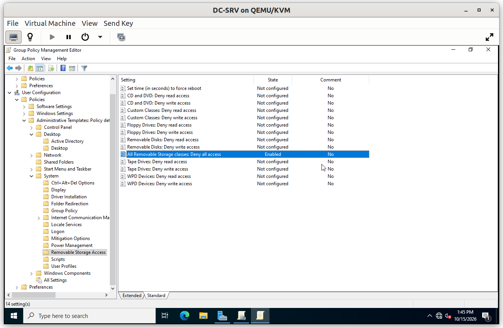
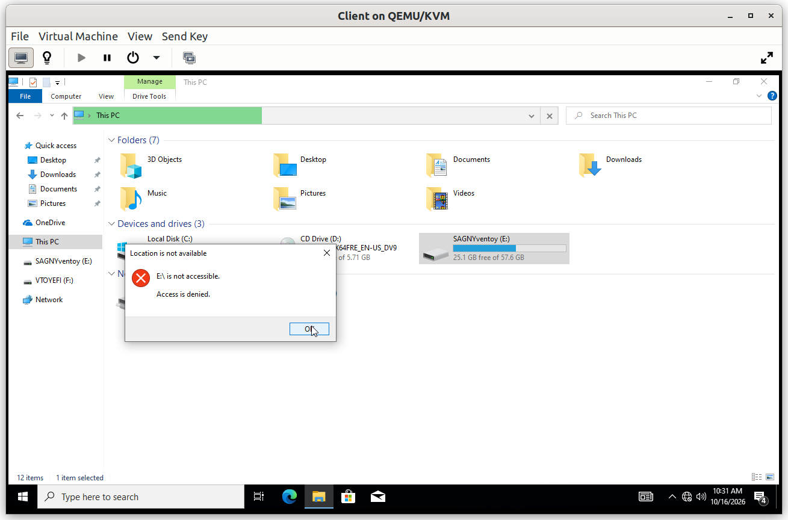
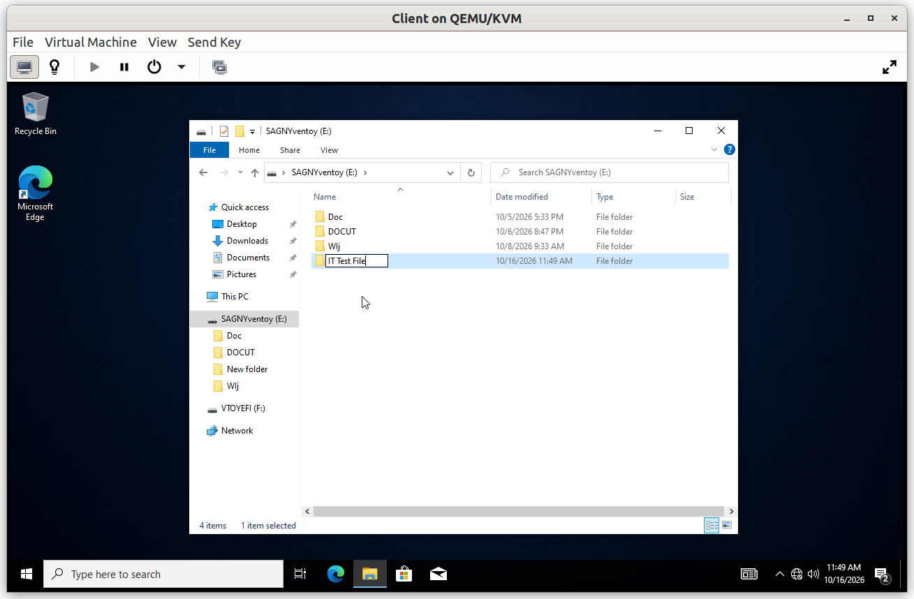
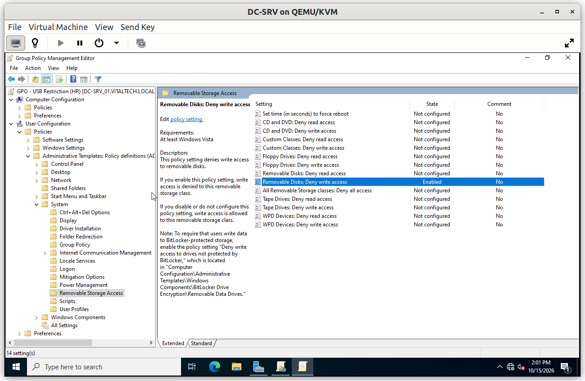
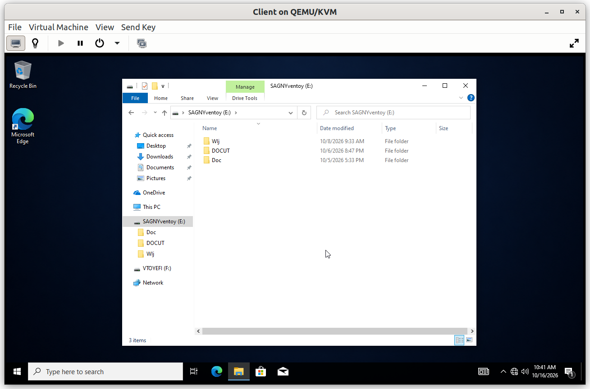

# Group Policy: Data Protection

Removable storage is the easiest way to take data out of a company. Two policies restrict it for the departments that handle sensitive files, with a level of restriction adapted to each department.

## Summary

| GPO | Linked to | Restriction |
|---|---|---|
| GPO - USB Restriction - Finance | `OU_Finance` | Removable storage fully denied |
| GPO - USB Restriction - HR | `OU_HR` | Write denied, read allowed |

Both policies are **user** settings, so they follow the user: the restriction applies to a Finance or HR user on any machine, and does not affect other users of the same machine.

---

## GPO - USB Restriction - Finance

**Scope**: linked to `OU_Finance`.

**Why**: the Finance department handles financial data, so no file may leave on a removable disk, and no external file may enter. The policy denies read and write access to removable storage.

**Configuration**

### Verification

#### V1. Removable disk blocked for Finance

- **Test**: on the client, sign in as a Finance user and attach a removable disk.
- **Expected**: the disk cannot be opened and Windows reports that access is denied.
- **Result**: ✅

#### V2. Other departments are not affected

- **Test**: attach the same removable disk and sign in as an IT user.
- **Expected**: the disk opens normally, which proves that the policy is limited to its OU.
- **Result**: ✅

---

## GPO - USB Restriction - HR

**Scope**: linked to `OU_HR`.

**Why**: HR staff legitimately import documents such as CVs from removable disks, so reading is allowed. Writing is denied, which prevents personal data from leaving on a disk. The restriction is lighter than for Finance because the need is different.

**Configuration**

### Verification

#### V1. Reading allowed

- **Test**: on the client, sign in as an HR user, attach a removable disk that contains a file and open it.
- **Expected**: the file can be read.
- **Result**: ✅

#### V2. Writing denied

- **Test**: with the same user, copy a file to the removable disk.
- **Expected**: the copy is refused.
- **Result**: ✅

