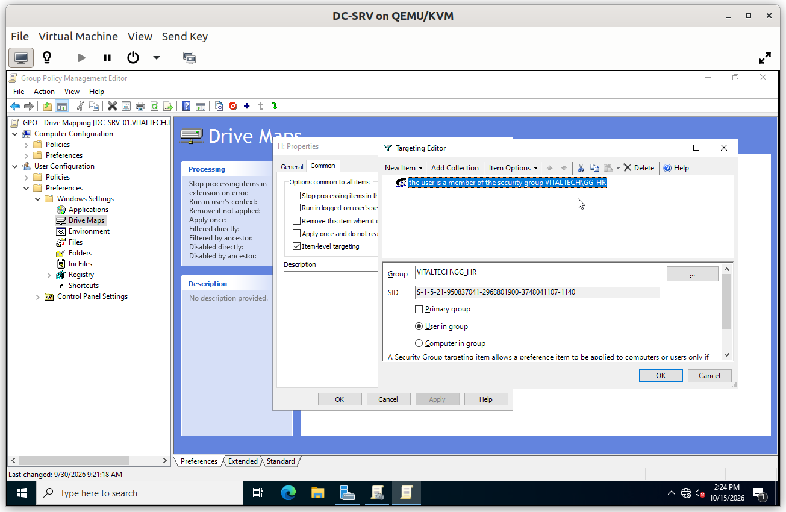
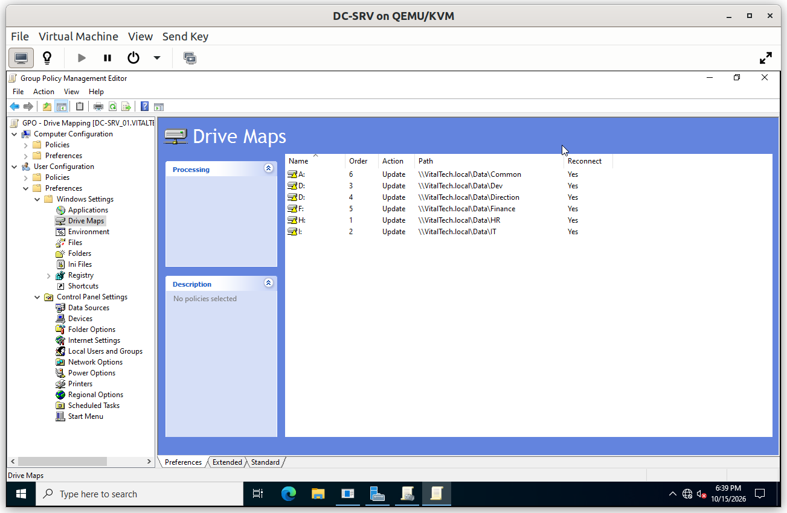
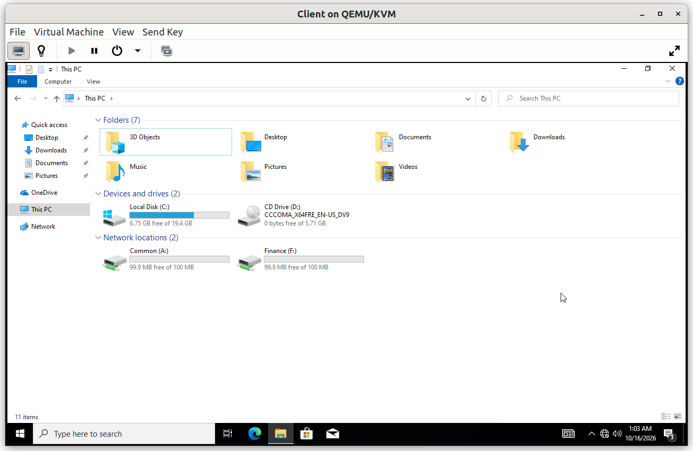
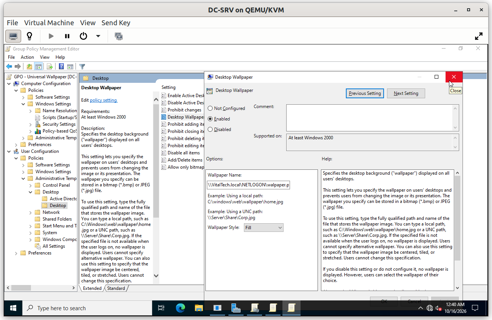
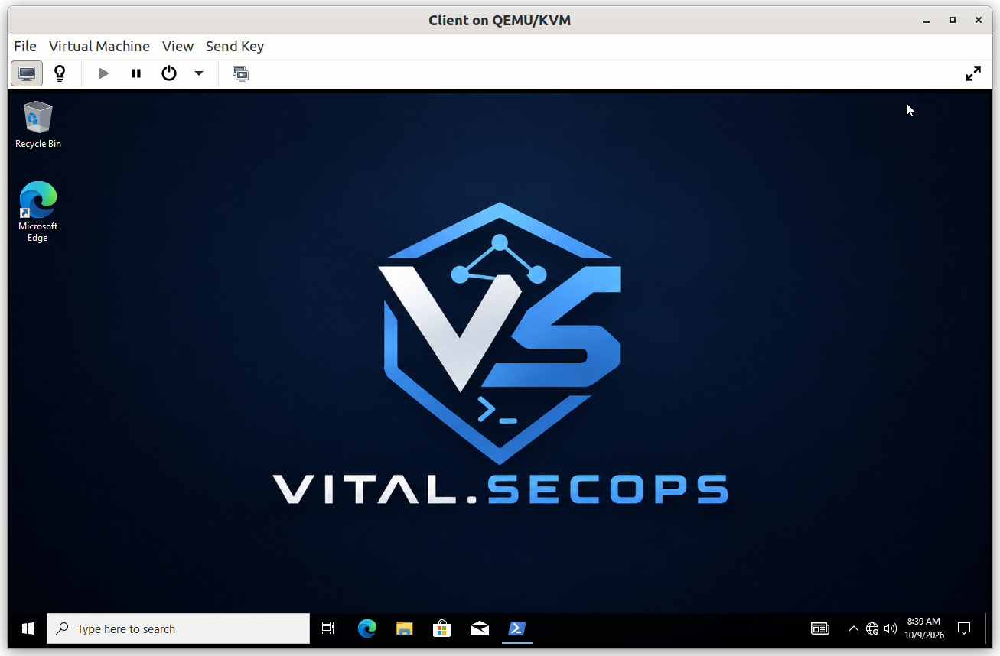
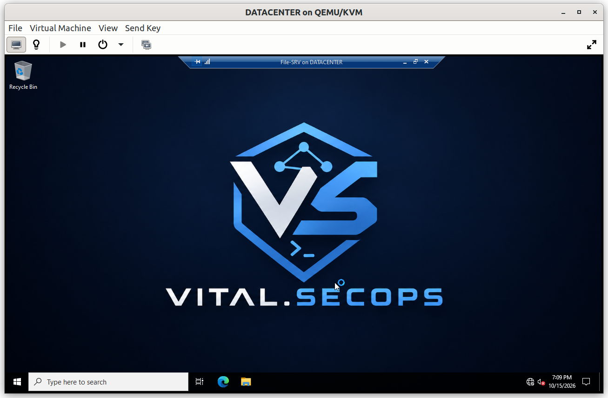
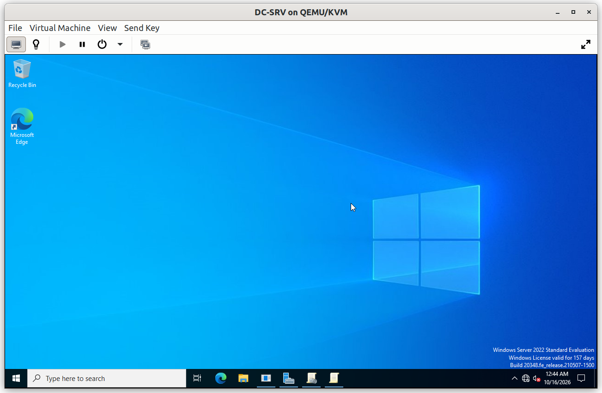

# Group Policy: User Environment

These policies shape what users see when they sign in: their network drives and the corporate wallpaper.

## Summary

| GPO | Linked to | Purpose |
|---|---|---|
| GPO - Drive Mapping | `Users` | Maps the network drives each user needs, according to group membership |
| GPO - Universal Wallpaper | `Workstations` | Applies one corporate wallpaper on every machine |

---

## GPO - Drive Mapping

**Scope**: linked to `Users`, so it applies to every user account of the company. Item-level targeting decides which drive each user receives.

**Why**: users should open a drive in the Explorer, not type a network path. Each drive is mapped to a share on `File-SRV`, with the path written as `\\File-SRV\<share>` (the domain name, not the server name), so the drives keep working if the share moves to another server.

Item-level targeting uses the **global groups** (`GG_*`), which matches the AGDLP model: users belong to global groups, and the domain local groups only appear in permissions. A dedicated `GG_Common` group gives access to the shared folder used by all departments.

**Configuration**

### Verification

#### V1. An HR user receives the HR drives

- **Test**: sign in on the client as an HR user and open *This PC*.
- **Expected**: the HR drive and the common drive are mapped, and no other department drive appears.
- **Result**: ✅

#### V2. A Finance user receives the Finance drives

- **Test**: sign in as a Finance user and open *This PC*.
- **Expected**: the Finance drive and the common drive are mapped, and the HR drive does not appear.
- **Result**: ✅

The access rights behind each drive are tested in [`05_File_Server`](../05_File_Server/).

---

## GPO - Universal Wallpaper

**Scope**: linked to `Workstations`, the parent of `OU_Server` and `WKS_Users`. It therefore applies to the client machines and to the member servers. The Domain Controllers are outside this OU and are not affected.

**Why**: a single corporate wallpaper on every machine gives the company a consistent identity and shows at first glance that the machine is managed by policy. The user cannot change it, and Windows displays that the setting is managed by the organization.

**Configuration**

### Verification

#### V1. Wallpaper on the client

- **Test**: sign in on the Windows 10 client.
- **Expected**: the corporate wallpaper is displayed, and the personalization settings report that they are managed by the organization.
- **Result**: ✅

#### V2. Wallpaper on a member server

- **Test**: sign in on `File-SRV`.
- **Expected**: the same wallpaper is displayed.
- **Result**: ✅

#### V3. No wallpaper on the Domain Controller

- **Test**: sign in on `DC-SRV_01`.
- **Expected**: the default Windows background, which proves that the policy does not reach the Domain Controllers.
- **Result**: ✅

