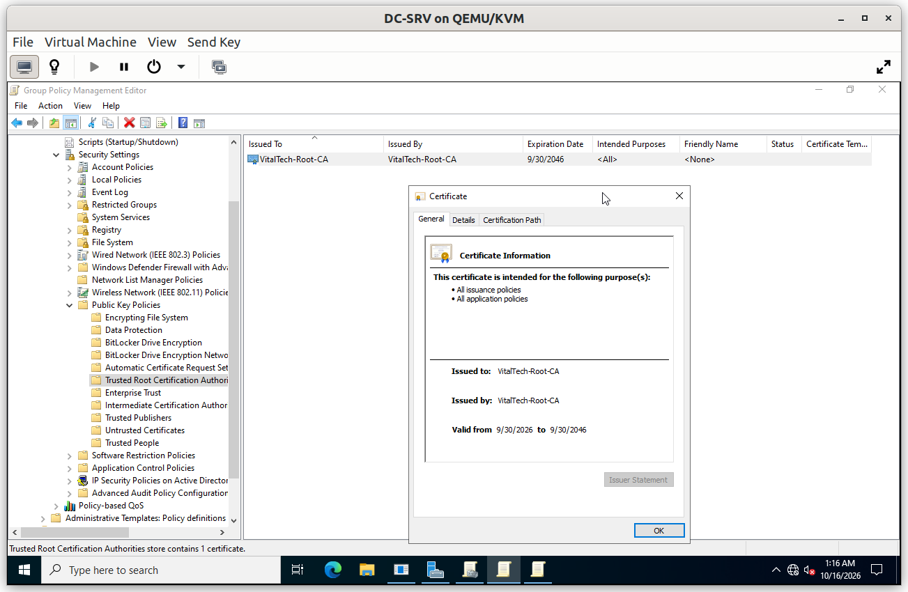
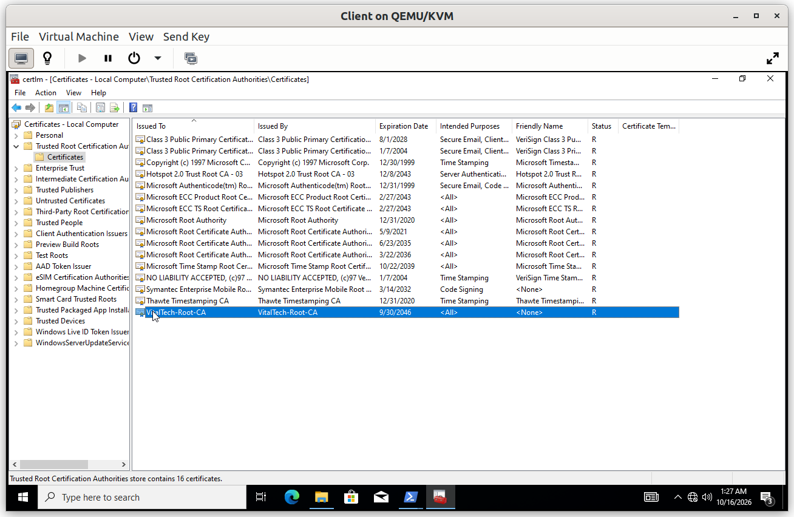
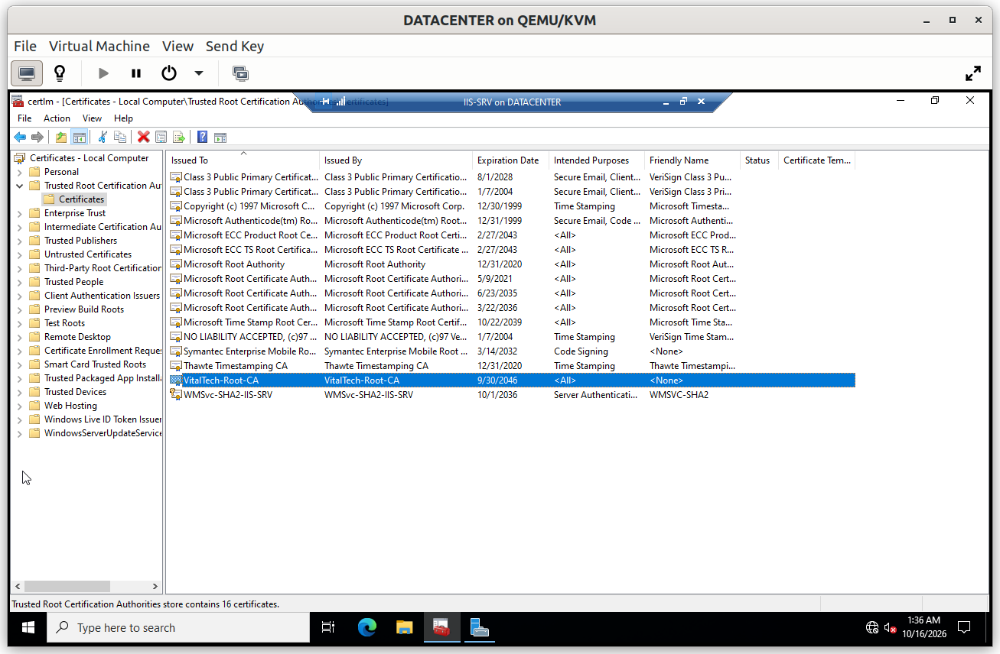

# Group Policy: Trust

A certificate is only useful if the machines that receive it trust the authority that issued it. This policy distributes the trust in the company's Root CA to the whole domain.

## Summary

| GPO | Linked to | Purpose |
|---|---|---|
| PKI - Trusted Root CA | Domain | Installs the Root CA certificate as a trusted root on every domain machine |

---

## PKI - Trusted Root CA

**Scope**: linked at the domain level, so every domain machine receives it.

**Why**: the Root CA (`VitalTech-Root-CA`) is offline and has no automatic way to reach the machines. The policy imports its certificate into the *Trusted Root Certification Authorities* store of each computer. Every certificate signed by the Issuing CA, such as the HTTPS certificate of the web server, is then trusted without any warning and without manual installation on each machine.

**Configuration**

### Verification

#### V1. Root certificate on the client

- **Test**: on the Windows 10 client, open `certlm.msc` and browse to *Trusted Root Certification Authorities* > *Certificates*.
- **Expected**: `VitalTech-Root-CA` is listed among the trusted roots..
- **Result**: ✅

#### V2. Root certificate on a server

- **Test**: on `IIS-SRV`, open `certlm.msc` and browse to *Trusted Root Certification Authorities* > *Certificates*.
- **Expected**: `VitalTech-Root-CA` is listed as well.
- **Result**: ✅

The effect for users, an HTTPS page opening without a certificate warning, is shown in [`07_IIS`](../07_IIS/).
