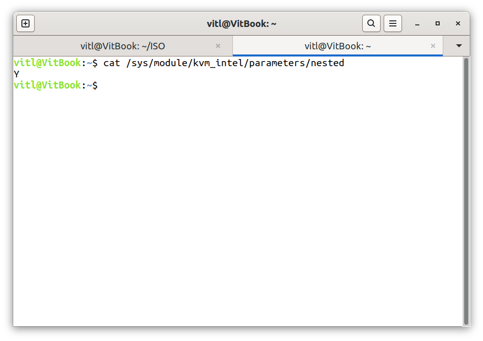
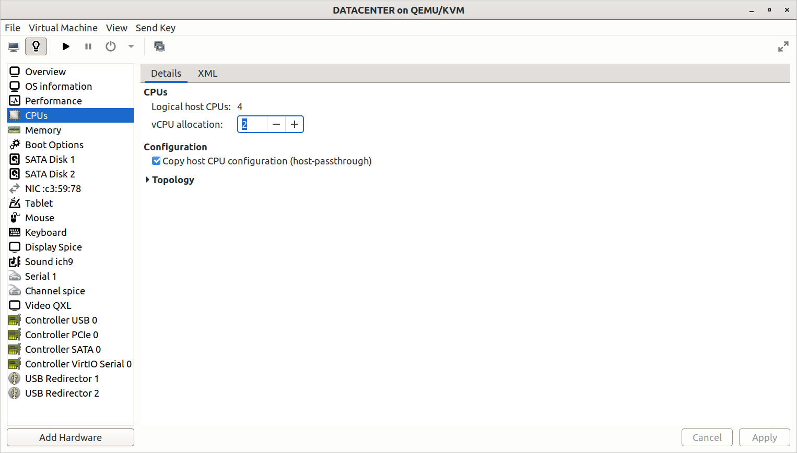
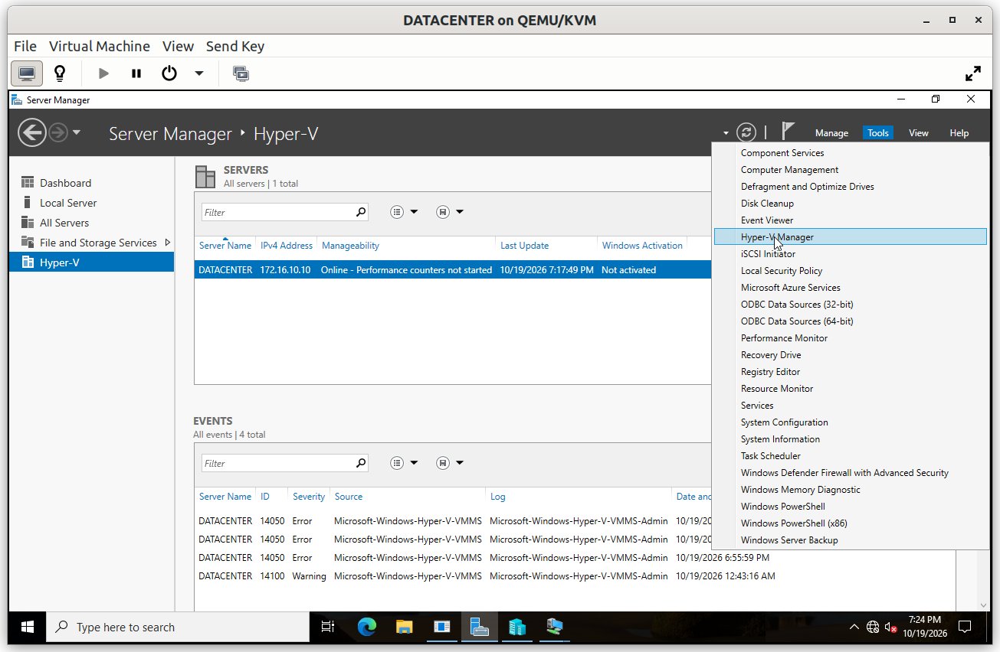
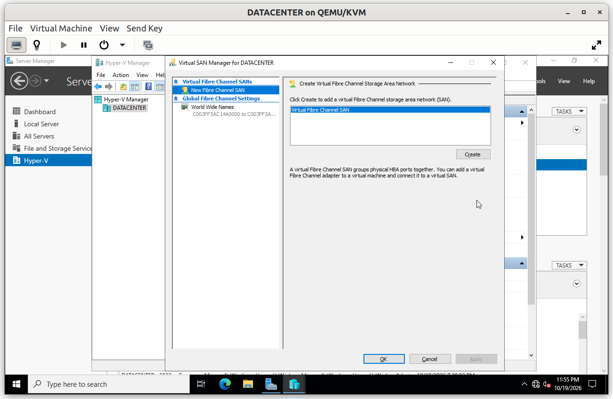
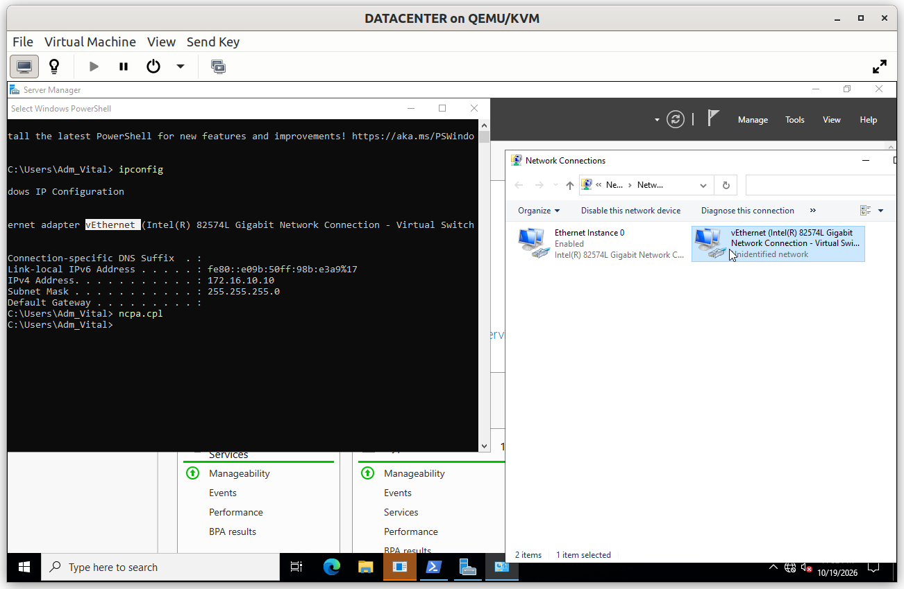
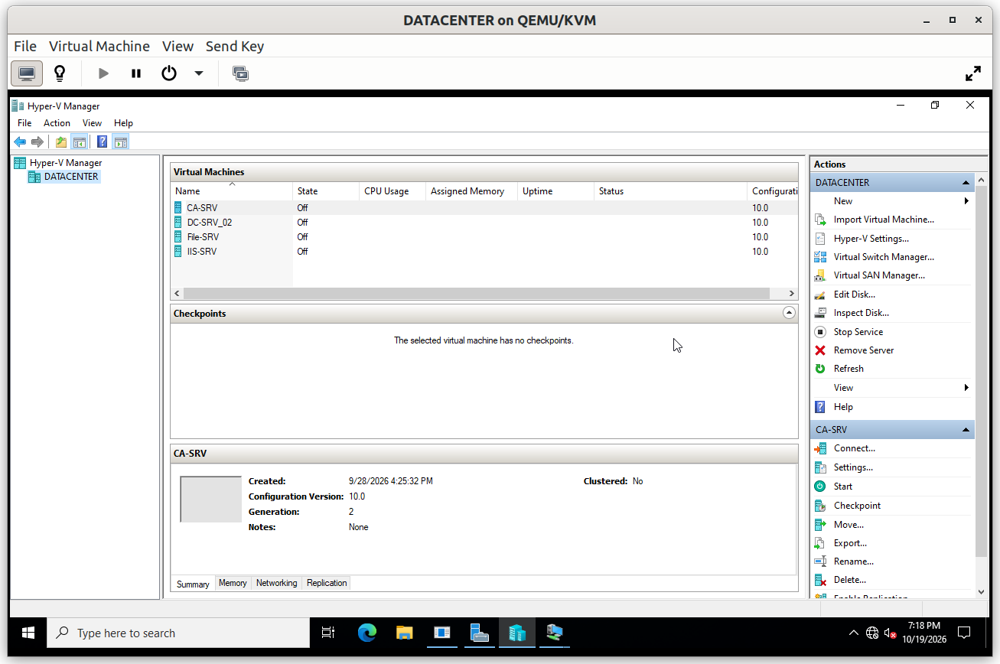
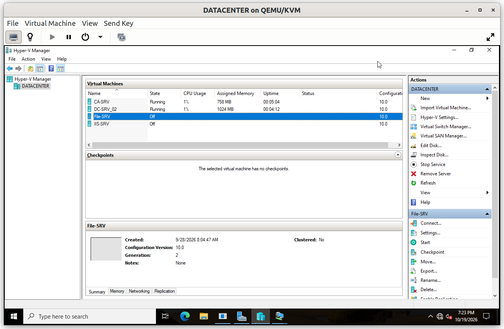
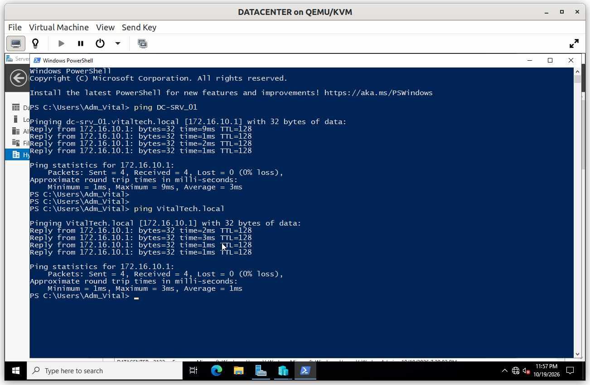

# DATACENTER: Hyper-V Host

`DATACENTER` is a Windows Server host running the Hyper-V role. It is itself a virtual machine on QEMU/KVM, so it relies on **nested virtualization**. It hosts four of the lab servers (`DC-SRV_02`, `File-SRV`, `CA-SRV` and `IIS-SRV`) on the same isolated network as the rest of the lab.

## Summary

| # | Step | Purpose |
|---|---|---|
| 1 | Nested virtualization | Let a virtual machine run its own virtual machines |
| 2 | Hyper-V role | Turn the server into a virtualization host |
| 3 | External virtual switch | Connect the hosted servers to the lab network |
| 4 | Hosted virtual machines | Run four servers on a single host |

---

## Step 1. Nested virtualization

Hyper-V needs the processor's hardware virtualization extensions, which a virtual machine does not see by default. On the QEMU/KVM host, nested virtualization is enabled for the Intel processor, and the CPU of `DATACENTER` is set to **host-passthrough**, so that it receives the extensions of the physical processor.

```bash
cat /sys/module/kvm_intel/parameters/nested
```

The command returns `Y` when nested virtualization is enabled.





---

## Step 2. Hyper-V role

The **Hyper-V** role is installed from Server Manager, together with its management tools.



---

## Step 3. External virtual switch

An **external virtual switch** is bound to the network adapter of `DATACENTER`. The hosted servers connect to it and sit on the same `172.16.10.0/24` network as the servers and the client running directly on QEMU/KVM, so they communicate without any routing. The host keeps its own address, `172.16.10.10`, on the virtual adapter created by the switch.





---

## Step 4. Hosted virtual machines

| Virtual machine | Role |
|---|---|
| `DC-SRV_02` | Additional Domain Controller |
| `File-SRV` | File server |
| `CA-SRV` | Issuing Certification Authority |
| `IIS-SRV` | Web server |

Each virtual machine has **2048 MB of memory and 1 virtual processor**. `DC-SRV_01` and the client run directly on QEMU/KVM, next to `DATACENTER`.



### Verification

#### V1. Hosted servers running

- **Test**: open Hyper-V Manager on `DATACENTER`.
- **Expected**: the four virtual machines are listed with the state *Running*, which proves that nested virtualization works.
- **Result**: ✅



#### V2. Hosted servers on the lab network

- **Test**: on `DATACENTER`, run `ping 172.16.10.1`.
- **Expected**: `DC-SRV_01`, which runs directly on QEMU/KVM, replies, which proves that the virtual switch connects the hosted servers to the lab network.
- **Result**: ✅



---

## Limits

- Nested virtualization reduces performance, and each hosted server has a single virtual processor. This is enough for a laboratory, not for production.
- All hosted servers depend on a single host: if `DATACENTER` stops, they all stop.
