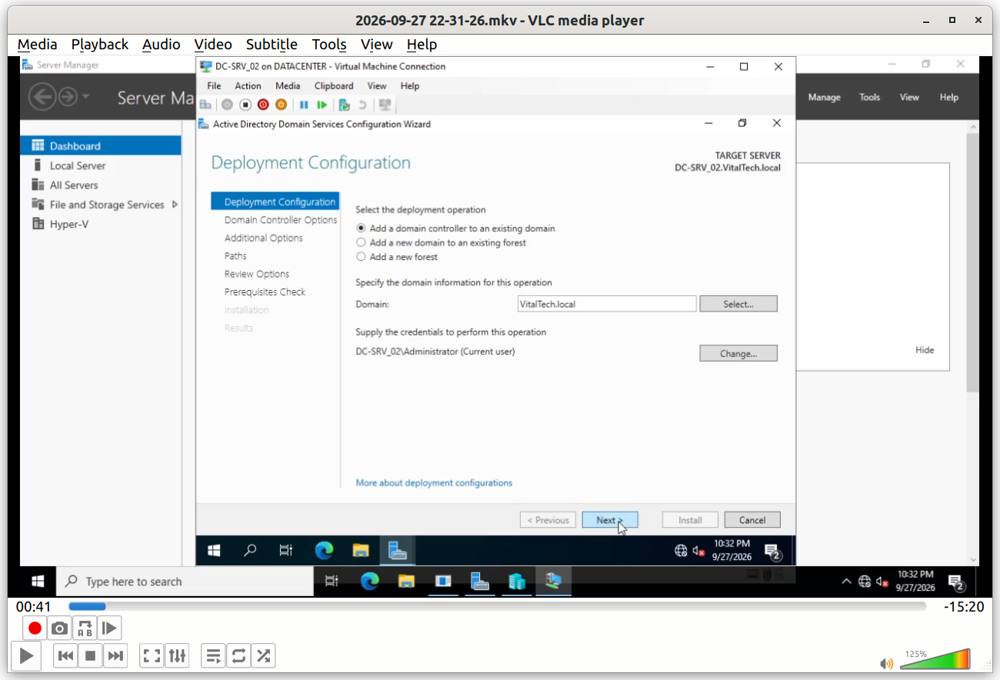
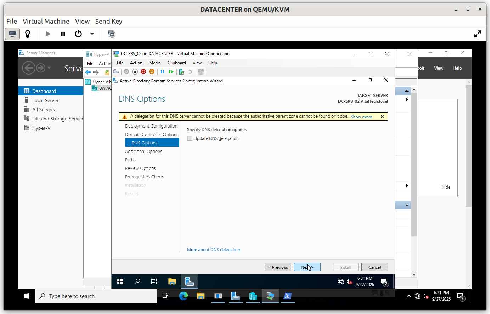
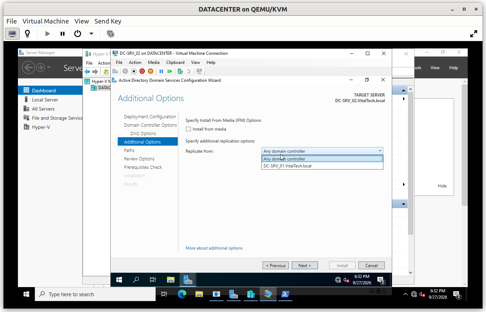
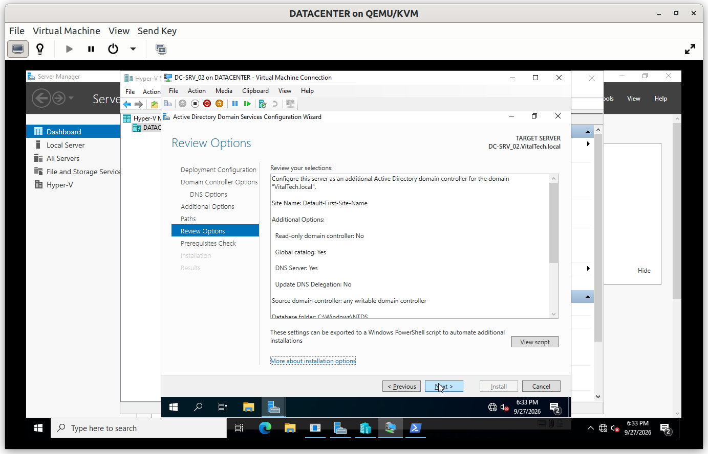
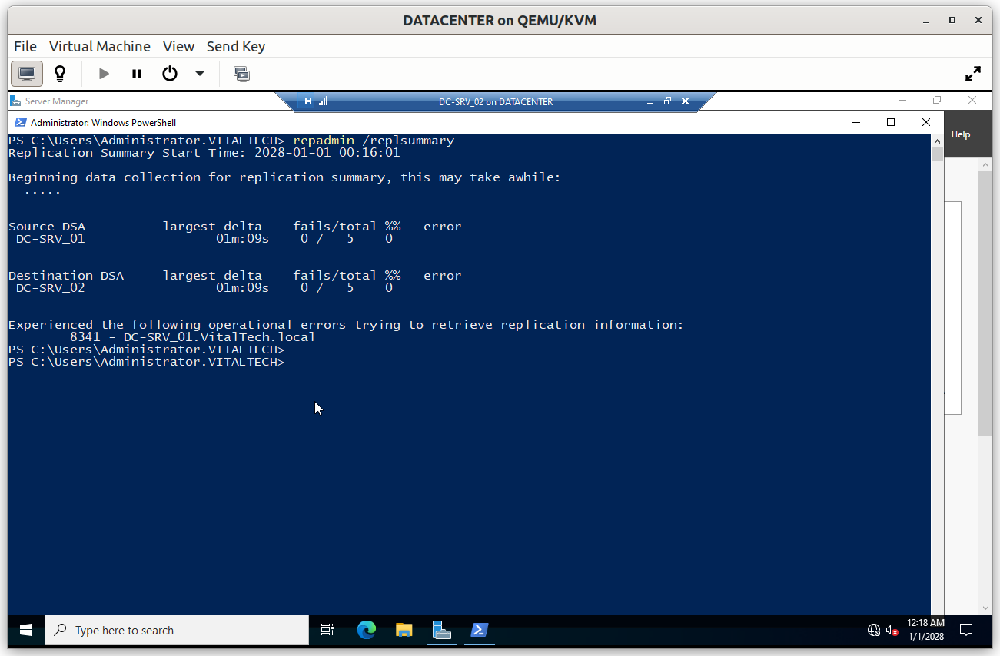
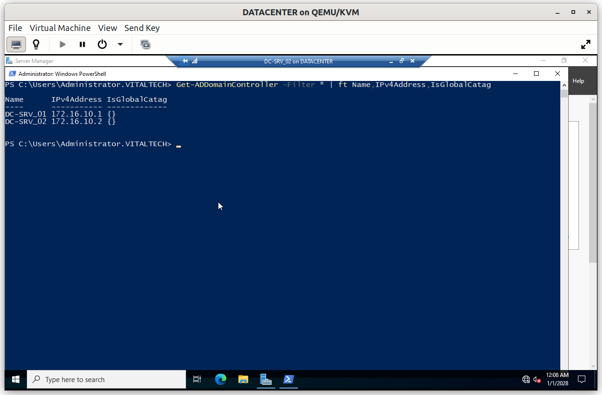
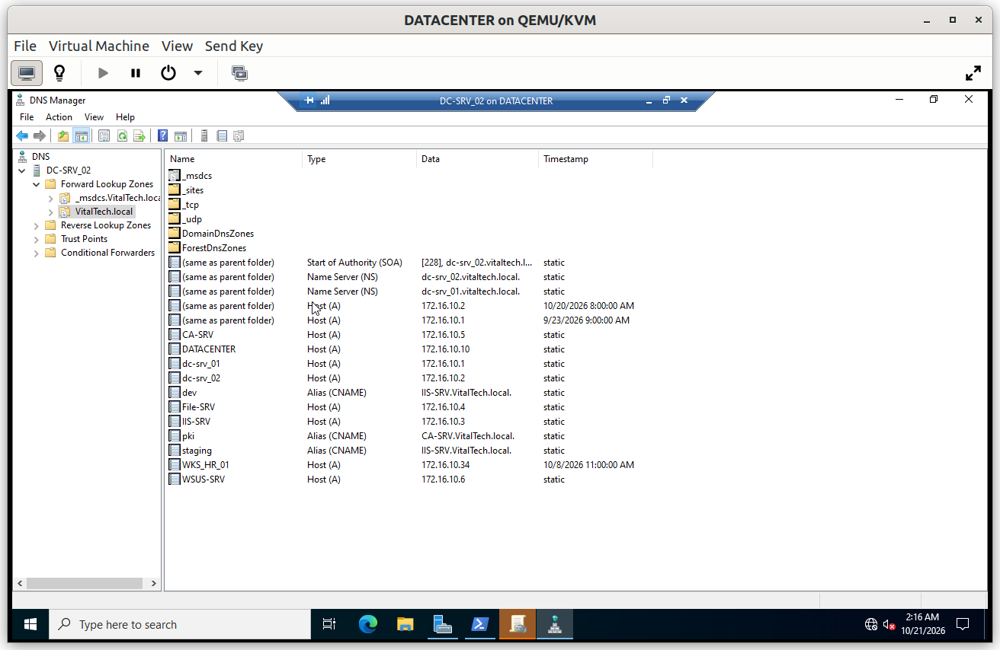
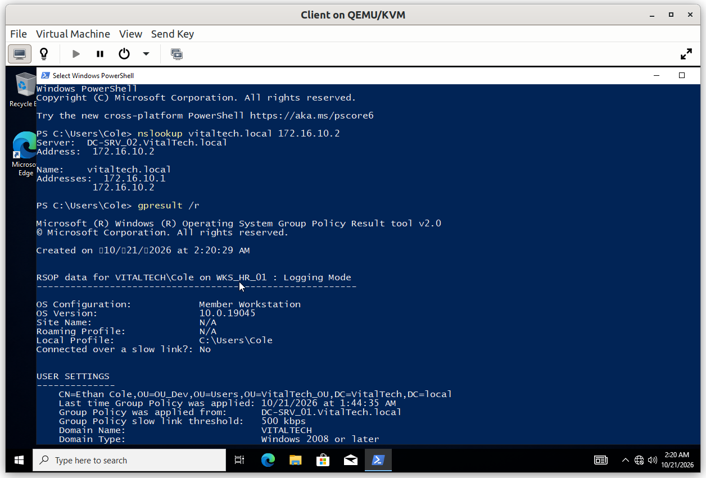

# DC-SRV_02: Additional Domain Controller

`DC-SRV_02` is a second Domain Controller of the same domain. It provides redundancy: authentication and DNS keep working if `DC-SRV_01` becomes unavailable. This document covers its promotion and the tests that prove replication.

## Summary

| # | Step | Purpose |
|---|---|---|
| 1 | Install the AD DS role | Same procedure as on `DC-SRV_01` |
| 2 | Promote the server to an additional Domain Controller | Join the existing domain `VitalTech.local` |
| 3 | Verify replication and service | Prove that both Domain Controllers are in sync |

---

## Prerequisites

| Item | Value |
|---|---|
| Computer name | `DC-SRV_02` |
| IP address | `172.16.10.2/24` (static) |
| Preferred DNS server | `172.16.10.1` (`DC-SRV_01`) |
| Domain membership | Joined to `VitalTech.local` |

The server must resolve the domain through `DC-SRV_01` before the promotion, otherwise it cannot locate the existing domain.

## Step 1. Install the AD DS role

The role is installed exactly as on `DC-SRV_01`: see [Step 1 of DC-SRV_01](../01_DC-SRV_01/DC-SRV_01.md#step-1-install-the-ad-ds-role).

---

## Step 2. Promote the server to an additional Domain Controller

The promotion differs from `DC-SRV_01` on one point: the server is added to the **existing domain**, instead of creating a new forest.

On the Deployment Configuration page, *Add a domain controller to an existing domain* is selected for `VitalTech.local`. The wizard proposes the local administrator of the server by default, which has no rights in the domain: through *Change...*, the credentials of a domain account allowed to add a Domain Controller are supplied.

The server is also set up as a DNS server and a Global Catalog, so that it can answer DNS queries and authenticate users on its own. The DNS Options page then warns that a DNS delegation cannot be created. This is expected: `VitalTech.local` is a private domain with no parent zone, so there is nothing to delegate from, and the warning is ignored.

On the Additional Options page, the source of the initial replication is chosen.

The Review Options page lists all the choices before the configuration is applied.

---

## Step 3. Verify replication and service

### V1. Replication summary

- **Test**: on a Domain Controller, run `repadmin /replsummary`.
- **Expected**: both Domain Controllers are listed with no replication failures.
- **Result**: ✅

### V2. Domain Controllers of the domain

- **Test**: run `Get-ADDomainController -Filter * | ft Name,IPv4Address,IsGlobalCatalog`.
- **Expected**: `DC-SRV_01` and `DC-SRV_02` are listed, both Global Catalogs.
- **Result**: ✅

### V3. DNS zone replicated

- **Test**: open the DNS console on `DC-SRV_02`.
- **Expected**: the zone `VitalTech.local` and its records are present without any manual copy.
- **Result**: ✅

### V4. Service from the client

- **Test**: from the Windows 10 client, run `nslookup` against `DC-SRV_02` and `gpresult /r`.
- **Expected**: names resolve through `DC-SRV_02` and the GPOs are applied.
- **Result**: ✅

