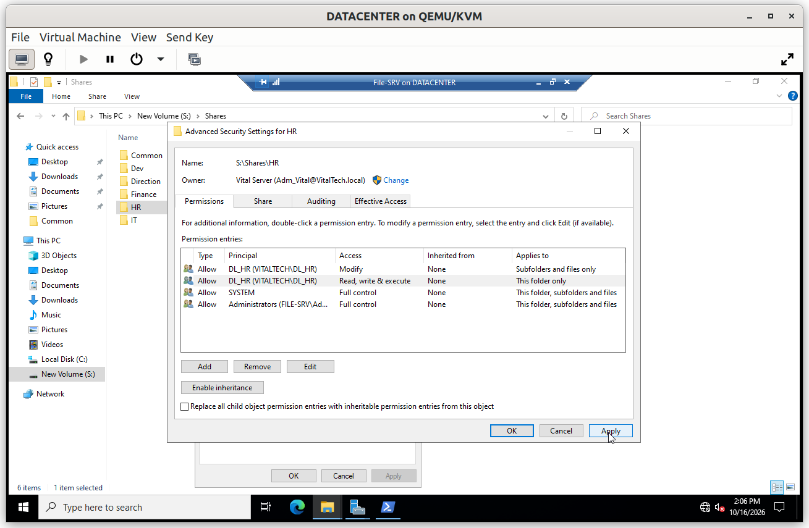
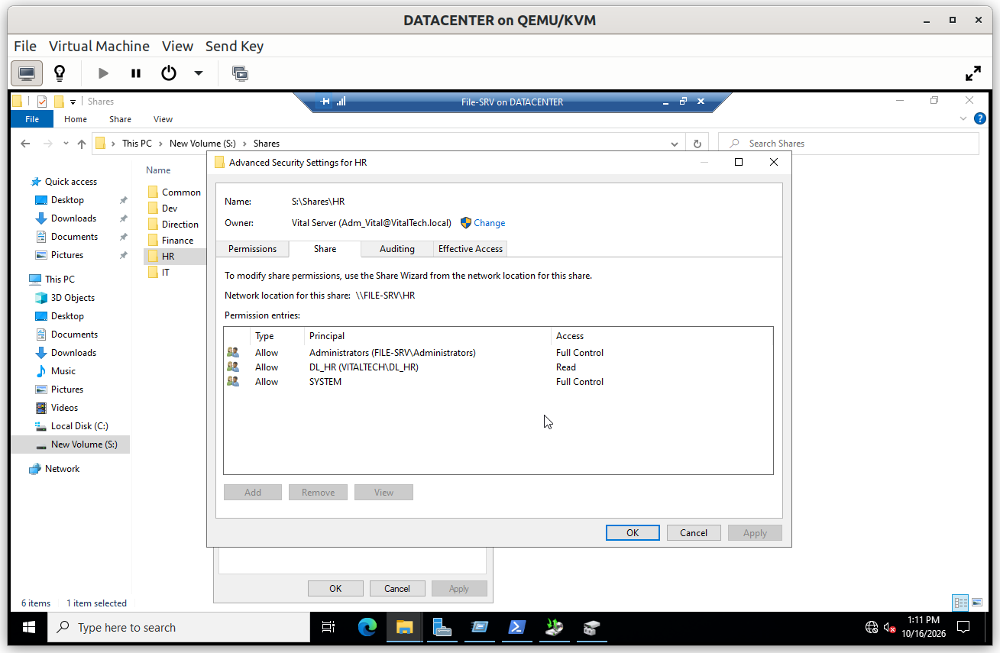
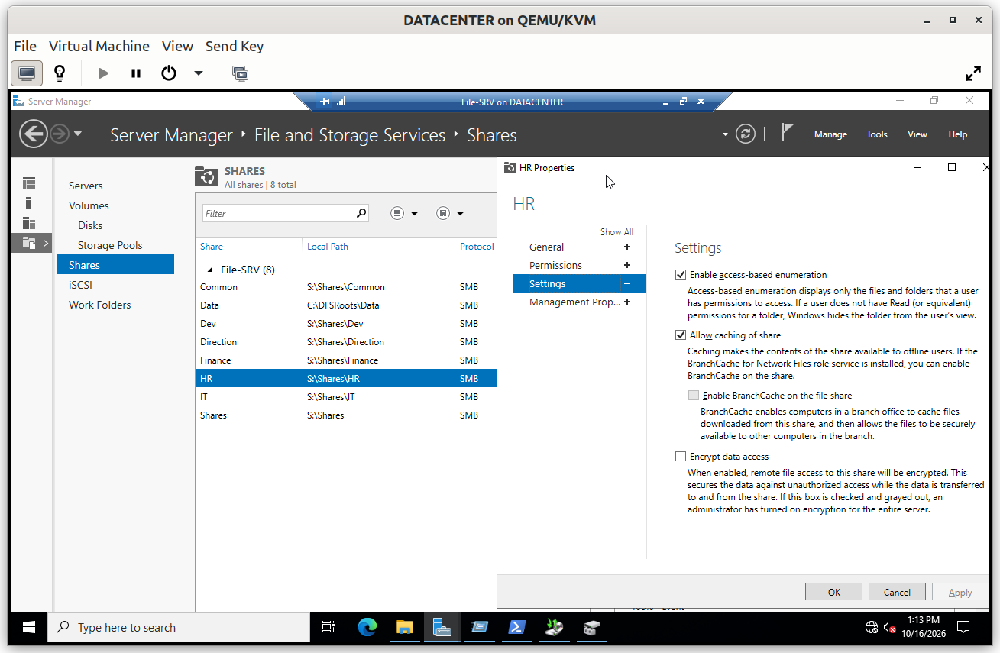
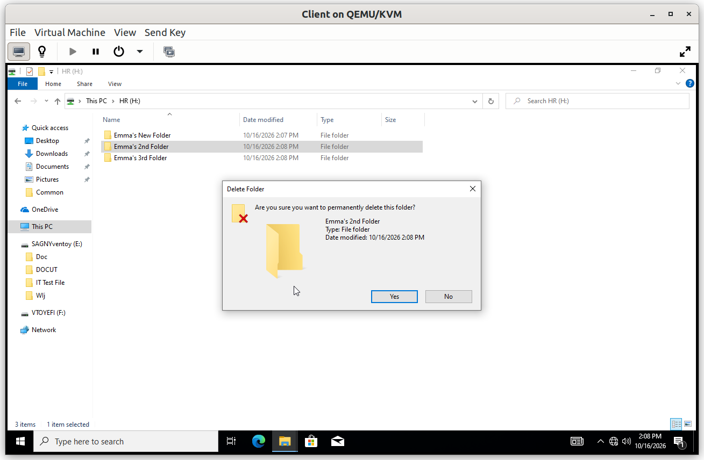
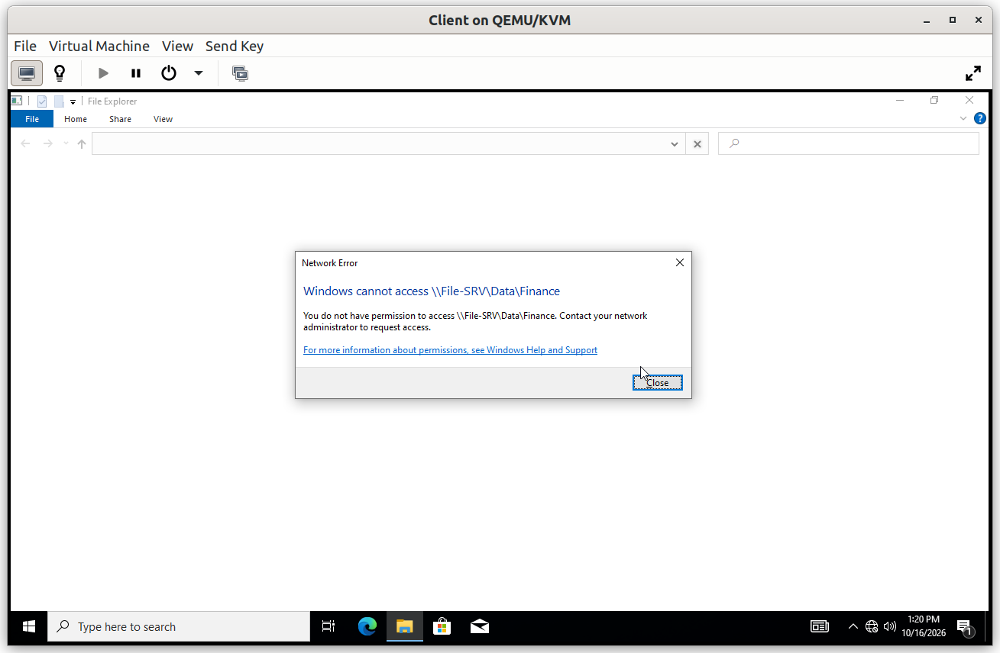
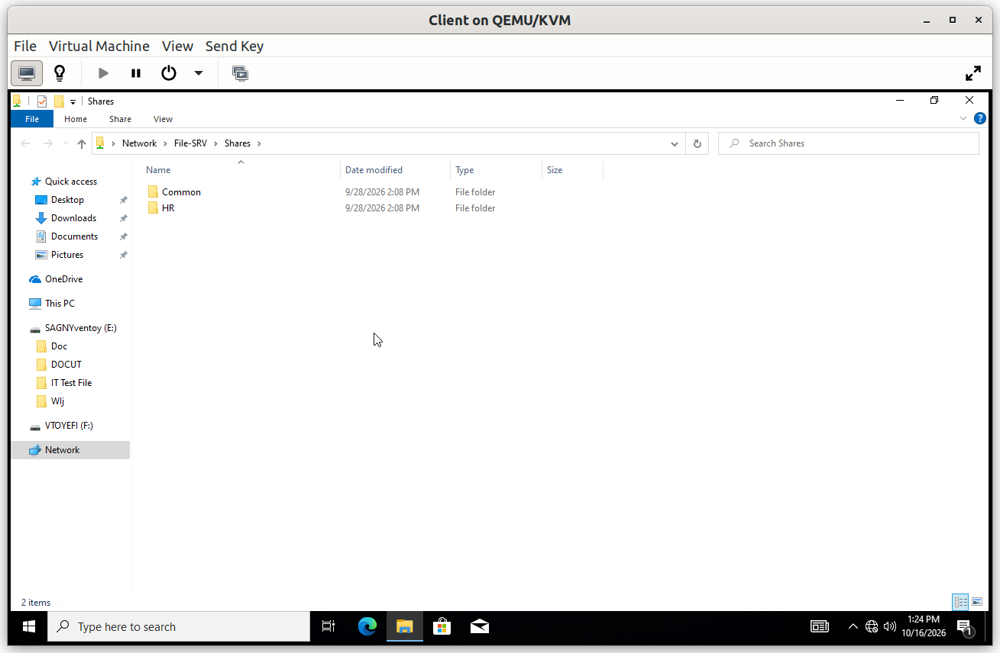
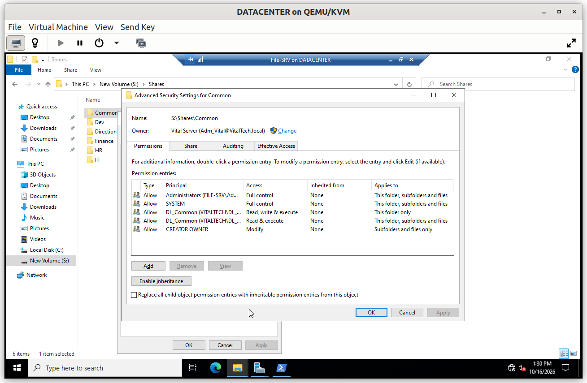
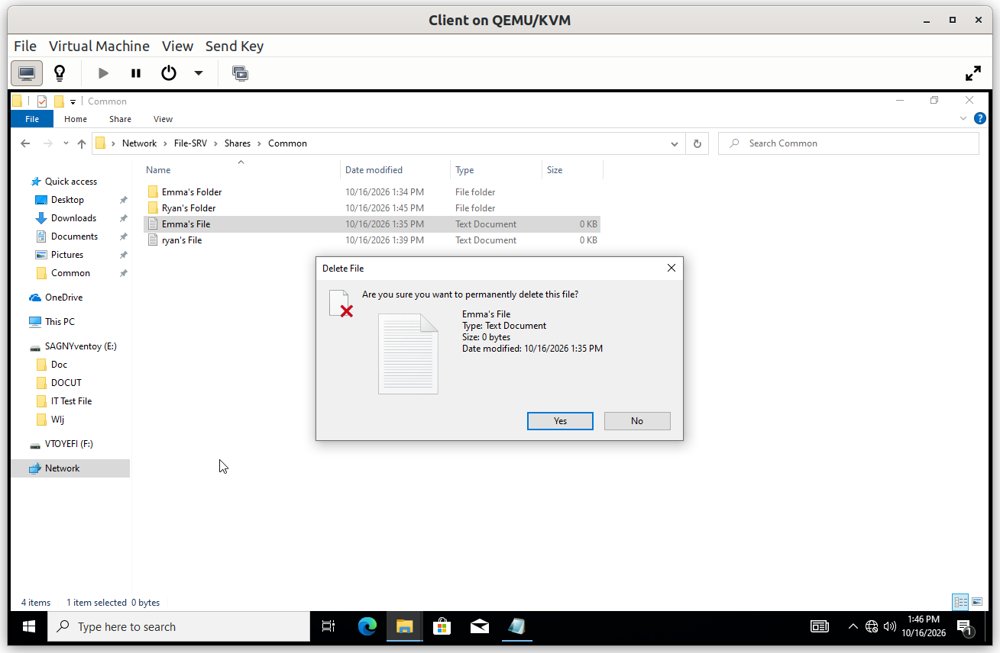
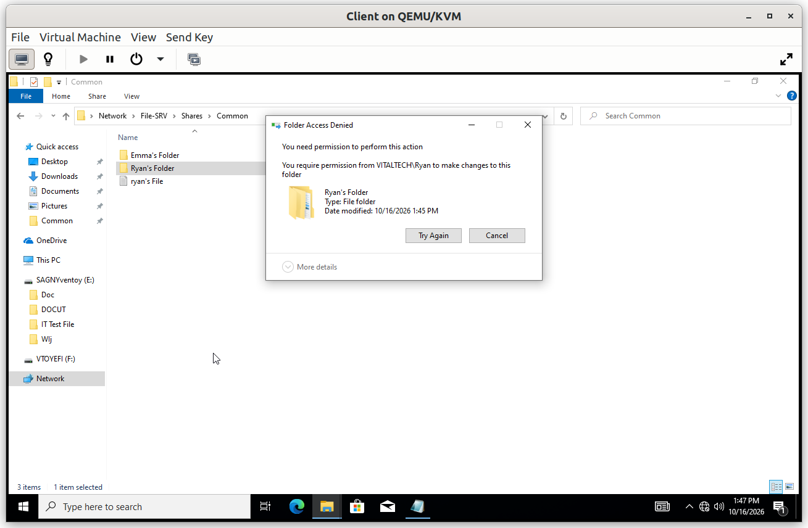
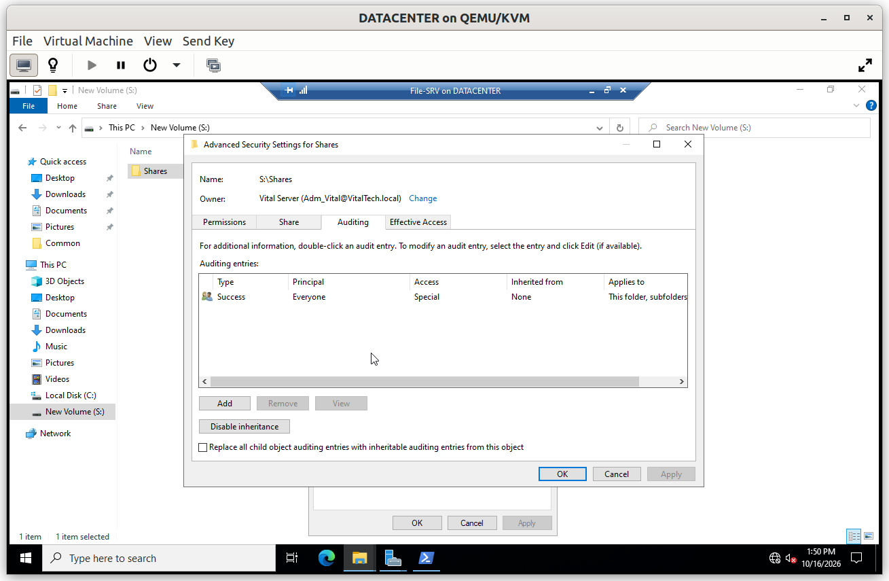

# File-SRV: Access Control

Access to the data follows the AGDLP model and the principle of least privilege: each person reaches the folders of their own department, plus the common folder, and nothing else.

## Summary

| # | Step | Purpose |
|---|---|---|
| 1 | NTFS permissions | Grant each department access to its own folder only |
| 2 | Share permissions | Keep the share layer simple and let NTFS decide |
| 3 | Access-based enumeration | Hide the folders a user cannot access |
| 4 | Common folder | Let departments exchange files, with owner-only modification |
| 5 | Audit entry | Record who accesses the data |

---

## Step 1. NTFS permissions

Permissions are granted only to **domain local groups** (`DL_*`), which contain the matching global groups (`GG_*`). A user gets access by joining a global group, never by receiving a permission directly. For example, `DL_HR` holds Modify on the `HR` folder, and `GG_HR` is a member of `DL_HR`.

On each department folder, inheritance from the parent is disabled and the broad groups (`Users`, `Authenticated Users`) are removed, so only the department group remains, with `Administrators` and `SYSTEM` keeping Full Control to keep the server manageable.

---

## Step 2. Share permissions

Each share gives `Authenticated Users` the **Change** right. The share layer acts as a wide front door, and the real control is left to the NTFS permissions of each folder.

Windows applies the **most restrictive** of the share and NTFS permissions, evaluated for the network path used. Duplicating the `DL_*` groups at the share level as well would double the administration without adding protection, and would risk inconsistencies between the two layers.

---

## Step 3. Access-based enumeration

Access-based enumeration (ABE) is enabled on the shares. A user browsing the share only sees the folders they are allowed to open. Without it, the names of the other departments' folders would be visible even though their content is protected, which is already an information leak.

### Verification

Use an HR user on the Windows 10 client.

#### V1. Access to the own department

- **Test**: open the HR drive, create a file, modify it and delete it.
- **Expected**: all three operations succeed.
- **Result**: ✅

#### V2. Access to another department refused

- **Test**: open `\\File-SRV\Data\Finance` in the Explorer address bar.
- **Expected**: *Access is denied*.
- **Result**: ✅

The refused access is recorded on the server, as shown in [`03_Audit`](../02_Group_Policy/03_Audit.md).

#### V3. Other folders are invisible

- **Test**: browse `\\File-SRV\Shares`.
- **Expected**: only the folders that the user can access are listed (`HR` and `Common`).
- **Result**: ✅

---

## Step 4. Common folder

The `Common` folder lets all departments exchange files and announcements. Every user can read what is shared there and add files, but **only the owner of a file can modify or delete it**. This is done with the `CREATOR OWNER` principal, which gives the author of an item its modification rights and nobody else.

### Verification

Two users from different departments are needed (for example an HR user and a Finance user).

#### V4. A user modifies their own file

- **Test**: the HR user creates a file in `Common`, then modifies it.
- **Expected**: the modification is saved.
- **Result**: ✅

#### V5. A user cannot modify another user's file

- **Test**: the Finance user opens the file created by the HR user and tries to save a change.
- **Expected**: the file can be read, but the modification is refused.
- **Result**: ✅

---

## Step 5. Audit entry

The audit policy enabled by GPO ([`03_Audit`](../02_Group_Policy/03_Audit.md)) only turns the subcategories on. An **audit entry** (SACL) on `S:\Shares` defines what is recorded, and it is inherited by every folder below. Without this entry, no file access would be logged.

