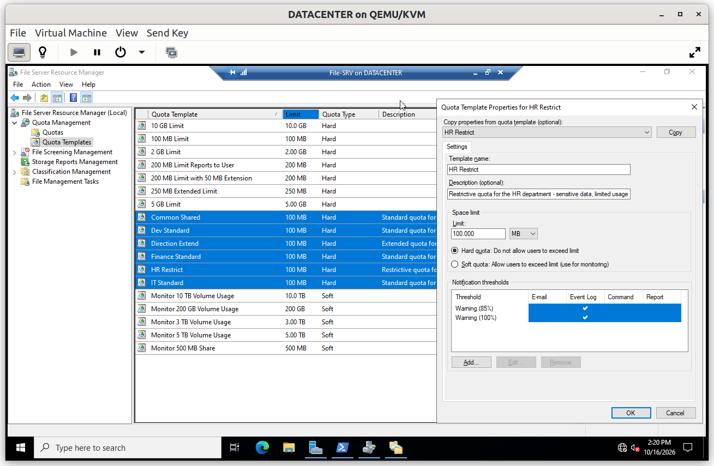
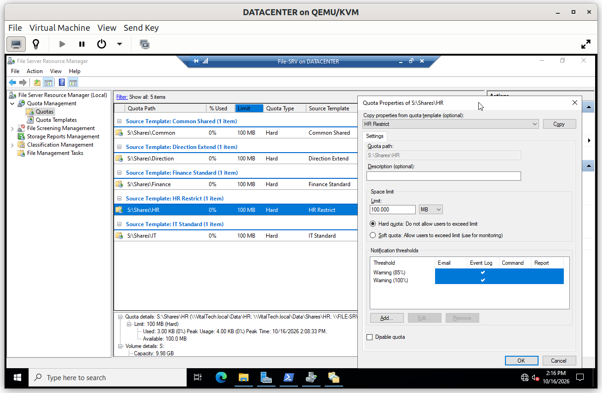
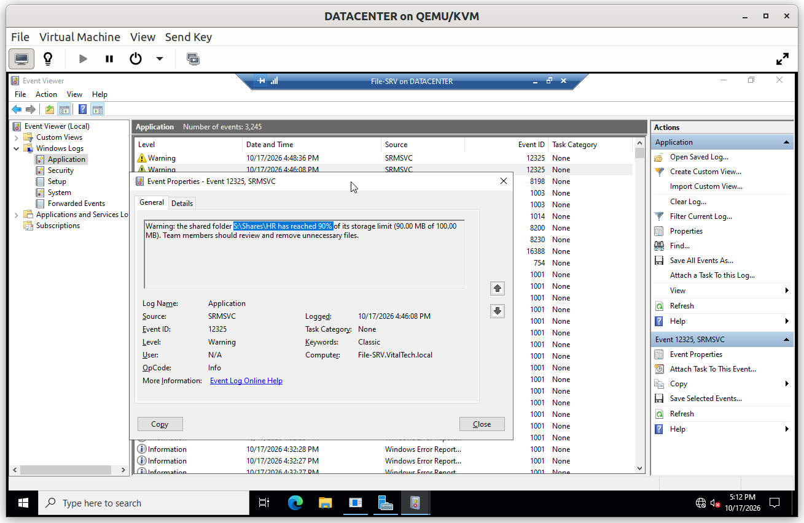
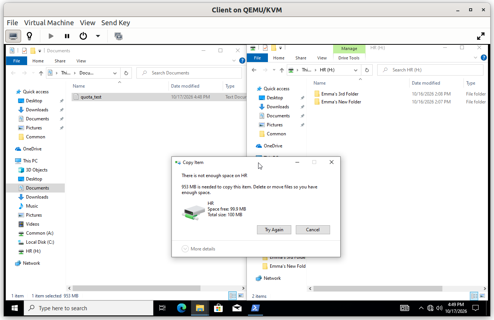

# File-SRV: Quotas

Quotas stop a single user or department from filling the disk. They are managed with File Server Resource Manager (FSRM) and applied to the shared folders.

## Summary

| # | Step | Purpose |
|---|---|---|
| 1 | Quota template | Define one reusable limit with its thresholds |
| 2 | Quota on the folders | Apply the template to each shared folder |

---

## Step 1. Quota template

A template defines a limit of **100 MB** with two thresholds:

- **85 %**: a warning, so the administrator knows a folder is nearly full
- **100 %**: the limit, beyond which writes are refused

Notifications are written to the **Windows event log**, where they can be monitored without any mail server. Using a template rather than separate quotas keeps all folders consistent: changing the template updates every quota derived from it.

---

## Step 2. Quota on the folders

The template is applied to each shared folder under `S:\Shares`. FSRM only accepts a **local path**, not a network path, so the quotas are set on `S:\Shares\<folder>` and not on the share.

### Verification

#### V1. Warning threshold logged

- **Test**: as an HR user on the client, copy a 90 MB file to the `HR` drive, then open *Event Viewer* > *Windows Logs* > *Application* on `File-SRV`.
- **Expected**: the copy succeeds, and an event from FSRM records that the 85 % threshold was crossed for the `HR` folder.
- **Result**: ✅

#### V2. Quota limit enforced

- **Test**: as an HR user on the client, create a test file of about 950 MB in a local folder (`fsutil file createnew quota_test.bin <size in bytes>`), then copy it to the `HR` drive in the Explorer.
- **Expected**: the copy is refused because the file is larger than the quota. Windows reports that there is not enough space on `HR`, and the drive reports a total size of 100 MB, which matches the quota limit.
- **Result**: ✅

