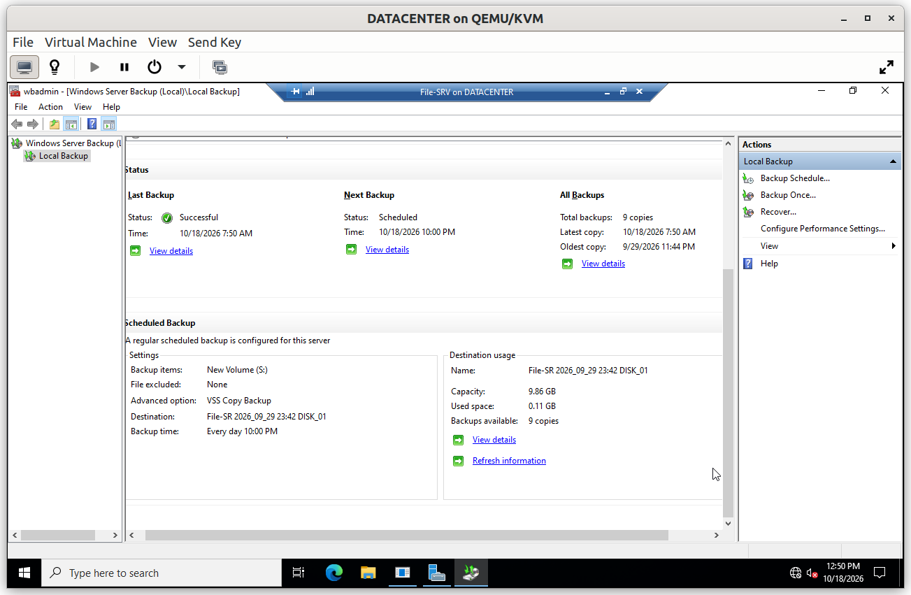
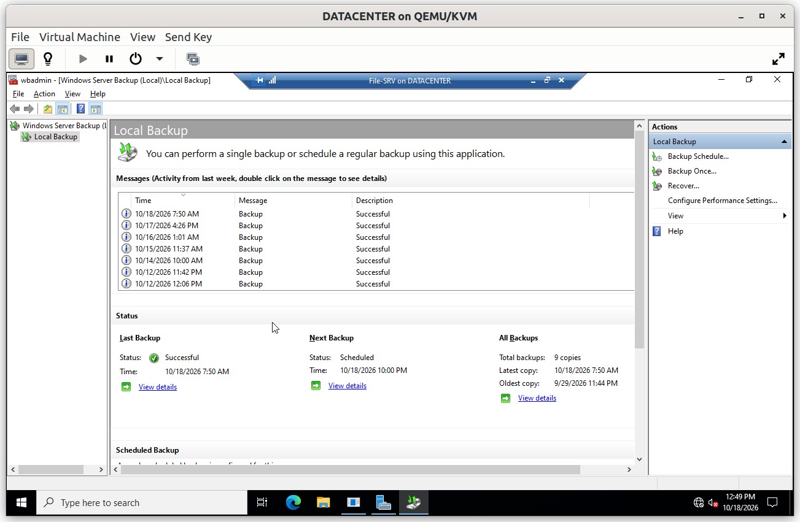
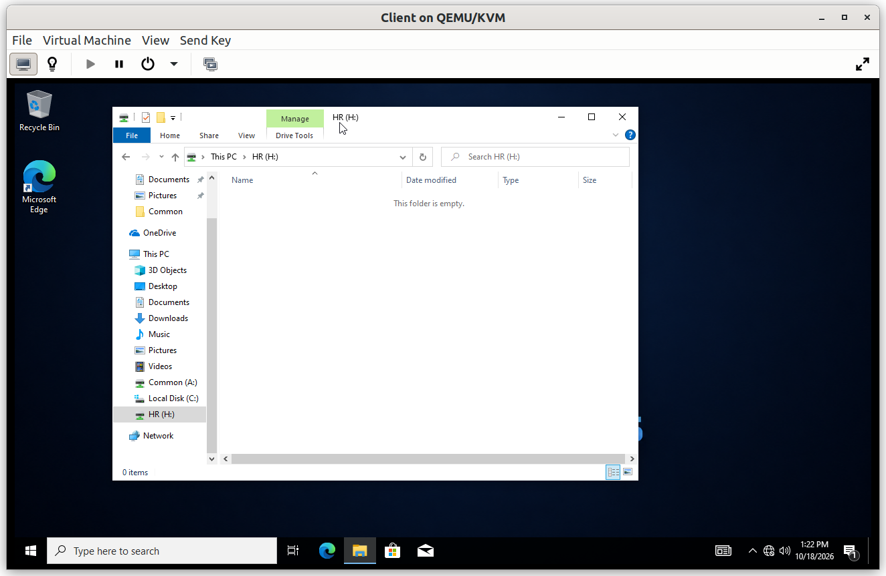
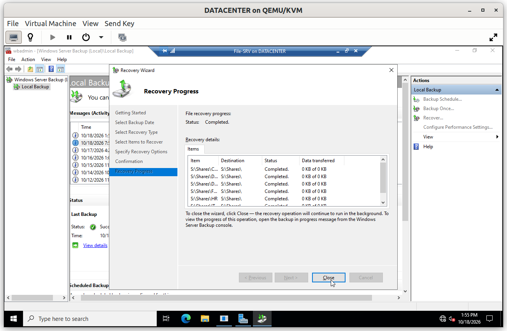
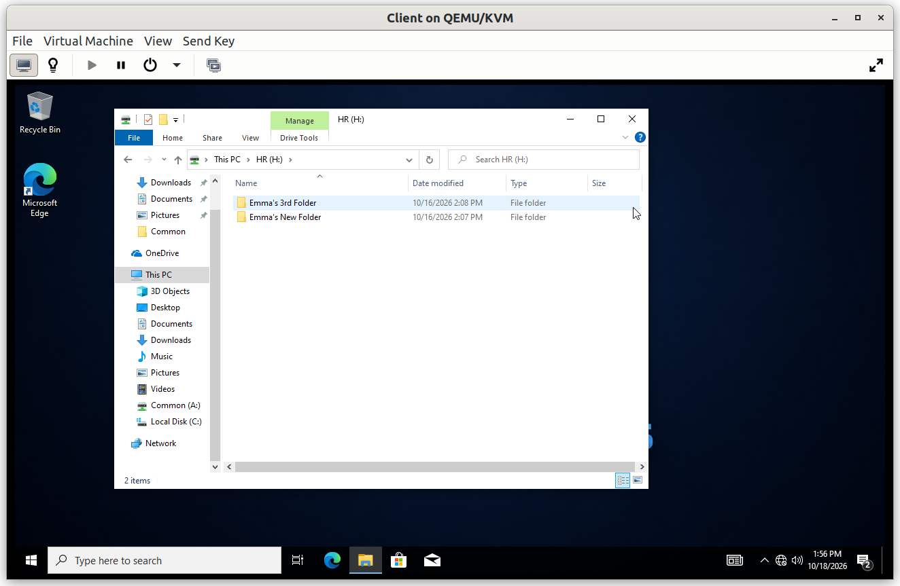

# File-SRV: Backup and Restore

A backup is only worth something if a restore has been tested. This document covers the scheduled backup of the data volume with Windows Server Backup, and the restore of a deleted file.

## Summary

| # | Step | Purpose |
|---|---|---|
| 1 | Scheduled backup | Copy the data volume to a dedicated disk every day |

---

## Step 1. Scheduled backup

The **Windows Server Backup** feature is installed on `File-SRV`, and a **daily schedule** (every day at 10:00 PM) backs up the data volume `S:` to a dedicated virtual disk of about 10 GB. The disk is kept apart from the data, so that a problem on `S:` does not affect the copies.

Automating the backup removes the dependency on someone remembering to run it. The mode is **VSS Copy Backup**, which does not interfere with other backup products, and several copies are kept so that an older version of a file can be recovered.

### Verification

#### V1. Scheduled backups run

- **Test**: open the Windows Server Backup console on `File-SRV` after several days.
- **Expected**: the message list shows one successful backup for each scheduled run, and the status reports the last backup as successful, with several copies available.
- **Result**: ✅

#### V2. Restore of a deleted file

- **Test**: delete a test file from the `HR` folder (it was created before the last backup), then use *Recover* in Windows Server Backup to restore it from the latest copy.
- **Expected**: the file reappears in its folder with its content, and its permissions are restored with it.
- **Result**: ✅

---

## Limits

- The backup covers the data volume only, not the system state, so it does not allow rebuilding the server itself.
- The backup runs once a day, so up to one day of changes can be lost in a failure.
- The backup disk is attached to the same host as the server. In production, the copy would be stored off the server, on another system or off site.
