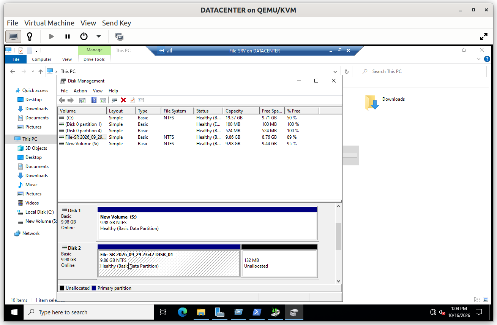
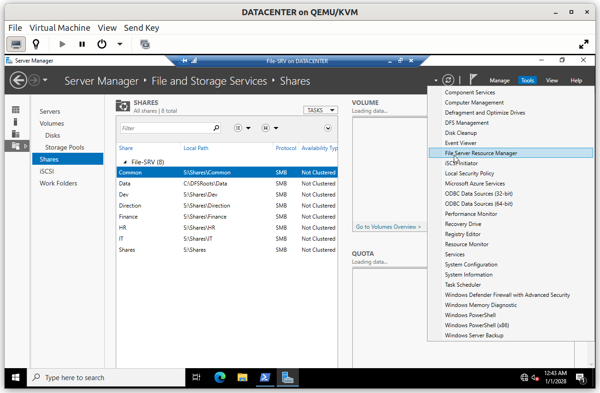
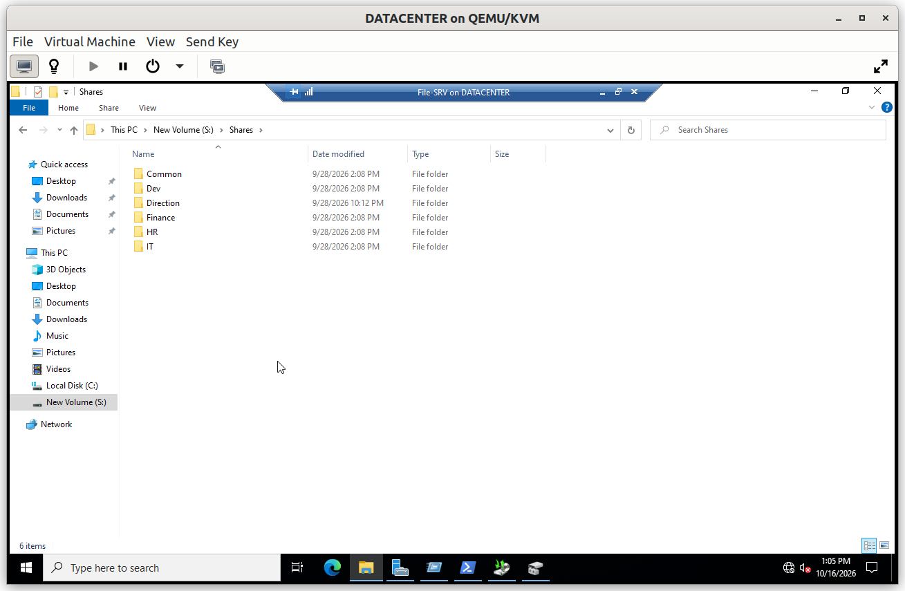
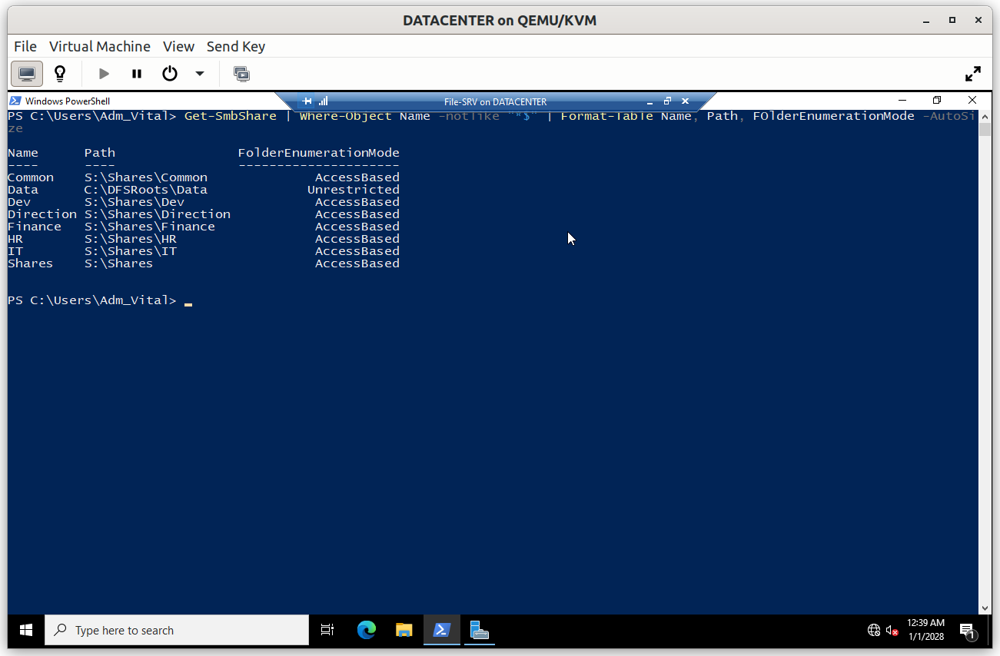

# File-SRV: Secure File Sharing

`File-SRV` shares files between the members of each department while applying the principle of **least privilege**: every department has a private folder reachable only by its own members, and a common folder lets all departments exchange files and announcements. Quotas limit storage use, access is audited, and the data is backed up.

## Summary

| # | Step | Purpose |
|---|---|---|
| 1 | Data disk | Keep the data on its own volume, apart from the operating system |
| 2 | File server roles | Install File Server and File Server Resource Manager (FSRM) |
| 3 | Folder structure and shares | Create one folder and one share per department, plus a common folder |

The rest of the configuration is documented in separate files:

| File | Content |
|---|---|
| [`01_Access_Control.md`](01_Access_Control.md) | Permissions, access-based enumeration, common folder, audit entry |
| [`02_Quotas.md`](02_Quotas.md) | FSRM quotas |
| [`03_Backup.md`](03_Backup.md) | Backup and restore |

---

## Step 1. Data disk

A dedicated 10 GB virtual disk is attached to `File-SRV`, initialized, formatted in NTFS and mounted as `S:`.

Separating data from the system volume makes the data easier to back up and to restore, and lets the quotas apply to a volume of its own. FSRM also requires a local NTFS volume.



---

## Step 2. File server roles

The **File Server** role service and **File Server Resource Manager** are installed under *File and Storage Services*. The first provides the shares, and FSRM provides the quotas.



---

## Step 3. Folder structure and shares

All data lives under a single container, `S:\Shares`, with one folder per department:

```
S:\Shares
├── HR
├── IT
├── Finance
├── Direction
├── Dev
└── Common
```

Each folder can be reached through three paths, which all lead to the same data:

| Path | How it works |
|---|---|
| `\\File-SRV\HR` | The share of the folder itself |
| `\\File-SRV\Shares\HR` | Through the `Shares` share, which covers the whole container |
| `\\File-SRV\Data\HR` | Through the `Data` **DFS namespace**, whose folders point to the department shares |

The DFS namespace gives users a single, stable entry point: the shares can move to another server without changing the path users type, because only the target of the namespace folder changes.


The access rights do not depend on the path used: the NTFS permissions belong to the folder itself, and every share gives `Authenticated Users` the same Change right. A user who is refused through one path is refused through the other two.

The network drives of the users use the `Data` path, for example `\\File-SRV\Data\HR` (see [`05_User_Environment`](../02_Group_Policy/05_User_Environment.md)).



