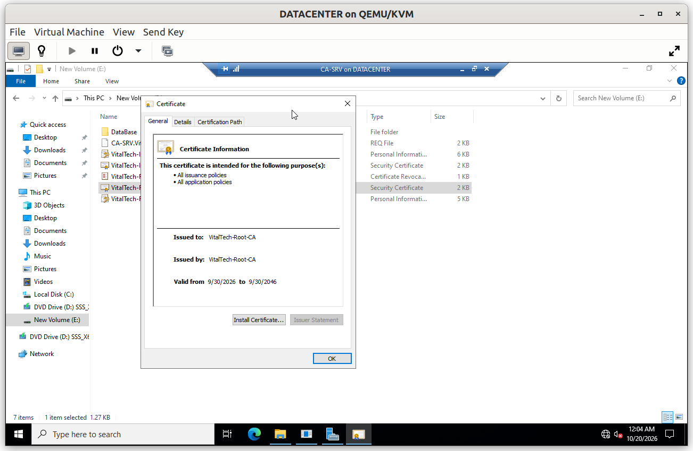
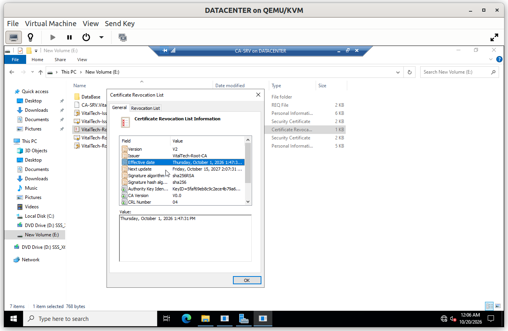
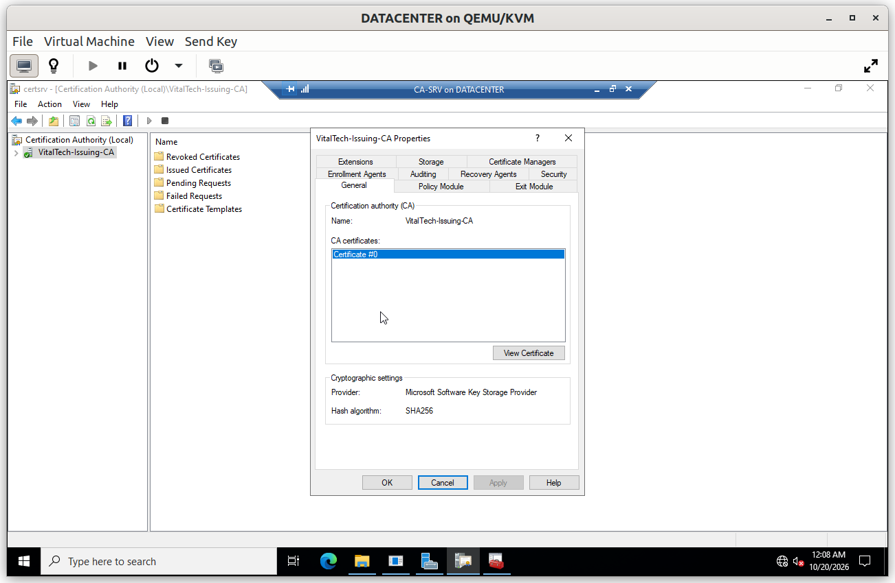
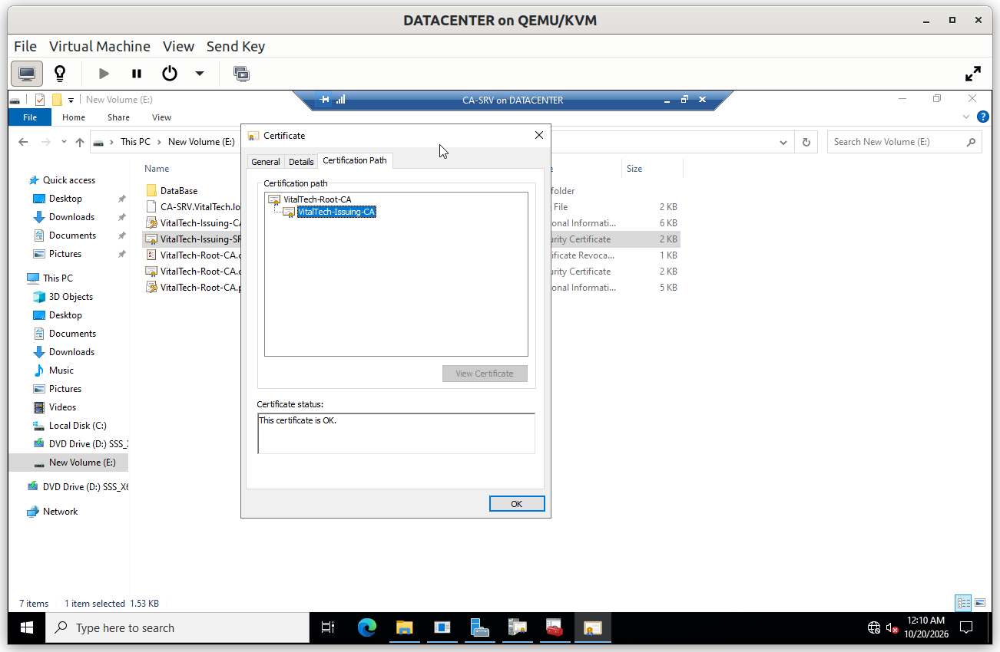
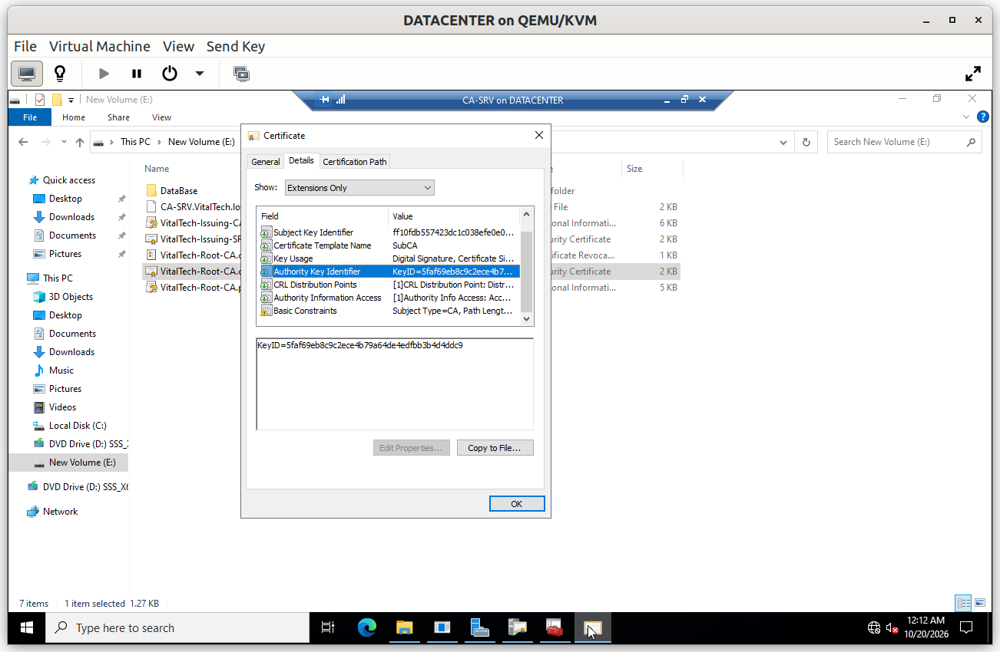
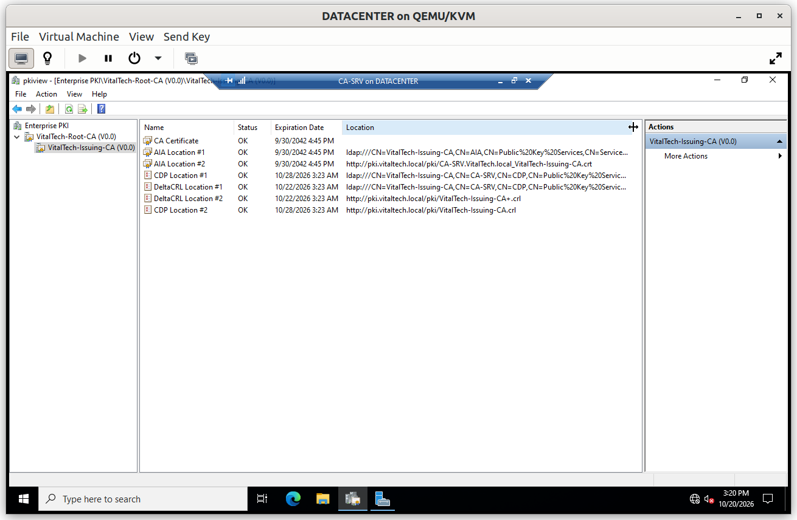
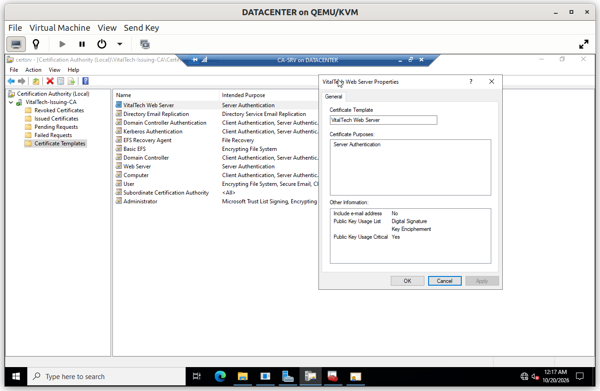
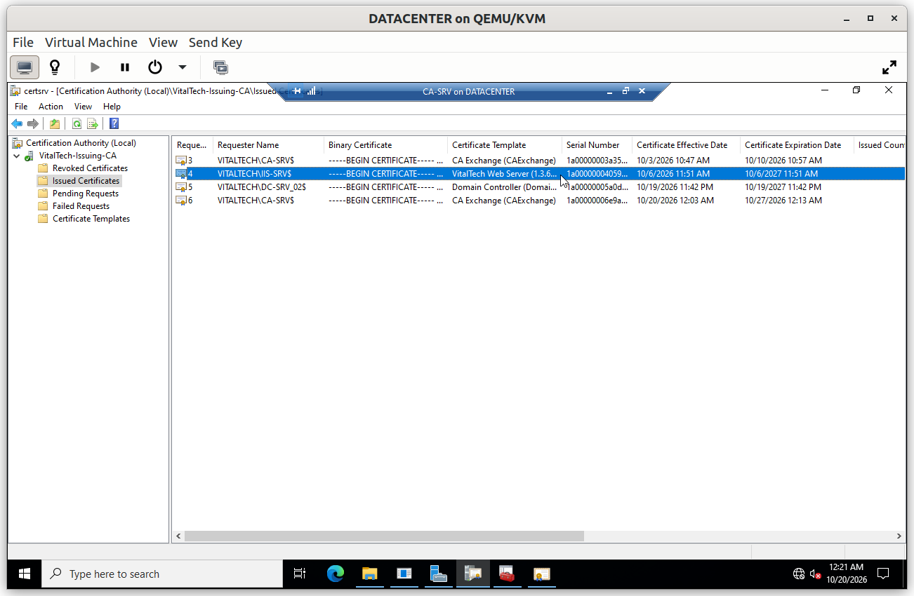

# PKI: Two-Tier Public Key Infrastructure

The lab runs an internal Public Key Infrastructure with two levels: an **offline Root CA**, which is the root of trust, and an **online Enterprise Issuing CA**, which issues certificates to the servers of the domain. The web server `IIS-SRV` uses one of them for HTTPS.

## Summary

| # | Step | Purpose |
|---|---|---|
| 1 | Root CA (offline) | Create the root of trust and keep it out of reach |
| 2 | Issuing CA (`CA-SRV`) | Issue certificates to the servers of the domain |
| 3 | Revocation information | Publish the CRL and the CA certificates so clients can check them |
| 4 | Trust distribution | Make every domain machine trust the Root CA |
| 5 | Server certificate | Issue the HTTPS certificate of `IIS-SRV` |

---

## Step 1. Root CA (offline)

`VitalTech-Root-CA` is a **standalone** Root CA, with an RSA 4096-bit key and SHA-256 signatures. Its own certificate is valid for 20 years, until 2046-09-30. It was used for two things only: signing the certificate of the Issuing CA and publishing its revocation list (CRL). After that, the machine was taken out of service and its key is kept as an offline backup.

Using two levels protects the root key. If the Issuing CA is ever compromised, it can be revoked and replaced without changing the root, and the trust that every machine already holds remains valid.

---

## Step 2. Issuing CA

`VitalTech-Issuing-CA` is an **Enterprise subordinate CA** installed on `CA-SRV`. Its certificate is signed by the Root CA and valid until 2042-09-30. Being an Enterprise CA, it is integrated with Active Directory and issues certificates from templates, which keeps the certificates consistent.

### Verification

#### V1. Chain of trust

- **Test**: on `CA-SRV`, open the certificate of the Issuing CA and look at the *Certification Path* tab.
- **Expected**: the path shows `VitalTech-Root-CA` then `VitalTech-Issuing-CA`, with the status *This certificate is OK*.
- **Result**: ✅

---

## Step 3. Revocation information

Clients must be able to check whether a certificate has been revoked. The CRL and the CA certificates are published over HTTP at `http://pki.VitalTech.local/pki`, a path that works without any certificate or authentication. The Issuing CA publishes a base CRL about every week and a delta CRL about every day. The Root CA is offline, so its CRL is published as a file on `CA-SRV`, and it is valid until 2027-10-15.

### Verification

#### V2. PKI health

- **Test**: on `CA-SRV`, open `pkiview.msc`.
- **Expected**: the certificates and CRL locations of both authorities are reported as *OK*.
- **Result**: ✅

The download of the Root CA certificate and CRL from a client is shown in [`01_Network_Security`](../02_Group_Policy/01_Network_Security.md).

---

## Step 4. Trust distribution

The certificate of the Root CA is installed as a trusted root on every domain machine by Group Policy, so that every certificate signed by the Issuing CA is trusted without any manual step. See [`06_Trust`](../02_Group_Policy/06_Trust.md).

---

## Step 5. Server certificate

The template **VitalTech Web Server** is published on the Issuing CA. `IIS-SRV` requests its HTTPS certificate from it, with the names of both sites in the certificate.

### Verification

#### V3. Certificate issued to the web server

- **Test**: on `CA-SRV`, open *Issued Certificates* in the Certification Authority console.
- **Expected**: the certificate requested by `IIS-SRV` is listed, issued from the template `VitalTech Web Server`.
- **Result**: ✅

The effect for users, an HTTPS page opening without a certificate warning, is shown in [`07_IIS`](../07_IIS/).

---

## Limits

- The Root CA no longer exists as a machine. Its CRL expires on **2027-10-15**: before that date, the Root CA must be restored from its key backup to publish a new CRL.
- There is a single Issuing CA, so certificate issuance stops if `CA-SRV` is unavailable.
