# IIS-SRV: Web Hosting

`IIS-SRV` is a multi-hosting web server for the internal development team: two sites, `dev` and `staging`, share the same server, the same IP address and the same HTTPS port. Each site runs in its own application pool, the traffic is encrypted with a certificate issued by the internal CA, and the content of the development site is deployed through a restricted share.

## Summary

| # | Step | Purpose |
|---|---|---|
| 1 | Web server and sites | Host the `dev` and `staging` sites on one server |
| 2 | Application pools | Isolate the two sites from each other |
| 3 | HTTPS with SNI | Serve both sites over HTTPS on the same IP address and port |
| 4 | HTTP redirection | Send every HTTP request to the HTTPS site |
| 5 | Staging authentication | Restrict the pre-production site to authenticated users |
| 6 | Developer share | Let the team deploy the `dev` content without a session on the server |

---

## Step 1. Web server and sites

The **Web Server (IIS)** role is installed on `IIS-SRV` (`172.16.10.3`), and two sites are created, each in its own folder:

| Site | Folder | Host name |
|---|---|---|
| `dev` | `C:\Site\Dev` | `dev.VitalTech.local` |
| `staging` | `C:\Site\Staging` | `staging.VitalTech.local` |

Both host names resolve to `IIS-SRV` in the DNS zone of the domain. The server tells the two sites apart by the host name in the request.

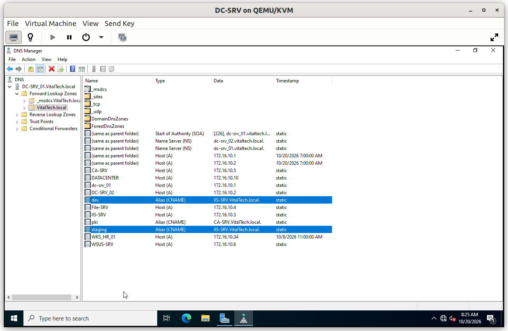

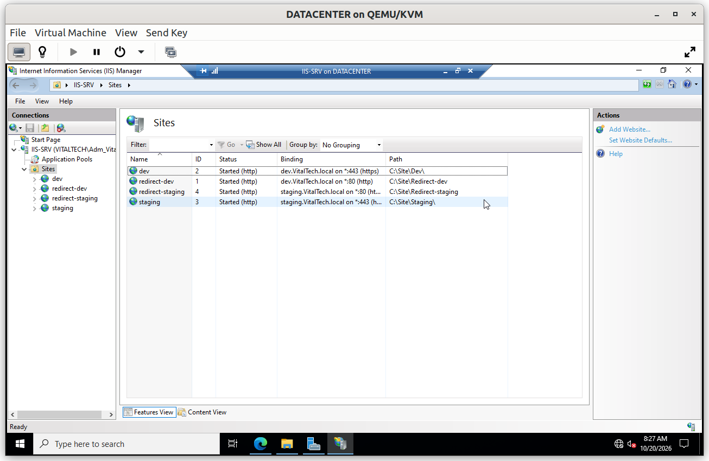

---

## Step 2. Application pools

Each site has its own application pool: `AppPool-dev` and `AppPool-staging`. Every pool runs in its own worker process with its own identity, so a crash or a compromised application in one site does not affect the other.

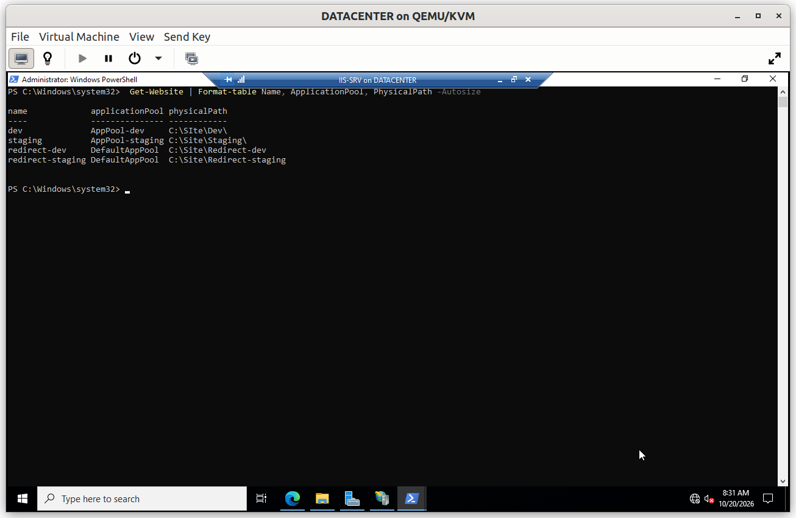

### Verification

#### V1. Pools are isolated

- **Test**: stop `AppPool-dev` in IIS Manager, then open both sites from the client.
- **Expected**: the `dev` site answers `503 Service Unavailable` while the `staging` site keeps working. Start the pool again afterwards.
- **Result**: ✅

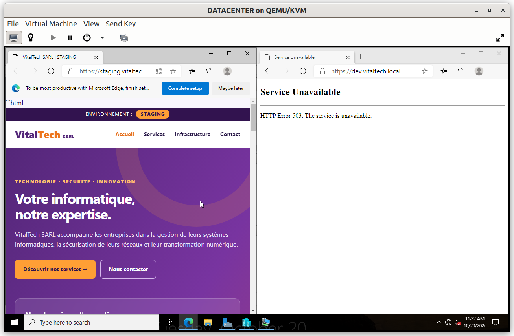

---

## Step 3. HTTPS with SNI

The two sites share one certificate, issued by `VitalTech-Issuing-CA` from the template **VitalTech Web Server**. The certificate carries both host names in its *Subject Alternative Name*, so a single certificate covers `dev.VitalTech.local` and `staging.VitalTech.local`.

Each site has an HTTPS binding on port 443 with its own host name and **Server Name Indication (SNI)** required. SNI lets the server choose the right site before the encrypted session starts, which is what allows two HTTPS sites to share the same IP address and port.

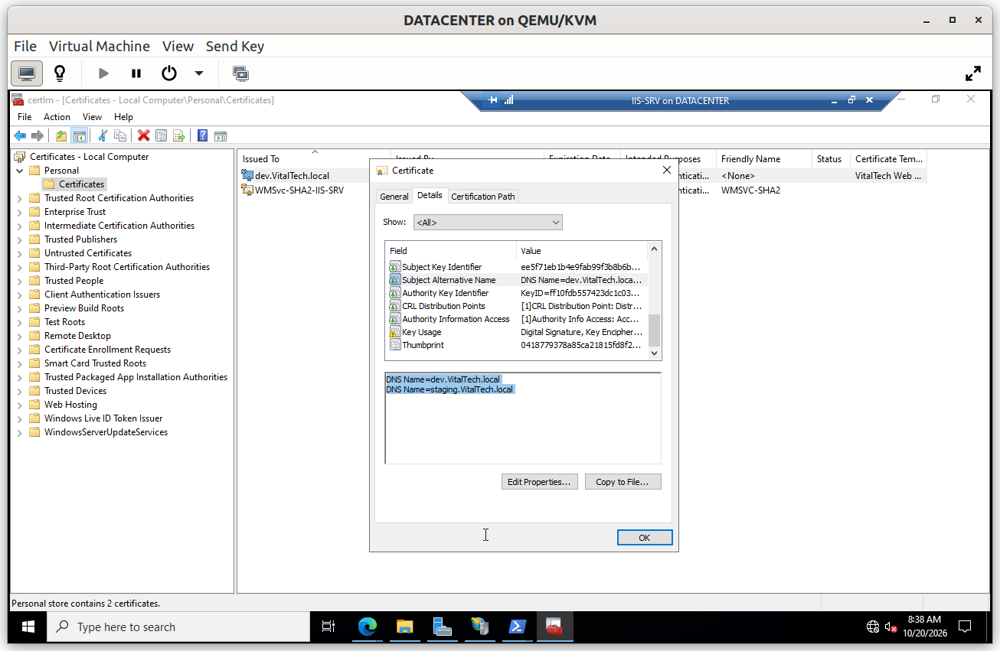

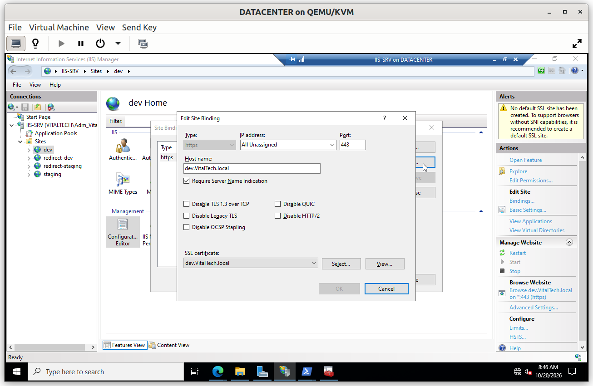

### Verification

Both tests are made from the Windows 10 client.

#### V2. Development site over HTTPS

- **Test**: from the Windows 10 client, open `https://dev.VitalTech.local` in a browser.
- **Expected**: the page opens with a padlock and no certificate warning, which also proves that the client trusts the internal Root CA.
- **Result**: ✅

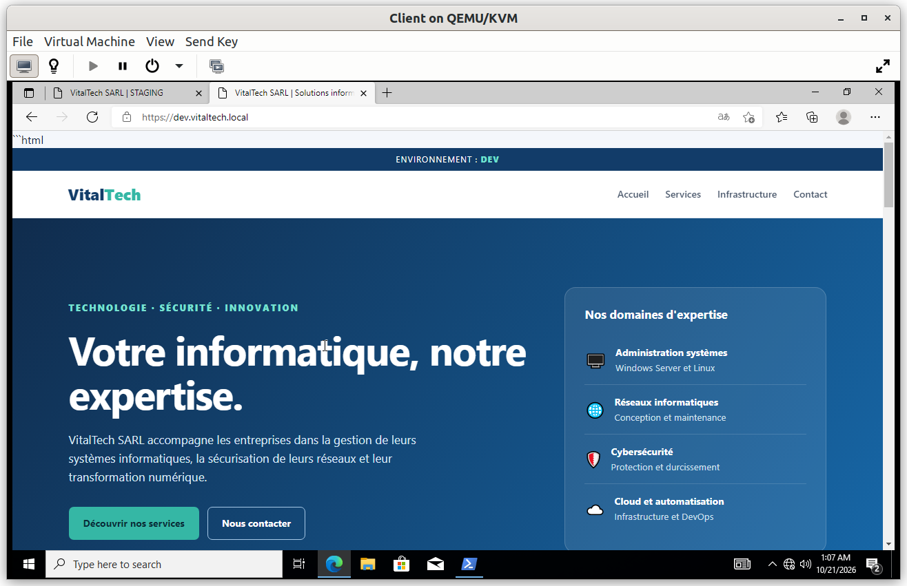

#### V3. Staging site over HTTPS, same server

- **Test**: open `https://staging.VitalTech.local` in a browser next to the `dev` site, and enter the credentials of a member of `GG_Dev` when asked.
- **Expected**: the page opens with a padlock and no certificate warning, and each name shows the content of its own site although both names point to the same IP address.
- **Result**: ✅

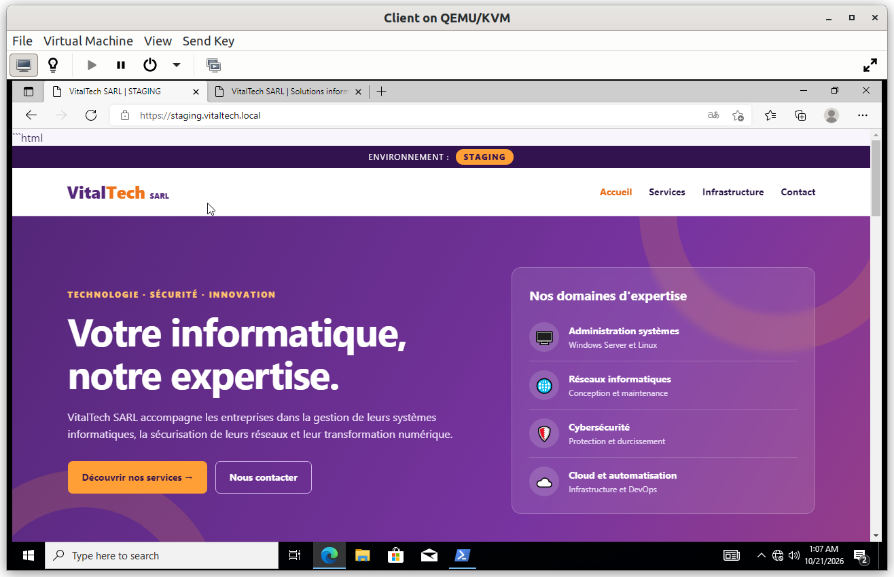

---

## Step 4. HTTP redirection

A user can type `http://` or no protocol at all, so port 80 must not leave the site unprotected. Two small sites listen on port 80, one per host name, and answer with a **permanent redirect (301)** to the matching HTTPS address. No content is ever served over HTTP.

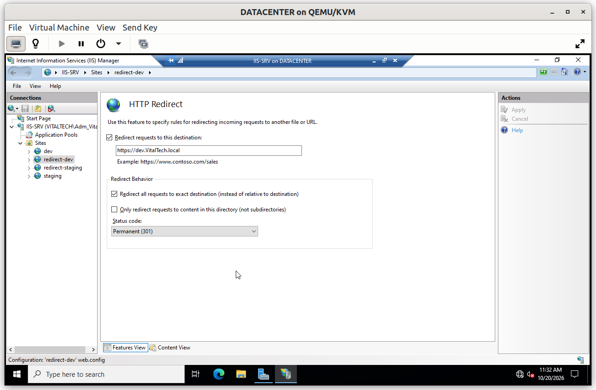

### Verification

#### V4. HTTP is redirected

- **Test**: from the client, run `curl.exe -I http://dev.VitalTech.local`.
- **Expected**: the response is `301 Moved Permanently`, and the `Location` header gives the `https://` address.
- **Result**: ✅

---

## Step 5. Staging authentication

The `staging` site holds pre-production content, so **Windows Authentication** is enabled and **Anonymous Authentication** is disabled: only authenticated domain users can open it. The `dev` site stays open without authentication, as a development site on an isolated network.

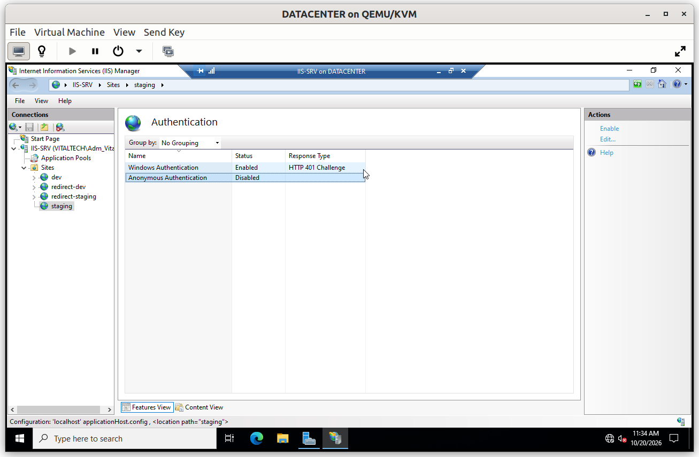

### Verification

#### V5. Anonymous access refused on staging

- **Test**: from the client, run `curl.exe -I https://staging.VitalTech.local`, which sends no credentials.
- **Expected**: the response is `401 Unauthorized`.
- **Result**: ✅

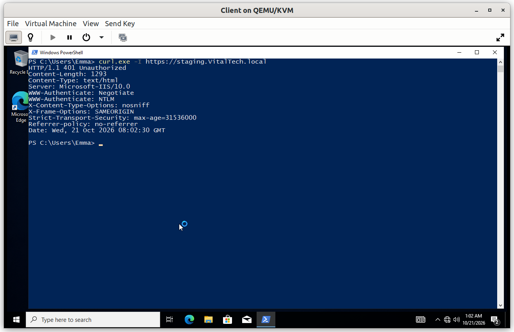

---

## Step 6. Developer share

The folder `C:\Site\Dev` is shared as the hidden share `Dev$` (`\\IIS-SRV\Dev$`), so the team can deposit the content of the `dev` site from their own workstation without opening a session on the server.

| Permission | Account | Right |
|---|---|---|
| Share | `VITALTECH\GG_Dev` | Change |
| Share | `IIS-SRV\Administrators` | Full Control |

`Everyone` is removed from the share. The effective right is always the more restrictive of the share and the NTFS permissions. The `staging` folder is not shared: its content is promoted from `dev` by the IT team.

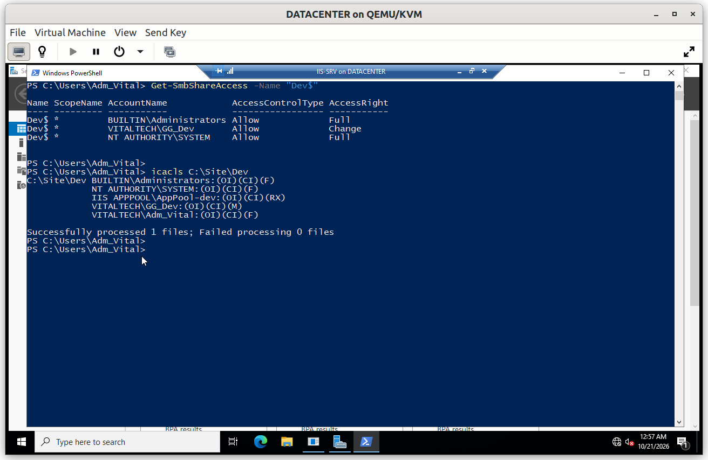

### Verification

#### V6. Authorized user allowed

- **Test**: open `https://staging.VitalTech.local` in a browser and enter the credentials of a member of `GG_Dev`.
- **Expected**: the page opens.
- **Result**: ✅

#### V7. Other users refused

- **Test**: open the same address and enter the credentials of an HR user, who is neither an administrator nor a member of `GG_Dev`.
- **Expected**: the page does not open. The browser asks for credentials again each time, and after cancelling it shows `401 - Unauthorized`.
- **Result**: ✅

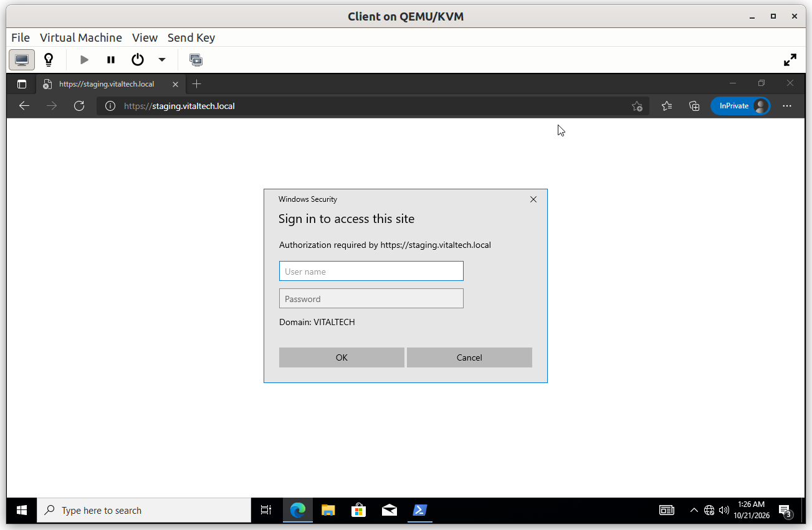

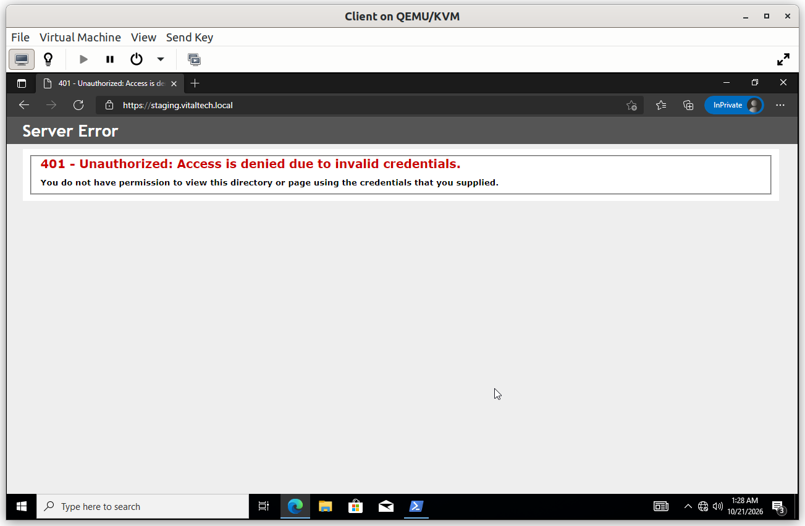

---

## Limits

- The `dev` site is open without authentication. This is acceptable on an isolated laboratory network, not in production.
- Both sites run on a single web server, so they depend on the same host.
