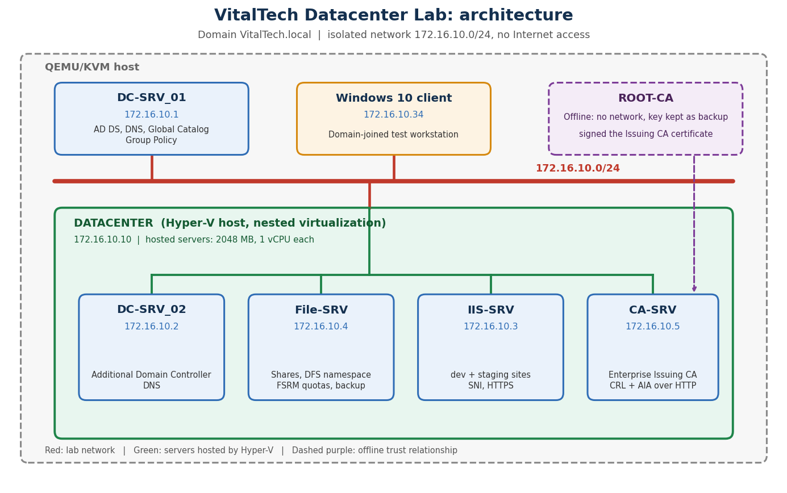

# VitalTech Datacenter Lab: Windows Server 2022 Enterprise Infrastructure

A multi-server Windows Server 2022 environment built to enterprise standards for a fictional IT company: Active Directory, a hardened Group Policy baseline, a two-tier PKI, a secure file server and an IIS multi-hosting platform.
The infrastructure is validated with documented tests and secured with a layered hardening baseline.



---

## 1. Overview

**VitalTech SARL** is a fictional IT services company. This lab simulates the infrastructure a small or medium business needs: centralized identity, least-privilege access to data, trusted internal web services and a security baseline enforced by policy.

The whole environment runs on an **isolated network** (`172.16.10.0/24`, no Internet access) on QEMU/KVM. A nested Hyper-V host (`DATACENTER`) runs most of the servers.

| Server | IP address | Hosted on |
|---|---|---|
| `DC-SRV_01` | `172.16.10.1` | QEMU/KVM |
| `DC-SRV_02` | `172.16.10.2` | `DATACENTER` (Hyper-V) |
| `IIS-SRV` | `172.16.10.3` | `DATACENTER` (Hyper-V) |
| `File-SRV` | `172.16.10.4` | `DATACENTER` (Hyper-V) |
| `CA-SRV` | `172.16.10.5` | `DATACENTER` (Hyper-V) |
| `DATACENTER` | `172.16.10.10` | QEMU/KVM |

The servers hosted on `DATACENTER` have 2048 MB of memory and 1 virtual processor each.
**Skills demonstrated**

- Designed an Active Directory forest with the **AGDLP** model and separated administrator accounts
- Enforced a **security baseline through GPO**: per-role firewall rules, advanced audit policy, USB restriction and local administrator control
- Deployed a **two-tier PKI**: an offline Root CA and an Enterprise Issuing CA, with trust distributed by GPO
- Built a **secure file server**: group-based NTFS permissions, FSRM quotas, access auditing and backup
- Configured an **IIS multi-hosting server**: dev/staging separation, one application pool per site, HTTPS through the internal CA (SNI)
- Validated every component with documented tests (Test, Expected, Result, Screenshot)
- Applied a layered hardening baseline: default-deny firewall, least privilege, auditing, device control and an offline root of trust
---

## 2. Lab components

### DC-SRV_01: Domain Controller and DNS

The backbone of the infrastructure. The Active Directory Domain Services role is installed on it, creating a new forest (`VitalTech.local`). On this server:

- Users, groups and Organizational Units are created following the **AGDLP** model: users go into global groups, global groups into domain local groups, and permissions are granted only to domain local groups
- Group Policy Objects are configured and linked to the OUs
- The **DNS** role resolves host names across the domain, so that services are reached by name instead of IP address

Details: [`01_Active_Directory`](01_Active_Directory/)

### Group Policy baseline

Group Policy is one of the most important layers of the infrastructure. It enforces the security baseline on every machine without manual configuration.

| Category | GPO | Role |
|---|---|---|
| Network security | GPO - Firewall - Base | Blocks inbound traffic by default on servers; RDP, WinRM and ICMP limited to `172.16.10.0/24` |
| Network security | GPO - Firewall - IIS / File Server / CA | Opens only the ports each server role needs |
| Network security | GPO - Firewall - WSUS | Opens TCP 8530 and 8531 for `WSUS-SRV` only. Prepared but not tested: WSUS is not deployed (see Known limitations) |
| Remote access | GPO - Server Baseline - Remote Access | Enables RDP on servers |
| Access control | GPP - Local Administrators | Controls local administrator group membership |
| Audit | GPO - Advanced Audit Policy | Audits File System and File Share access (Success and Failure) on servers and Domain Controllers |
| Data protection | GPO - USB Restriction - Finance / HR | Restricts removable storage for the matching departments |
| User environment | GPO - Drive Mapping | Maps network drives according to group membership |
| User environment | GPO - Universal Wallpaper | Applies the corporate wallpaper from NETLOGON |
| Trust | PKI - Trusted Root CA | Distributes the Root CA certificate to the domain |

Details: [`02_Group_Policy`](02_Group_Policy/)

### DATACENTER: Hyper-V host

A Windows Server host running the Hyper-V role, itself a virtual machine on QEMU/KVM with nested virtualization enabled. It hosts `DC-SRV_02`, `File-SRV`, `CA-SRV` and `IIS-SRV` on the same isolated network.

Details: [`03_Datacenter_Hyper-V`](03_Datacenter_Hyper-V/)

### DC-SRV_02: Additional Domain Controller

A second Domain Controller designed to provide redundancy: authentication and DNS should keep working if DC-SRV_01 becomes unavailable.

Details: [`04_DC-SRV_02`](04_DC-SRV_02/)


### File-SRV: Secure file sharing

Provides network file sharing with the principle of **least privilege**:

- Each department has a private share, reachable only by its own members
- A common folder lets all departments exchange files and announcements
- In the common folder, only the owner of a file can modify or delete it (`CREATOR OWNER`)
- FSRM quotas limit storage use and log events, share access is audited (event 5145), and Windows Server Backup protects the data

Details: [`03_File_Server`](03_File_Server/)

### ROOT-CA: Offline Root Certification Authority

A standalone Root CA with no network connection. It was powered on only to sign the Issuing CA certificate and to publish its CRL, then taken out of service: its key is kept as an offline backup. Keeping the root of trust offline protects the whole PKI from remote compromise.

### CA-SRV: Enterprise Issuing CA

The online Certification Authority (`VitalTech-Issuing-CA`), signed by the Root CA. It issues trusted certificates to the servers and objects of the company. Its CRL and AIA are published over HTTP at `pki.VitalTech.local`.

Details: [`04_PKI`](04_PKI/)

### IIS-SRV: Web hosting

Hosts two sites, `dev` and `staging`, on the same IP address and port 443, told apart by **SNI**. Each site runs in its own application pool for isolation, and the HTTPS certificate is issued by the internal CA with both host names in the SAN.

Details: [`05_IIS`](05_IIS/)

### Windows 10 client

A domain-joined workstation used for every user-side test: logon, GPO application, drive mapping, permissions and HTTPS access.
rs above.

---

## 3. Repository structure

```
.
├── README.md
├── 01_Active_Directory/     DC-SRV_01 and DNS
├── 02_Group_Policy/         GPO catalog, scope, settings, verification
├── 03_Datacenter_Hyper-V/   Nested virtualization host
├── 04_DC-SRV_02/            Additional Domain Controller
├── 05_File_Server/          Shares, NTFS, FSRM quotas, audit, backup
├── 06_PKI/                  Offline Root CA, Issuing CA, CRL/AIA, trust GPO
├── 07_IIS/                  Sites, app pools, HTTPS bindings (SNI)
└── assets/                  Diagrams and shared images
```

Each folder holds one `.md` file and an `images/` folder referenced inline. Each configuration is followed by its verification.

---

## 4. Validation results

Legend: ✅ passed | ⚠️ known limitation

| Area | Test | Result |
|---|---|---|
| Active Directory | Domain user logon and group membership | ✅ |
| Active Directory | Forced password change at first logon | ✅ |
| DNS | Forward and reverse resolution | ✅ |
| Group Policy | Firewall: closed by default, role-specific ports, filtering by server | ✅ |
| Group Policy | Remote Desktop: administrator allowed, standard user refused | ✅ |
| Group Policy | Local administrators separated by role | ✅ |
| Group Policy | File access audited | ✅ |
| Group Policy | Removable storage restriction | ✅ |
| Group Policy | Drive mapping and wallpaper | ✅ |
| File-SRV | Permissions per department, owner-only changes in the common folder | ✅ |
| File-SRV | Quota enforced | ✅ |
| File-SRV | Scheduled backup and file restore | ✅ |
| PKI | Chain of trust and PKI health | ✅ |
| IIS | HTTPS with SNI, isolated pools, redirection, restricted access | ✅ |
| Datacenter | Hosted servers running and reachable | ✅ |

Each result is documented with its screenshot in the section of the component it concerns.
---

## 5. Security hardening

The security baseline is built into the configuration itself, and each measure is verified in the component where it applies.

| Measure | Documented in |
|---|---|
| Default-deny firewall on servers, role-specific ports only, remote administration limited to the lab subnet | [`02_Group_Policy`](02_Group_Policy/) |
| Separated administrator accounts, local administrator rights by role | [`01_Active_Directory`](01_Active_Directory/), [`02_Group_Policy`](02_Group_Policy/) |
| Least privilege on data: NTFS permissions by group, access-based enumeration, owner-only changes in the common folder | [`05_File_Server`](05_File_Server/) |
| Audit of file access | [`02_Group_Policy`](02_Group_Policy/) |
| Removable storage restriction | [`02_Group_Policy`](02_Group_Policy/) |
| Offline root of trust and internal certificates | [`06_PKI`](06_PKI/) |
| Secure dynamic DNS updates | [`01_Active_Directory`](01_Active_Directory/) |

No secrets are stored in this repository.
---

## 6. Known limitations

- No Internet access by design, so patch management (WSUS) is out of scope: the WSUS firewall policy is prepared but untested because WSUS is not deployed
- Firewall policies apply to servers only: the client workstations have no firewall policy in this lab
- Network isolation means some firewall scoping (for example RDP limited to the subnet) cannot be proven from outside the subnet
- No penetration test was performed: the hardening measures are verified by functional tests, not by attack scenarios
- The Root CA no longer exists as a machine: its CRL expires on 2027-10-15, and the CA must be restored from its key backup to publish a new one before then
- The Issuing CA publishes its base CRL about once a week: if `CA-SRV` is powered off when it expires, clients can no longer check revocation until it is republished (`certutil -CRL`)
- Replication from `DC-SRV_02` to `DC-SRV_01` reported an RPC error (1722) that was not diagnosed, and the failover between the two Domain Controllers was not tested
- Lab environment: single host, one virtual processor per hosted server, no Infrastructure as Code

---

## 9. Author

**Vital Kossi Didier AYI**: Windows Server administration and DevSecOps, available for freelance work.

- GitHub: `https://github.com/Sagny-Ak/`
- Fiverr: `https://fr.fiverr.com/s/X00z4yV`
- LinkedIn: `https://www.linkedin.com/in/vital-ayi`
